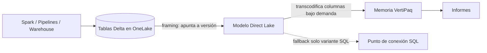

# Direct Lake

Parte de: [[17-Power-BI/09 Avanzado/_Índice Avanzado|Avanzado]]

> [!info] Cómo avanzar
> `progreso`: **pendiente** → **viendo** (estudiando) → **visto** (contestaste la autoevaluación sin abrir las respuestas) → **dominado** (hiciste el laboratorio o lo aplicaste de verdad).

## Contenido

### Qué es
**Direct Lake** es un modo de almacenamiento de modelos semánticos de Microsoft Fabric que lee los datos **directamente de tablas Delta en OneLake** (archivos Parquet) y los carga en la memoria del motor VertiPaq **bajo demanda**, sin una importación previa ni consultas SQL al origen en cada interacción. Busca combinar la velocidad de Import con la frescura de DirectQuery, para datos que ya viven en un Lakehouse o Warehouse de Fabric.

### Cómo funciona
(Microsoft Learn, consultado nov 2026)
1. **Datos en Delta**: un proceso (Spark, Dataflows Gen2, pipelines, Warehouse) escribe tablas Delta en OneLake. El formato Parquet es **columnar** y con compresión parecida a VertiPaq.
2. **Transcodificación**: cuando una consulta DAX necesita una columna por primera vez, el motor la carga desde los Parquet a memoria (junto con las que requieren relaciones y medidas). Las columnas quedan **residentes** hasta que se expulsan por falta de uso, presión de memoria o una nueva actualización.
3. **"Actualizar" = framing (enmarcado)**: en Direct Lake, la actualización **no copia datos**. Lee los metadatos más recientes de las tablas Delta y apunta el modelo a la versión vigente de los archivos. Tarda segundos y es incremental (solo invalida lo que cambió). Las consultas ven los datos **del último framing exitoso**. Por defecto está activada la opción *Mantener los datos de Direct Lake actualizados*, que hace framing al detectar cambios; puedes apagarla para controlar el momento (por ejemplo, al terminar el ETL) y hacer framing por programación o API.
4. **Dos variantes**:
   - **Direct Lake sobre OneLake** (recomendada para modelos nuevos): no depende del punto de conexión SQL, funciona con la seguridad de OneLake y **no tiene fallback**; solo opera en modo Direct Lake.
   - **Direct Lake sobre puntos de conexión SQL**: usa el punto de conexión SQL de análisis y **sí puede hacer fallback**.
5. **Fallback a DirectQuery**: en la variante SQL, si una consulta no puede resolverse en Direct Lake, el motor la manda como **DirectQuery** al punto de conexión SQL: devuelve datos al momento pero más lento. Causas: tablas con RLS/OLS/enmascaramiento definidos en SQL, tablas basadas en **vistas SQL no materializadas**, tablas que exceden los **límites de protección** del SKU (archivos Parquet, grupos de filas, filas, memoria), o tablas no enmarcadas. Se controla con la propiedad **DirectLakeBehavior**: *Automatic* (predeterminado, fallback silencioso), *DirectLakeOnly* (falla con error; útil en desarrollo para detectar causas) y *DirectQueryOnly*. El motivo por tabla se consulta con `EVALUATE TABLETRAITS()`.



### Ejemplo
Pochteca.Nomisma migra sus movimientos de Postgres a un **Lakehouse** de Fabric con un pipeline nocturno. Crea un modelo **Direct Lake sobre OneLake** con `Movimientos` (800 millones de filas), `Cuenta`, `Calendario`. Apaga la actualización automática y, al final del pipeline, una actividad hace el framing del modelo. Resultado: el informe responde como Import, sin cargar 800 millones de filas en cada actualización, y los datos aparecen minutos después del ETL. Para depurar en desarrollo:

```dax
EVALUATE TABLETRAITS()
```

### Cuándo usarlo y cuándo no
- **Úsalo** cuando los datos ya están (o deben estar) en OneLake en Delta, son grandes y quieres evitar ventanas largas de importación.
- **No** si tu origen es SQL Server local sin intención de pasar por Fabric: Import o DirectQuery siguen siendo la opción.
- Requiere capacidad Fabric; la memoria disponible por modelo depende del SKU.
- Diseña las tablas Delta pensando en el modelo: columnas necesarias, tipos correctos, `OPTIMIZE`/`VACUUM` para no rebasar límites de archivos.

### Errores comunes
1. **Vistas SQL** como tablas del modelo (variante SQL): provocan fallback. Materialízalas como tablas Delta.
2. **Seguridad en el punto de conexión SQL** esperando que no afecte: fuerza DirectQuery. Usa RLS del modelo o la variante OneLake.
3. **Creer que "actualizar" recarga datos**: solo reenmarca; si el ETL no terminó, verás datos a medias si dejas la actualización automática.
4. **Muchos archivos pequeños** en Delta: rebasan los límites; compacta.
5. **No dimensionar la capacidad**: la expulsión de columnas por memoria hace lentas las primeras consultas.

### Para profundizar
- [Información general de Direct Lake (Microsoft Learn)](https://learn.microsoft.com/en-us/power-bi/enterprise/directlake-overview)
- [Cómo funciona Direct Lake](https://learn.microsoft.com/en-us/fabric/fundamentals/direct-lake-how-it-works)
- [Desarrollar modelos Direct Lake](https://learn.microsoft.com/en-us/fabric/fundamentals/direct-lake-develop)

## Autoevaluación

Contesta primero en voz alta o en papel; luego despliega la respuesta.

> [!question]- ¿Cómo funciona Direct Lake?
> El modelo semántico carga en memoria, bajo demanda, las columnas de tablas Delta de OneLake; no hay copia de importación ni SQL por consulta.

> [!question]- ¿Qué es el *fallback* a DirectQuery?
> Cuando algo no se puede resolver en Direct Lake (p. ej. vistas SQL, ciertos límites), puede caer a DirectQuery sobre el punto SQL, con peor rendimiento. Se puede configurar (verificar comportamiento actual en la documentación).

> [!question]- ¿Qué se "actualiza" en Direct Lake?
> Un *framing*: el modelo apunta a la versión más reciente de las tablas Delta; es rápido porque no copia datos.

