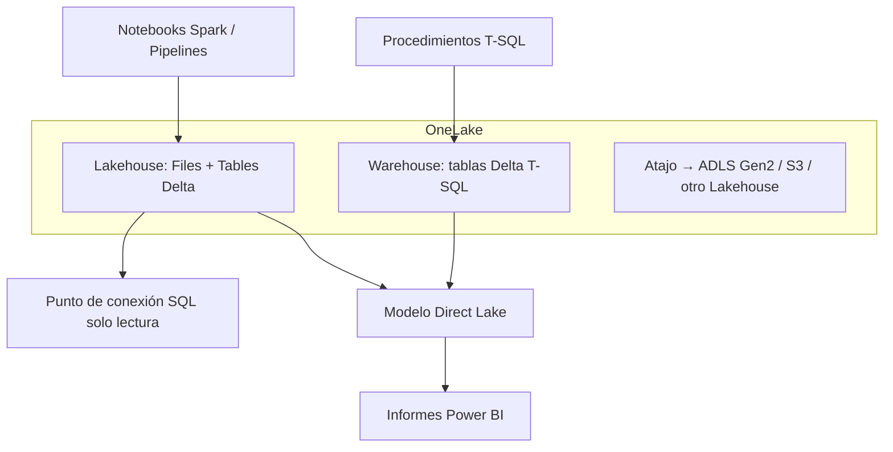

# Fabric - Lakehouse, Warehouse y OneLake

Parte de: [[17-Power-BI/09 Avanzado/_Índice Avanzado|Avanzado]]

> [!info] Cómo avanzar
> `progreso`: **pendiente** → **viendo** (estudiando) → **visto** (contestaste la autoevaluación sin abrir las respuestas) → **dominado** (hiciste el laboratorio o lo aplicaste de verdad).

## Contenido

### Qué es
En Microsoft Fabric, el almacenamiento analítico gira alrededor de tres conceptos:

- **OneLake**: el **lago de datos único y lógico** de todo el tenant (el "OneDrive de los datos"), construido sobre Azure Data Lake Storage Gen2. Cada workspace y elemento de Fabric guarda ahí sus datos; el formato estándar para tablas es **Delta Lake** (Parquet + registro de transacciones).
- **Lakehouse**: elemento que combina **archivos** (cualquier formato, zona `Files`) y **tablas Delta** (zona `Tables`), pensado para ingeniería de datos con **Spark** (notebooks en PySpark/Spark SQL). Expone automáticamente un **punto de conexión SQL de análisis de solo lectura** para consultar sus tablas con T-SQL.
- **Warehouse**: almacén de datos relacional con **T-SQL completo**: crear tablas, `INSERT/UPDATE/DELETE`, transacciones multi-tabla, procedimientos almacenados y vistas. También guarda sus tablas como Delta en OneLake.

### Cómo funciona
| | Lakehouse | Warehouse |
|---|---|---|
| Lenguaje principal | Spark (Python, Scala, SQL), Dataflows | T-SQL |
| Escritura con SQL | No (punto de conexión SQL de solo lectura) | Sí, DML/DDL completo y transacciones |
| Datos no estructurados | Sí (`Files`) | No |
| Perfil típico | Ingeniero de datos, ciencia de datos | Desarrollador SQL / BI |
| Almacenamiento | Delta en OneLake | Delta en OneLake |

**Relación con OneLake**: ambos son "vistas" sobre datos que viven en OneLake. Como el formato es abierto (Delta/Parquet), los mismos datos los puede leer Spark, el motor SQL, los modelos [[Direct Lake]] de Power BI o herramientas externas por la API compatible con ADLS. No hay que copiar datos entre motores.

**Atajos (shortcuts)**: un atajo es una **referencia** dentro de un Lakehouse (o KQL database) que apunta a datos en otro lugar —otro Lakehouse o workspace de OneLake, ADLS Gen2, Amazon S3, Google Cloud Storage, Dataverse, entre otros— y los hace aparecer como si estuvieran ahí, **sin copiarlos**. Sirven para no duplicar datos entre áreas y para integrar orígenes externos. Los permisos y el costo de lectura del origen siguen aplicando.



### Ejemplo
Arquitectura medallón para Wee.Reporteria:
- **Lakehouse Bronce**: archivos CSV y JSON de los sistemas fuente en `Files`, más un **atajo** al contenedor ADLS donde otro equipo ya deja exportaciones (sin copiarlas).
- **Lakehouse Plata**: notebooks PySpark limpian y escriben tablas Delta.
- **Warehouse Oro**: el equipo SQL (que domina T-SQL y procedimientos, como en Itzamna.Dionisio) construye el modelo estrella con procedimientos almacenados:

```sql
-- En el Warehouse: cargar la dimensión cliente desde el Lakehouse Plata (consulta entre bases)
INSERT INTO dbo.DimCliente (ClienteId, Nombre, Region)
SELECT c.ClienteId, c.Nombre, c.Region
FROM LH_Plata.dbo.clientes AS c
WHERE NOT EXISTS (SELECT 1 FROM dbo.DimCliente d WHERE d.ClienteId = c.ClienteId);
```

- Un modelo **Direct Lake** sobre el Warehouse Oro alimenta los informes.

### Cuándo usarlo y cuándo no
- **Lakehouse**: datos semiestructurados, grandes volúmenes, transformaciones en Spark, ciencia de datos.
- **Warehouse**: equipos SQL, necesidad de transacciones y DML, modelos dimensionales mantenidos con T-SQL.
- Pueden combinarse (lo normal). Si solo tienes un SQL Server con unos millones de filas y Power BI Import, quizá no necesitas Fabric todavía. Requiere capacidad Fabric (ver [[Power BI y Microsoft Fabric]]).

### Errores comunes
1. **Intentar `INSERT` en el punto de conexión SQL del Lakehouse**: es de solo lectura.
2. **Copiar datos entre workspaces** cuando bastaba un atajo.
3. **Archivos Delta fragmentados** por escrituras pequeñas: compacta con `OPTIMIZE`.
4. **Elegir por moda** y no por las habilidades del equipo.
5. **Olvidar permisos** del origen al crear atajos.

### Para profundizar
- [¿Qué es OneLake? (Microsoft Learn)](https://learn.microsoft.com/en-us/fabric/onelake/onelake-overview)
- [Lakehouse en Microsoft Fabric](https://learn.microsoft.com/en-us/fabric/data-engineering/lakehouse-overview)
- [Atajos de OneLake](https://learn.microsoft.com/en-us/fabric/onelake/onelake-shortcuts)

## Autoevaluación

Contesta primero en voz alta o en papel; luego despliega la respuesta.

> [!question]- ¿Diferencia entre Lakehouse y Warehouse en Fabric?
> Lakehouse: archivos y tablas Delta, se trabaja sobre todo con Spark/notebooks y tiene un punto de conexión SQL de solo lectura. Warehouse: almacén relacional con T-SQL completo (lectura y escritura).

> [!question]- ¿Qué relación tienen con OneLake?
> Ambos guardan sus tablas en OneLake en formato Delta Parquet; otros motores y Power BI (Direct Lake) leen esas mismas tablas.

> [!question]- ¿Qué son los atajos (shortcuts)?
> Referencias en OneLake a datos de otro lugar (otro lakehouse, ADLS, S3) sin copiarlos.

