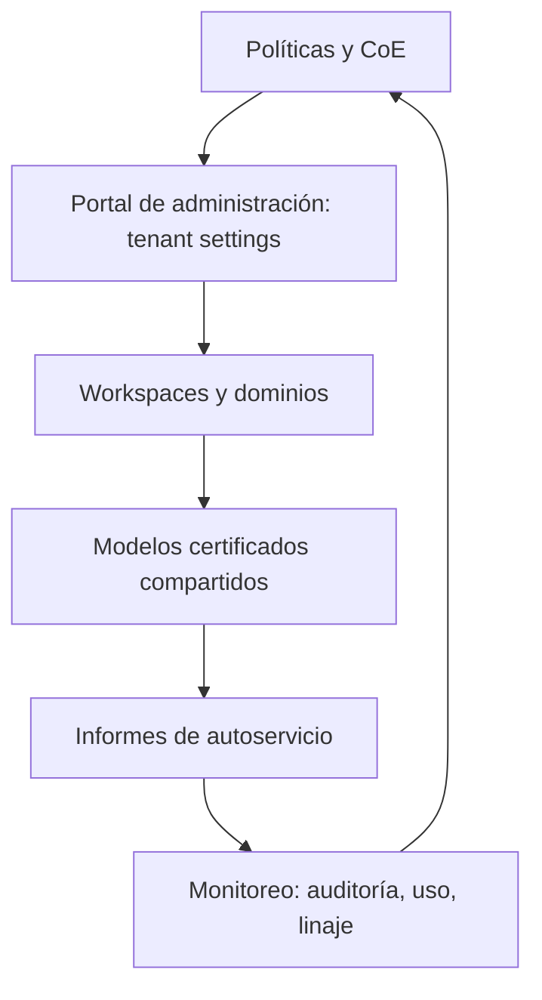

# Gobierno de datos en Power BI

Parte de: [[17-Power-BI/09 Avanzado/_Índice Avanzado|Avanzado]]

> [!info] Cómo avanzar
> `progreso`: **pendiente** → **viendo** (estudiando) → **visto** (contestaste la autoevaluación sin abrir las respuestas) → **dominado** (hiciste el laboratorio o lo aplicaste de verdad).

## Contenido

### Qué es
El **gobierno** en Power BI es el conjunto de **reglas, roles, procesos y configuraciones** que permite que mucha gente cree y consuma informes con autonomía (autoservicio) **sin perder control** sobre la calidad, la seguridad y el costo. No es prohibir; es dar un camino claro para hacer las cosas bien.

### Cómo funciona
**Qué incluye**
1. **Configuración del tenant**: qué funciones están habilitadas y para qué grupos (publicar en la web, exportar, compartir con externos, crear workspaces, visuales personalizados, Copilot, XMLA, entidades de servicio).
2. **Estructura de contenido**: convenciones de workspaces, dominios de Fabric por área de negocio, separación de modelos e informes, DEV/TEST/PROD con [[Canalizaciones de implementación (deployment pipelines)|canalizaciones]] y Git.
3. **Seguridad y protección**: roles, grupos de seguridad, RLS/OLS, etiquetas de confidencialidad de Purview (ver [[Seguridad y permisos en el Service]]).
4. **Calidad y confianza**: [[Certificación y promoción de contenido]], documentación de medidas, modelos compartidos.
5. **Monitoreo y auditoría**: registro de actividad y auditoría de Microsoft 365/Purview, workspace de supervisión de administración, uso por informe, inventario con la API de escáner de administración, [[Linaje de datos]].
6. **Capacidades y costo**: quién asigna workspaces a capacidades, monitoreo de consumo (aplicación de métricas de capacidad de Fabric).
7. **Personas**: un **Centro de Excelencia (CoE)**, campeones por área, capacitación y una comunidad interna.

**El portal de administración** (*Configuración → Portal de administración*) es el lugar donde los administradores de Fabric/Power BI controlan todo esto: **configuración del inquilino**, capacidades, workspaces de toda la organización, códigos de inserción de Publicar en la Web, visuales de la organización, registros de uso, dominios, configuración de etiquetas y respaldo. Para entrar se necesita el rol de **administrador de Fabric** (o administrador global/Power Platform).

### Buena práctica contra "cada quien su versión de la verdad"
El problema típico: Ventas, Finanzas y Dirección presentan tres cifras distintas de "ventas del mes" porque cada uno construyó su modelo con su propia lógica. La práctica que lo evita:

1. **Modelos semánticos compartidos y certificados** por dominio (Ventas, Finanzas), mantenidos por un equipo responsable, con medidas definidas una vez y documentadas (descripción en cada medida).
2. Los analistas crean sus informes **sobre esos modelos** con permiso de compilación, en vez de importar datos por su cuenta.
3. Un **glosario** de métricas (qué es "venta neta", qué incluye) aprobado por negocio.
4. **Respaldo visible**: en *Obtener datos* los certificados salen primero.
5. Revisión periódica: modelos duplicados detectados con el inventario y el linaje se consolidan o se retiran.

### Ejemplo
En Itzamna se arranca así:
- Tenant: crear workspaces solo para `GRP-BI-Creadores`; Publicar en la Web deshabilitado; exportar a Excel permitido pero con etiquetas obligatorias.
- Dominios: Comercial, Finanzas, Operación, cada uno con su administrador de dominio y revisores de certificación.
- Modelos certificados: "Ventas Itzamna", "Cartera", "Inventario".
- Mensualmente, el CoE revisa el uso (informes sin vistas en 90 días se archivan) y las actualizaciones fallidas.

### Cuándo usarlo y cuándo no
Desde el inicio, aunque sea ligero. Un gobierno excesivo (todo pasa por TI) mata el autoservicio; uno ausente produce caos y riesgos de fuga. Ajusta el nivel por tipo de contenido: personal, de equipo, empresarial.

### Errores comunes
1. **Dejar el tenant con la configuración predeterminada** sin revisarla.
2. **Gobierno solo técnico** sin dueños de negocio de las métricas.
3. **Prohibir todo** y empujar a la gente a Excel por fuera.
4. **No auditar**: nadie sabe qué se compartió con quién.
5. **Un solo administrador** que concentra todo.

### Para profundizar
- [Planeación de implementación de Power BI (Microsoft Learn)](https://learn.microsoft.com/en-us/power-bi/guidance/powerbi-implementation-planning-introduction)
- [Qué es el portal de administración](https://learn.microsoft.com/en-us/fabric/admin/admin-center)
- [Gobierno en Microsoft Fabric](https://learn.microsoft.com/en-us/fabric/governance/governance-compliance-overview)

## Autoevaluación

Contesta primero en voz alta o en papel; luego despliega la respuesta.

> [!question]- ¿Qué incluye el gobierno en Power BI?
> Configuración del inquilino, roles y permisos, workspaces por entorno, certificación, etiquetas de confidencialidad, auditoría/monitoreo de uso y estándares de modelado.

> [!question]- ¿Qué es el portal de administración?
> Donde el administrador controla configuraciones del inquilino (exportar, publicar en web, visuales, Copilot), capacidades y registros de auditoría.

> [!question]- Buena práctica para evitar "cada quien su versión de la verdad".
> Modelos semánticos centrales certificados, documentación de medidas y un proceso de promoción a producción.

