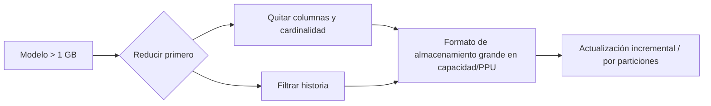

# Modelos grandes

Parte de: [[17-Power-BI/09 Avanzado/_Índice Avanzado|Avanzado]]

> [!info] Cómo avanzar
> `progreso`: **pendiente** → **viendo** (estudiando) → **visto** (contestaste la autoevaluación sin abrir las respuestas) → **dominado** (hiciste el laboratorio o lo aplicaste de verdad).

## Contenido

### Qué es
Un "modelo grande" es un modelo semántico en **Import** cuyo tamaño comprimido en memoria supera el límite predeterminado de **1 GB** del Service. Para que pueda crecer existe el **formato de almacenamiento de modelo semántico grande** (*large semantic model storage format*), una configuración del modelo que guarda sus datos en Azure Premium Files y le permite llegar hasta el tamaño de memoria que dé la capacidad (o el máximo que fije el administrador). Además de técnicas de licencia, manejar modelos grandes es sobre todo **reducir** lo que cargas.

### Cómo funciona
**El formato de almacenamiento grande** (Microsoft Learn, consultado nov 2026)
- Disponible en capacidades **Fabric (F)**, **Premium (P)**, **Embedded (A)** y en **PPU**. En workspaces Pro el límite sigue siendo 1 GB.
- **No está activado por defecto**: se activa por modelo (*Configuración → Formato de almacenamiento de modelo semántico grande → Activado*, y luego actualizar) o como predeterminado del workspace (*Configuración → Premium → Formato de almacenamiento predeterminado*).
- No cambia el límite de **subida** desde Desktop (**10 GB**); el modelo puede crecer más allá en el Service al actualizarse (típicamente con actualización incremental).
- Mejora el rendimiento de las escrituras por [[Punto de conexión XMLA]] y activa la **carga bajo demanda**: solo se pagina a memoria lo que se consulta.
- Una vez creado, el workspace no puede moverse a una capacidad de otra región.
- Cuidado con la actualización: un modelo cercano a la mitad de la memoria del SKU puede quedarse sin memoria al refrescar completo (necesita espacio para la copia nueva); usa actualizaciones por tablas o particiones.

**Técnicas para manejar modelos grandes**
1. **Quitar columnas** que no se usan (sobre todo de alta cardinalidad: IDs de transacción, GUIDs, marcas de tiempo con segundos, textos libres).
2. **Reducir cardinalidad**: separar fecha y hora, redondear decimales, tipos enteros para claves.
3. **Filtrar filas**: solo los años necesarios para el análisis.
4. **Modelo estrella** con claves enteras; evita tablas planas enormes (ver [[Modelo estrella (hechos y dimensiones)]]).
5. **Evitar columnas calculadas** pesadas en la tabla de hechos; calcula en el origen o en Power Query.
6. **[[Actualización incremental]]** para no recargar la historia completa.
7. **[[Agregaciones]]** y **modelos compuestos**: detalle en DirectQuery, resúmenes en Import.
8. **[[Direct Lake]]** si los datos están en OneLake.
9. Medir con **VertiPaq Analyzer** qué columnas pesan más (ver [[Rendimiento - Performance Analyzer y VertiPaq Analyzer]] y [[Cómo funciona el motor VertiPaq]]).



### Ejemplo
El modelo de movimientos de Pochteca.Nomisma pesa 6 GB. VertiPaq Analyzer muestra que `Movimientos[IdTransaccion]` (GUID único por fila) ocupa 2.3 GB y `FechaHora` con segundos otros 900 MB. Acciones: quitar el GUID (nadie lo usa en informes; para buscar una transacción hay un informe paginado sobre SQL), separar `Fecha` y `Hora` redondeada a minuto. Resultado: 2.4 GB. Como sigue arriba de 1 GB, el workspace se mueve a capacidad F y se activa el formato grande; con actualización incremental, solo se refrescan los últimos 3 días.

```powershell
# Revisar el modo de almacenamiento del modelo (requiere módulo MicrosoftPowerBIMgmt y permisos de admin)
(Get-PowerBIDataset -Scope Organization -Id <IdDelModelo> -Include actualStorage).ActualStorage
```

### Cuándo usarlo y cuándo no
- **Actívalo** cuando el modelo optimizado sigue necesitando más de 1 GB, o si vas a escribir por XMLA.
- **No** como primera reacción: un modelo inflado con columnas inútiles también será lento y caro en una capacidad grande.

### Errores comunes
1. **Subir el SKU antes de optimizar.**
2. **Olvidar actualizar** tras activar el formato.
3. **Refrescar completo** un modelo enorme y quedarse sin memoria.
4. **Pensar que el límite de 10 GB de subida** es el tamaño máximo del modelo.
5. **No medir**: decidir sin VertiPaq Analyzer qué quitar.

### Para profundizar
- [Modelos semánticos grandes en Power BI Premium (Microsoft Learn)](https://learn.microsoft.com/en-us/fabric/enterprise/powerbi/service-premium-large-models)
- [Técnicas de reducción de datos para modelos Import](https://learn.microsoft.com/en-us/power-bi/guidance/import-modeling-data-reduction)

## Autoevaluación

Contesta primero en voz alta o en papel; luego despliega la respuesta.

> [!question]- ¿Qué es el formato de almacenamiento de modelo grande?
> Una opción del modelo semántico en capacidad/PPU que permite crecer más allá del límite estándar de tamaño de publicación (verificar límites en la página oficial).

> [!question]- Técnicas para manejar modelos grandes.
> Actualización incremental, agregaciones, quitar columnas, reducir cardinalidad, modelos compuestos o Direct Lake.

