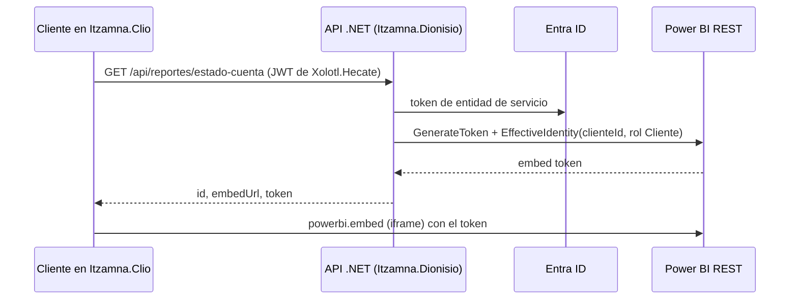

# Power BI Embedded (incrustar en una aplicación React o .NET)

Parte de: [[17-Power-BI/09 Avanzado/_Índice Avanzado|Avanzado]]

> [!info] Cómo avanzar
> `progreso`: **pendiente** → **viendo** (estudiando) → **visto** (contestaste la autoevaluación sin abrir las respuestas) → **dominado** (hiciste el laboratorio o lo aplicaste de verdad).

## Contenido

### Qué es
**Power BI Embedded** (análisis integrados) permite mostrar informes, paneles o visuales de Power BI **dentro de tu propia aplicación** (web, portal, SaaS), con la API REST y el [[Cliente JavaScript de Power BI]]. Hay dos escenarios con reglas muy distintas:

| | Insertar para la organización (*el usuario es dueño de los datos*) | Insertar para los clientes (*la aplicación es dueña de los datos*) |
|---|---|---|
| Usuarios | Internos, con cuenta de Entra ID | Externos (clientes), con la autenticación de tu app |
| Licencia por usuario | Sí: cada usuario necesita la licencia que requiera el contenido (Pro/PPU, o gratuita en capacidad) | No: los usuarios no necesitan licencia de Power BI |
| Cómo se autentica con Power BI | El usuario inicia sesión (token de Entra ID) | Tu backend con una **entidad de servicio** (recomendado) o "usuario maestro" genera un **embed token** |
| Capacidad | No obligatoria | Obligatoria en producción: **A** (Azure Power BI Embedded), **F** (Fabric) o **P/EM** |
| Visuales R/Python | Soportados | No soportados |

(Microsoft Learn, consultado nov 2026.) Con licencia Pro existen tokens de prueba solo para desarrollo; en producción sin capacidad aparece el aviso de versión de prueba.

### Cómo funciona: app owns data
1. Registras una **app en Entra ID** (entidad de servicio), habilitas en el tenant que las entidades de servicio usen las API, y la agregas como **Miembro/Administrador** del workspace.
2. El workspace con el informe se asigna a una **capacidad** (A, F o P).
3. Tu **backend** (.NET) obtiene un token de Entra ID para la API de Power BI, consulta el `embedUrl` del informe y llama a **GenerateToken** para crear un **embed token** de corta duración para ese informe y su modelo.
4. El backend devuelve al **frontend** (React) `id`, `embedUrl` y `token`.
5. El frontend inserta el informe con `powerbi-client` / `powerbi-client-react`, renovando el token antes de que expire.

**RLS en app owns data**: como los usuarios no existen en Entra ID, el modelo no puede usar su identidad directamente. Defines roles en el modelo (p. ej. con `USERNAME()` o `CUSTOMDATA()` en el filtro DAX) y, al generar el token, pasas una **identidad efectiva** (*EffectiveIdentity*): un `username` (por ejemplo el Id del cliente), los **roles** y el modelo. El token queda "sellado" con esa identidad y el informe solo muestra sus filas. El usuario no puede cambiarlo desde el navegador.



### Ejemplo
Controller de ASP.NET Core que entrega el token para el cliente autenticado (identidad emitida por Xolotl.Hecate). Usa el paquete `Microsoft.PowerBI.Api`; los nombres de clases corresponden a su versión 4 (revísalos contra la versión que instales):

```csharp
[ApiController]
[Route("api/reportes")]
public sealed class ReportesController(IPowerBIClientFactory fabrica, IOptions<PowerBiOpciones> opc) : ControllerBase
{
    [HttpGet("estado-cuenta")]
    [Authorize(Policy = "Cliente")]
    public async Task<ActionResult<EmbedInfo>> EstadoCuenta(CancellationToken ct)
    {
        var clienteId = User.FindFirstValue("cliente_id")
            ?? throw new InvalidOperationException("Token sin cliente_id");
        using var pbi = await fabrica.CrearAsync(ct);               // cliente autenticado con entidad de servicio
        var o = opc.Value;

        var informe = await pbi.Reports.GetReportInGroupAsync(o.WorkspaceId, o.ReportId, cancellationToken: ct);

        var solicitud = new GenerateTokenRequestV2(
            reports: [new GenerateTokenRequestV2Report(o.ReportId)],
            datasets: [new GenerateTokenRequestV2Dataset(informe.DatasetId)],
            identities: [new EffectiveIdentity(
                username: clienteId,                                 // lo lee USERNAME() en el rol
                datasets: [informe.DatasetId],
                roles: ["Cliente"])]);

        var token = await pbi.EmbedToken.GenerateTokenAsync(solicitud, cancellationToken: ct);
        return new EmbedInfo(o.ReportId.ToString(), informe.EmbedUrl, token.Token, token.Expiration);
    }
}

public sealed record EmbedInfo(string Id, string EmbedUrl, string Token, DateTime Expira);
```

Rol "Cliente" en el modelo, sobre la tabla `Cliente`: `[ClienteId] = USERNAME()`. Del lado de React, el componente de la nota [[Cliente JavaScript de Power BI]].

### Cuándo usarlo y cuándo no
- **Para la organización**: portales internos o apps de línea de negocio donde todos tienen cuenta corporativa.
- **Para los clientes**: SaaS o portales para externos (estados de cuenta, tableros de clientes).
- **No** uses Publicar en la Web para clientes: es público.
- Dimensiona la capacidad A/F según concurrencia; se puede pausar o escalar en Azure.

### Errores comunes
1. **Usar un usuario maestro** con contraseña en el código; prefiere entidad de servicio con certificado y secretos en Key Vault.
2. **Olvidar la identidad efectiva** con RLS: el informe falla o muestra todo.
3. **Embed tokens largos o reutilizados** entre usuarios.
4. **Filtrar solo en el cliente JavaScript** en vez de RLS.
5. **Workspace sin capacidad** en producción.

### Para profundizar
- [¿Qué es el análisis integrado de Power BI? (Microsoft Learn)](https://learn.microsoft.com/en-us/power-bi/developer/embedded/embedded-analytics-power-bi)
- [Tokens de acceso para análisis integrados](https://learn.microsoft.com/en-us/power-bi/developer/embedded/embed-tokens)
- [RLS con análisis integrados](https://learn.microsoft.com/en-us/power-bi/developer/embedded/embedded-row-level-security)

## Autoevaluación

Contesta primero en voz alta o en papel; luego despliega la respuesta.

> [!question]- ¿Diferencia entre *incrustar para la organización* y *para los clientes*?
> Para la organización (user owns data): el usuario inicia sesión con su cuenta de Entra ID y necesita licencia. Para clientes (app owns data): la app se autentica con una entidad de servicio y genera *embed tokens*; los usuarios finales no necesitan cuenta de Power BI. Requiere capacidad (verificar en la página oficial).

> [!question]- Flujo básico de app owns data.
> 1) El backend (.NET) obtiene un token de Entra ID con la entidad de servicio. 2) Llama a la API REST para obtener el informe y generar un embed token. 3) El frontend (React) usa `powerbi-client` / `powerbi-client-react` con embedUrl, id y token.

> [!question]- ¿Cómo aplicas RLS en app owns data?
> Pasando una *identidad efectiva* (username y roles) al generar el embed token.

