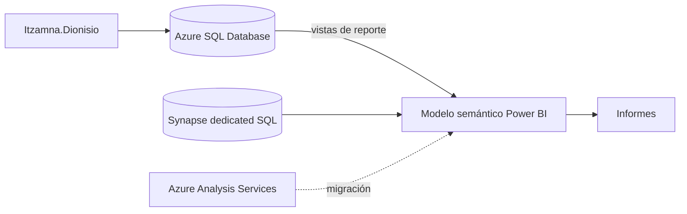

# Power BI con Azure (SQL, Synapse y Analysis Services)

Parte de: [[17-Power-BI/09 Avanzado/_Índice Avanzado|Avanzado]]

> [!info] Cómo avanzar
> `progreso`: **pendiente** → **viendo** (estudiando) → **visto** (contestaste la autoevaluación sin abrir las respuestas) → **dominado** (hiciste el laboratorio o lo aplicaste de verdad).

## Contenido

### Qué es
Power BI se integra de forma nativa con los servicios de datos de Azure. Los tres que más aparecen en proyectos son:

- **Azure SQL Database** (y Azure SQL Managed Instance): SQL Server administrado en la nube.
- **Azure Synapse Analytics**: plataforma analítica con grupos SQL dedicados (MPP) y sin servidor, Spark y pipelines.
- **Azure Analysis Services (AAS)**: el motor tabular de Analysis Services como PaaS, el mismo motor de los modelos semánticos de Power BI.

### Cómo funciona
**Azure SQL Database como origen**
- Conector nativo; se conecta **sin gateway** si el servidor es accesible por red pública (con reglas de firewall que permitan los servicios de Azure). Si usa *private endpoint*, necesitas gateway de red virtual o un gateway en la VNet.
- Autenticación recomendada: **Microsoft Entra ID** (OAuth del usuario o entidad de servicio) en lugar de usuario SQL.
- Soporta **Import**, **DirectQuery** (con plegado de consultas completo) y modelos compuestos.
- **Cuándo usarlo**: cuando tus sistemas transaccionales o tu data mart ya viven en Azure SQL (como Itzamna.Dionisio con Dapper y procedimientos), volúmenes de hasta cientos de millones de filas bien indexadas, y quieres DirectQuery o Import sin gateway. Crea **vistas o tablas de reporte** dedicadas, no consultes las tablas transaccionales directamente (ver [[Consultas nativas de SQL y vistas para Power BI]]).

**Azure Analysis Services hoy**
- Sigue operando y soporta el mismo nivel de compatibilidad tabular que Power BI, pero Microsoft **concentra las inversiones en los modelos semánticos de Power BI/Fabric**, que tienen todo lo de AAS y más (actualización incremental, agregaciones, Direct Lake, Copilot, formato grande, XMLA de lectura/escritura). Microsoft ofrece guías y una herramienta de **migración de AAS a Power BI**. Según su guía de migración no hay planes anunciados de retirarlo (consultado nov 2026), pero para proyectos nuevos la recomendación es modelos semánticos en Power BI/Fabric.
- En Power BI se consume con **conexión dinámica** (ver [[Conexión dinámica (Live Connection) en Power BI]]).

**Azure Synapse Analytics**
- Sus **grupos SQL dedicados** sirven como data warehouse MPP para volúmenes muy grandes, consumibles desde Power BI con Import o DirectQuery (con vistas materializadas y caché de conjuntos de resultados para acelerar DirectQuery).
- Microsoft posiciona a **Microsoft Fabric** (Warehouse, Lakehouse, Data Factory, Spark) como la evolución de Synapse, con guías de migración. Synapse sigue disponible para quienes lo usan, pero en proyectos nuevos se evalúa primero Fabric (ver [[Fabric - Lakehouse, Warehouse y OneLake]]). (Estado de soporte a largo plazo de Synapse: pendiente de confirmar en Microsoft Learn al planear.)



### Ejemplo
Itzamna.Dionisio corre en Azure App Service con Azure SQL Database. Para reportería:
1. Creas un esquema `rpt` con vistas (`rpt.vw_Ventas`, `rpt.vw_Clientes`) en archivos `.sql` versionados en Azure DevOps.
2. Un usuario de base de datos de Entra ID de solo lectura (o la identidad de la entidad de servicio) con permiso solo sobre `rpt`.
3. Modelo Import con actualización 4 veces al día, sin gateway.
4. Si el negocio pide datos al minuto en una página, tabla de pedidos del día en DirectQuery (modelo compuesto).

```sql
CREATE OR ALTER VIEW rpt.vw_Ventas
AS
SELECT v.VentaId, v.Fecha, v.SucursalId, v.ClienteId, v.Importe
FROM dbo.Venta AS v
WHERE v.Cancelada = 0;
```

### Cuándo usarlo y cuándo no
- **Azure SQL**: tu caso más común como desarrollador .NET.
- **AAS**: solo si ya lo tienes; planea la migración.
- **Synapse**: cargas existentes; para nuevas, Fabric.

### Errores comunes
1. **DirectQuery contra tablas transaccionales** sin índices: bloqueos y lentitud.
2. **Usuarios SQL con contraseña** compartida en vez de Entra ID.
3. **Pensar que siempre hace falta gateway** para Azure SQL.
4. **Crear AAS nuevos** en 2026 sin evaluar Power BI.
5. **Ignorar el costo**: DirectQuery a Synapse dedicado puede requerir más DWU.

### Para profundizar
- [Azure SQL Database con DirectQuery (Microsoft Learn)](https://learn.microsoft.com/en-us/power-bi/connect-data/service-azure-sql-database-with-direct-connect)
- [Migrar de Azure Analysis Services a Power BI](https://learn.microsoft.com/en-us/power-bi/guidance/migrate-azure-analysis-services-to-power-bi)

## Autoevaluación

Contesta primero en voz alta o en papel; luego despliega la respuesta.

> [!question]- ¿Cuándo usar Azure SQL Database como origen?
> Para datos relacionales en la nube; soporta Import, DirectQuery y plegado; sin gateway salvo red privada.

> [!question]- ¿Qué rol tiene Azure Analysis Services hoy?
> Modelos tabulares empresariales en la nube; Microsoft recomienda migrar sus cargas a modelos semánticos de Power BI/Fabric (verificar en la documentación).

> [!question]- ¿Y Azure Synapse?
> Plataforma de análisis (pools SQL dedicados/serverless, Spark); muchas de sus capacidades evolucionaron hacia Fabric.

