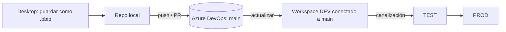

# Power BI con Git y control de versiones

Parte de: [[17-Power-BI/09 Avanzado/_Índice Avanzado|Avanzado]]

> [!info] Cómo avanzar
> `progreso`: **pendiente** → **viendo** (estudiando) → **visto** (contestaste la autoevaluación sin abrir las respuestas) → **dominado** (hiciste el laboratorio o lo aplicaste de verdad).

## Contenido

### Qué es
Durante años un `.pbix` era un binario imposible de versionar bien. Hoy hay dos piezas que lo resuelven:

1. **Formato de proyecto (PBIP)** en Power BI Desktop: guarda informe y modelo como **carpetas de archivos de texto** ([[TMDL y proyectos PBIP|TMDL para el modelo, PBIR para el informe]]) que Git puede comparar línea por línea.
2. **Integración de Git de los workspaces** (Fabric): conecta un workspace a una rama de un repositorio en **Azure DevOps, GitHub o GitHub Enterprise** (solo en la nube) para **confirmar** (commit) los cambios hechos en el Service al repo y **actualizar** el workspace con lo que hay en el repo.

### Cómo funciona
**Integración de Git del workspace** (Microsoft Learn, consultado nov 2026)
- Requiere que el workspace esté en una licencia de capacidad: Fabric (F), Premium (P) o prueba; PPU solo para elementos de Power BI. El administrador habilita en el tenant la sincronización con Git (y con GitHub, si aplica).
- En *Configuración del workspace → Integración de Git* eliges organización, proyecto, repositorio, **rama** y carpeta.
- El panel de **Control de código fuente** muestra cambios del workspace por confirmar y cambios del repo por actualizar; puedes resolver conflictos.
- Elementos de Power BI soportados: informes, modelos semánticos (no push ni conexiones dinámicas a AAS), informes paginados, apps de la organización (algunos en versión preliminar).
- Permite **ramificar a otro workspace** (cada desarrollador trabaja en su rama y su workspace) y combinar con *pull requests* en Azure DevOps.

**`.gitignore` en un proyecto PBIP**
Power BI Desktop crea un `.gitignore` al guardar como proyecto; debe excluir los archivos locales de la carpeta `.pbi`:

```gitignore
# Configuración local del usuario y caché de datos del modelo
**/.pbi/localSettings.json
**/.pbi/cache.abf
```

`cache.abf` contiene **los datos** importados (puede pesar GB y tener información confidencial) y `localSettings.json` configuración de tu equipo. Lo demás (definiciones TMDL, PBIR, `.pbip`, `definition.pbism`, `definition.pbir`) sí se versiona.



### Flujo recomendado
1. Cada desarrollador trabaja en **Desktop con PBIP** en una **rama de característica** (`feature/margen-por-sucursal`), o en un workspace propio conectado a su rama.
2. Commits pequeños con mensajes claros; revisa el diff de TMDL (qué medida cambió) antes de subir.
3. **Pull request** a `main` con revisión de un compañero (y validaciones automáticas en el pipeline: por ejemplo, reglas de buenas prácticas con Tabular Editor).
4. El workspace **DEV** está conectado a `main` y se **actualiza** desde Git.
5. Promoción a TEST y PROD con [[Canalizaciones de implementación (deployment pipelines)]] (o despliegue por API desde Azure Pipelines).
6. Nunca editar directo en PROD.

### Ejemplo
Repositorio `bi-comercial` en Azure DevOps:

```text
bi-comercial/
├─ .gitignore
├─ Ventas.pbip
├─ Ventas.SemanticModel/
│  ├─ definition.pbism
│  └─ definition/
│     ├─ model.tmdl
│     ├─ relationships.tmdl
│     └─ tables/Ventas.tmdl
└─ Ventas.Report/
   ├─ definition.pbir
   └─ definition/ (páginas y visuales en JSON)
```

En el PR, el revisor ve en el diff de `tables/Ventas.tmdl` que la medida `Margen %` pasó de `DIVIDE([Margen], [Ventas])` a `DIVIDE([Margen], [Ventas], 0)`.

### Cuándo usarlo y cuándo no
- **Úsalo** en todo equipo de BI con más de una persona o con requisitos de auditoría.
- Para un informe personal, PBIP + Git local ya ayuda, aunque no haya integración de workspace.
- Si no hay capacidad, igual puedes versionar PBIP en el repo y publicar desde Desktop o por API; la sincronización del workspace es la que exige capacidad.

### Errores comunes
1. **Versionar `cache.abf`**: repos gigantes y datos expuestos.
2. **Trabajar dos personas en el mismo archivo de informe** sin ramas: conflictos en JSON difíciles de resolver.
3. **Editar en el Service y en Desktop a la vez** sin sincronizar.
4. **Commits gigantes** sin descripción.
5. **Confundir Git con despliegue**: Git versiona; las canalizaciones o el pipeline promueven.

### Para profundizar
- [Introducción a la integración de Git (Microsoft Learn)](https://learn.microsoft.com/en-us/fabric/cicd/git-integration/intro-to-git-integration)
- [Proyectos de Power BI Desktop (PBIP)](https://learn.microsoft.com/en-us/power-bi/developer/projects/projects-overview)
- [Formato de código fuente en Git](https://learn.microsoft.com/en-us/fabric/cicd/git-integration/source-code-format)

## Autoevaluación

Contesta primero en voz alta o en papel; luego despliega la respuesta.

> [!question]- ¿Qué ofrece la integración con Git de los workspaces?
> Conectar un workspace de Fabric/Power BI a un repositorio (Azure DevOps o GitHub) y sincronizar elementos en ambas direcciones. Requisitos: (verificar en la documentación).

> [!question]- ¿Qué debes poner en `.gitignore` en un proyecto PBIP?
> La caché local de datos y la configuración local (`cache.abf`, `localSettings.json`), que Desktop ya excluye en su .gitignore generado.

> [!question]- Flujo recomendado.
> Rama por cambio, guardar como PBIP, commit con mensaje claro, pull request con revisión, y despliegue a producción mediante pipelines.

