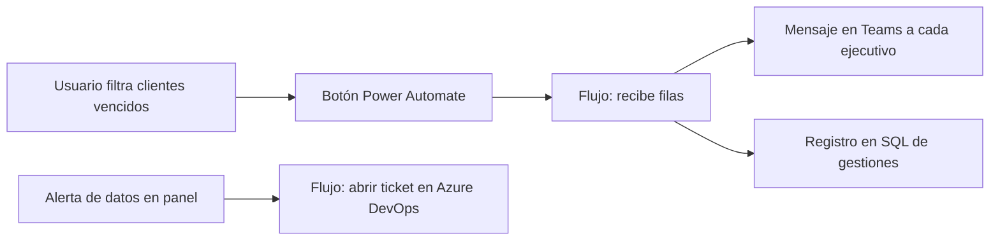

# Power BI con Power Automate y Power Apps

Parte de: [[17-Power-BI/09 Avanzado/_Índice Avanzado|Avanzado]]

> [!info] Cómo avanzar
> `progreso`: **pendiente** → **viendo** (estudiando) → **visto** (contestaste la autoevaluación sin abrir las respuestas) → **dominado** (hiciste el laboratorio o lo aplicaste de verdad).

## Contenido

### Qué es
Power BI forma parte de **Power Platform** junto con Power Automate (flujos de automatización) y Power Apps (aplicaciones de bajo código). La integración va en ambos sentidos:

- **Visual de Power Automate** en un informe: un botón que ejecuta un flujo y le pasa los datos que el usuario tiene filtrados o seleccionados.
- **Visual de Power Apps** en un informe: inserta una aplicación de lienzo dentro de la página, que recibe los datos del contexto; sirve para **escribir de vuelta** (writeback): capturar comentarios, aprobar, corregir.
- **Power Automate hacia Power BI**: flujos que actualizan modelos, exportan informes, reaccionan a alertas de datos o llenan conjuntos de datos.

### Cómo funciona
**Visual de Power Automate**
1. Agregas el visual *Power Automate* al informe.
2. Arrastras a su área **Datos de Power Automate** las columnas o medidas que el flujo debe recibir.
3. Desde el visual creas o eliges un flujo con el desencadenador **"Cuando alguien hace clic en un botón en un informe de Power BI"**.
4. En el flujo usas esos campos (por ejemplo, la lista de clientes filtrados) en acciones: correo, Teams, crear tareas en Azure DevOps, llamar a una API, insertar en SQL.
5. Formateas el botón y compartes; el usuario necesita permiso de ejecución del flujo y las licencias de Power Automate que requieran los conectores (los premium como HTTP o SQL requieren licencia de pago).

**Visual de Power Apps**
1. Agregas el visual *Power Apps*, arrastras los campos de contexto y creas una app nueva o eliges una existente.
2. En la app, la colección `PowerBIIntegration.Data` contiene las filas del contexto actual; puedes mostrar el cliente seleccionado y un formulario.
3. La app guarda en un origen (Dataverse, SQL, SharePoint). Tras guardar, puedes llamar `PowerBIIntegration.Refresh()` para que los visuales se refresquen (en DirectQuery se ve de inmediato; en Import hasta la siguiente actualización).

**Power Automate hacia Power BI** (acciones del conector): *Actualizar un modelo semántico*, *Exportar a archivo* (informes y paginados), desencadenador *Cuando se activa una alerta de datos*, *Ejecutar una consulta en un modelo semántico* (DAX).

### Ejemplo de flujo útil
**Cobranza en Pochteca.Nomisma**: el gerente filtra en el informe de cartera los clientes con más de 60 días vencidos de su región y presiona "Notificar ejecutivos". El flujo:
1. Recibe `Cliente`, `Ejecutivo (correo)`, `Saldo vencido`, `Días`.
2. Agrupa por ejecutivo y le manda un mensaje en Teams con su lista.
3. Inserta en la tabla `Gestion` de SQL una fila por cliente notificado (con quién y cuándo).

Con un **visual de Power Apps** en la página de detalle, el ejecutivo registra la promesa de pago del cliente seleccionado; esa tabla se muestra en el mismo informe en DirectQuery.

Otro flujo clásico: al terminar el ETL (desencadenador HTTP desde Azure Data Factory o Azure DevOps), *Actualizar un modelo semántico* y, al finalizar, *Exportar a archivo* PDF y enviarlo por correo.

### Cuándo usarlo y cuándo no
- **Úsalo** para cerrar el ciclo "veo el dato → actúo" sin salir del informe, y para automatizar tareas repetitivas alrededor de Power BI.
- **No** para procesos críticos de alto volumen o con reglas complejas: mejor un servicio propio (.NET) con la [[API REST de Power BI]] y colas.
- Considera licencias: conectores premium y capacidad de ejecución.

### Errores comunes
1. **Pasar al flujo miles de filas** sin querer (sin filtro): el visual manda las filas del contexto; limita el alcance.
2. **No manejar duplicados** en el flujo si el usuario presiona dos veces.
3. **Esperar que el visual de Power Apps refresque datos Import** al instante.
4. **Flujos con cuentas personales** como conexión: si esa persona se va, deja de funcionar.
5. **Visuales que no aparecen en suscripciones** ni exportaciones (Power Apps/Automate no se renderizan ahí).

### Para profundizar
- [Visual de Power Automate para Power BI (Microsoft Learn)](https://learn.microsoft.com/en-us/power-bi/create-reports/power-bi-automate-visual)
- [Visual de Power Apps para Power BI](https://learn.microsoft.com/en-us/power-bi/visuals/power-bi-visualization-powerapp)
- [Conector de Power BI para Power Automate](https://learn.microsoft.com/en-us/connectors/powerbi/)

## Autoevaluación

Contesta primero en voz alta o en papel; luego despliega la respuesta.

> [!question]- ¿Qué permite el visual de Power Automate en un informe?
> Ejecutar un flujo con los datos seleccionados (p. ej. enviar un correo a los clientes filtrados) desde un botón del informe.

> [!question]- ¿Y el visual de Power Apps?
> Incrustar una app que recibe los datos del contexto para capturar o corregir información ("write-back") sin salir del informe.

> [!question]- Ejemplo de flujo útil con Power BI.
> Desencadenar la actualización de un modelo semántico al terminar una carga, o enviar una alerta a Teams cuando una alerta de datos se dispara.

