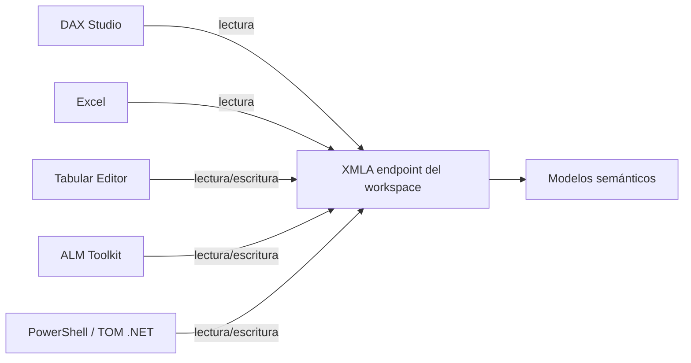

# Punto de conexión XMLA

Parte de: [[17-Power-BI/09 Avanzado/_Índice Avanzado|Avanzado]]

> [!info] Cómo avanzar
> `progreso`: **pendiente** → **viendo** (estudiando) → **visto** (contestaste la autoevaluación sin abrir las respuestas) → **dominado** (hiciste el laboratorio o lo aplicaste de verdad).

## Contenido

### Qué es
El **punto de conexión XMLA** expone los modelos semánticos de un workspace con el mismo protocolo que usa SQL Server Analysis Services (XML for Analysis). Gracias a él, herramientas externas se conectan a los modelos publicados como si fueran un servidor de Analysis Services: **DAX Studio**, **Tabular Editor**, **ALM Toolkit**, SSMS, Excel, Report Builder, scripts de PowerShell o código .NET con TOM/ADOMD. Es la puerta a la administración "de nivel empresarial" de modelos.

### Cómo funciona
(Microsoft Learn, consultado nov 2026)
- **Disponibilidad**: workspaces en capacidad **Premium/Fabric**, **PPU** y **Embedded**. No está disponible en workspaces Pro de capacidad compartida.
- **URL de conexión** (en *Configuración del workspace → Conexión*):

```text
powerbi://api.powerbi.com/v1.0/myorg/Comercial%20-%20Modelos%20%5BPROD%5D
```

  El nombre del workspace va codificado como URI; `myorg` sustituye al nombre del tenant para usuarios del tenant.
- **Solo lectura vs. lectura/escritura**:
  - **Lectura** (predeterminado): consultar datos y metadatos, DMVs, trazas. Lo usan DAX Studio, tablas dinámicas de Excel, Report Builder, consultas desde SSMS.
  - **Lectura/escritura**: además **modificar** el modelo: crear o cambiar medidas, tablas, roles y particiones, desplegar desde Tabular Editor, ALM Toolkit o Visual Studio, scripts TMSL, procesar particiones concretas, PowerShell. Se habilita por capacidad (*Portal de administración → Capacidades → cargas → Punto de conexión XMLA → Lectura y escritura*) o en la configuración de PPU.
- Además, en el tenant debe estar activa la opción de permitir puntos de conexión XMLA (activa por defecto), y el usuario o entidad de servicio necesita permisos en el workspace (Colaborador o superior para escribir) y sobre el modelo.



### Riesgo de modificar un modelo por XMLA
- **Ya no podrás descargar el `.pbix`**: cuando un modelo creado en Desktop recibe una operación de escritura por XMLA, el Service deja de permitir descargarlo como `.pbix`. Si perdiste tu archivo fuente, te quedas sin forma de abrirlo en Desktop (salvo reconstruirlo con PBIP/TMDL o Tabular Editor). Conserva siempre la fuente, idealmente en Git.
- **Desincronización**: si alguien después republica el `.pbix` viejo desde Desktop, **sobrescribe** los cambios hechos por XMLA.
- **Cambios directos en producción** sin revisión; un error en una medida o un rol de RLS afecta a todos de inmediato.
- **Procesamiento**: un `Process Full` mal lanzado puede dejar el modelo sin datos o saturar la capacidad.
Mitigación: tratar XMLA de escritura como un canal de despliegue controlado (desde un pipeline de Azure DevOps o ALM Toolkit con revisión), con permisos acotados y el modelo fuente versionado ([[TMDL y proyectos PBIP]]).

### Ejemplo
- El equipo de soporte usa **DAX Studio** por XMLA de lectura contra el modelo de PROD para revisar por qué una medida tarda.
- El pipeline de Azure DevOps despliega cambios de metadatos con Tabular Editor CLI por XMLA de lectura/escritura usando una entidad de servicio.
- Un job nocturno en .NET procesa solo la partición del día con TOM:

```csharp
using Microsoft.AnalysisServices.Tabular;

using var servidor = new Server();
// Cadena con entidad de servicio: User ID=app:<clientId>@<tenantId>; secreto desde Key Vault
servidor.Connect($"Data Source=powerbi://api.powerbi.com/v1.0/myorg/Comercial%20-%20Modelos%20%5BPROD%5D;User ID=app:{clientId}@{tenantId};Password={secreto}");
var modelo = servidor.Databases.GetByName("Ventas Itzamna").Model;
modelo.Tables["Ventas"].Partitions["Ventas-2026-11"].RequestRefresh(RefreshType.Full);
modelo.SaveChanges();   // ejecuta el procesamiento
```

### Cuándo usarlo y cuándo no
- **Lectura**: siempre que necesites diagnosticar, consultar o conectar herramientas.
- **Escritura**: modelos empresariales con despliegue controlado, particiones personalizadas, cambios masivos.
- **No** como sustituto de un proceso: editar a mano en PROD es la receta para perder cambios.

### Errores comunes
1. **Perder el `.pbix` fuente** tras escribir por XMLA.
2. **Republicar desde Desktop** encima de cambios hechos por XMLA.
3. **Nombre del workspace sin codificar** (espacios, corchetes).
4. **Esperar XMLA en un workspace Pro**.
5. **Dar lectura/escritura a todos los creadores** de la capacidad.

### Para profundizar
- [Conectividad del punto de conexión XMLA (Microsoft Learn)](https://learn.microsoft.com/en-us/fabric/enterprise/powerbi/service-premium-connect-tools)
- [Solución de problemas del punto de conexión XMLA](https://learn.microsoft.com/en-us/fabric/enterprise/powerbi/troubleshoot-xml-analysis-endpoint)
- [Tabular Object Model (TOM)](https://learn.microsoft.com/en-us/analysis-services/tom/introduction-to-the-tabular-object-model-tom-in-analysis-services-amo)

## Autoevaluación

Contesta primero en voz alta o en papel; luego despliega la respuesta.

> [!question]- ¿Qué es el punto de conexión XMLA?
> La interfaz que expone los modelos semánticos del Service como Analysis Services, para herramientas como DAX Studio, Tabular Editor, SSMS o ALM Toolkit.

> [!question]- ¿Diferencia entre lectura y lectura/escritura?
> Lectura: consultas y metadatos. Lectura/escritura: también desplegar y modificar modelos y particiones. Requiere capacidad/PPU y habilitarlo (verificar en la página oficial).

> [!question]- Riesgo de modificar un modelo por XMLA.
> Después ya no podrás descargarlo como .pbix desde el Service; conviene manejar el modelo como código (PBIP/TMDL) en control de versiones.

