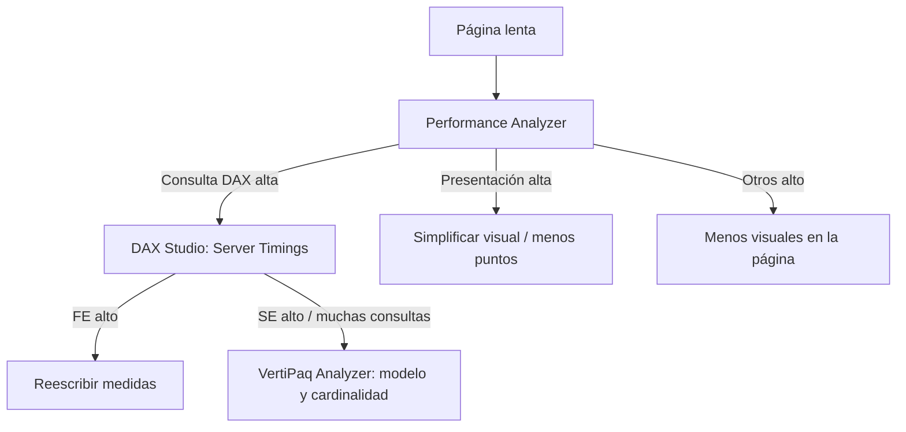

# Rendimiento - Performance Analyzer y VertiPaq Analyzer

Parte de: [[17-Power-BI/09 Avanzado/_Índice Avanzado|Avanzado]]

> [!info] Cómo avanzar
> `progreso`: **pendiente** → **viendo** (estudiando) → **visto** (contestaste la autoevaluación sin abrir las respuestas) → **dominado** (hiciste el laboratorio o lo aplicaste de verdad).

## Contenido

### Qué es
Dos herramientas complementarias para diagnosticar por qué un informe es lento:

- **Performance Analyzer** (Analizador de rendimiento): panel de Power BI Desktop que mide, **visual por visual**, cuánto tarda cada uno en una página y en qué se va ese tiempo. Responde "¿qué visual es lento?".
- **VertiPaq Analyzer**: conjunto de métricas sobre el **modelo** (tamaño de cada tabla, columna, diccionario y relación, cardinalidad, codificación). Viene integrado en **DAX Studio** (*Advanced → View Metrics*), Tabular Editor y Bravo. Responde "¿qué pesa en mi modelo y por qué?".

### Cómo funciona
**Performance Analyzer**
1. *Optimizar → Analizador de rendimiento* (o *Ver*), **Iniciar grabación**.
2. **Actualizar objetos visuales** o interactúa (cambia una segmentación).
3. Para cada visual verás:
   - **Consulta DAX**: tiempo que tardó el motor en responder la consulta del visual. Si es alto, el problema está en el modelo o en las medidas.
   - **Consulta directa** (en DirectQuery): tiempo del origen.
   - **Presentación visual**: tiempo de dibujar en pantalla (visuales con miles de puntos, visuales personalizados).
   - **Otros**: espera en cola porque otros visuales se ejecutan, preparación de la consulta. Mucho "Otros" suele indicar **demasiados visuales** en la página.
4. **Copiar consulta** te da el DAX exacto para analizarlo en DAX Studio con **Server Timings**: tiempo de *Formula Engine* (FE, un hilo, lógica compleja) vs *Storage Engine* (SE, VertiPaq, paralelo y rápido) y número de consultas al SE.

**VertiPaq Analyzer** (en DAX Studio conectado al modelo abierto en Desktop o por XMLA)
- **Tamaño total** por tabla y **% del modelo**.
- Por columna: **cardinalidad** (valores distintos), tamaño de **datos** y **diccionario**, codificación (hash o valor).
- **Relaciones**: tamaño y si hay **violaciones de integridad referencial** (claves en hechos sin fila en la dimensión).
- Particiones y segmentos.
Con eso detectas columnas de alta cardinalidad que inflan el modelo (GUIDs, fechas con hora, textos) y relaciones costosas.

### Caso: una página tarda 8 s y el visual más lento es una tabla con 15 medidas
1. **Performance Analyzer**: la tabla tiene 6.5 s de *Consulta DAX*, el resto es "Otros" de los demás visuales esperando.
2. **Copiar consulta** → DAX Studio con Server Timings: 85 % del tiempo en **FE** y 300 consultas al SE. Eso indica medidas que se evalúan fila por fila con lógica costosa, típicamente transición de contexto dentro de iteradores, `IF` con ramas pesadas o medidas que se recalculan varias veces.
3. Revisas las 15 medidas: varias repiten `[Ventas AA]` y calculan lo mismo con pequeñas variaciones. Acciones:
   - Usar **variables** para calcular una vez (ver [[DAX - variables (VAR y RETURN)]]).
   - Sustituir `FILTER ( ALL ( Ventas ), ... )` por filtros de columna en `CALCULATE`.
   - Evitar `SUMX` sobre la tabla de hechos con `CALCULATE` dentro cuando un `SUM` con filtro basta.
   - Reducir la granularidad de la tabla (¿se necesita por producto o basta por categoría con drill?).
   - Quitar medidas que nadie lee o mover algunas a un tooltip o a otra página.
   - Considerar [[Grupos de cálculo]] para variantes de tiempo (YTD, AA, Var) en lugar de 15 medidas.
4. **VertiPaq Analyzer**: la columna `Producto[Descripcion]` usada en filas tiene 400,000 valores; una relación con integridad referencial rota. Corriges en Power Query.
5. Vuelves a medir: la tabla baja a 1.2 s y la página a 2 s. Mide siempre antes y después, con caché limpia en DAX Studio.

Ver también [[DAX - optimización]] y [[DAX Studio]].

### Cuándo usarlo y cuándo no
- **Performance Analyzer**: cada vez que una página se siente lenta, antes de publicar.
- **VertiPaq Analyzer**: al diseñar o crecer el modelo, y cuando el tamaño o la actualización se disparan ([[Modelos grandes]]).
- No optimices a ciegas: sin medir, la mitad de los cambios no ayuda.

### Errores comunes
1. **Medir con caché caliente** y creer que ya está rápido.
2. **Culpar a la medida** cuando el tiempo está en "Otros" (demasiados visuales) o en presentación.
3. **Ignorar el origen** en DirectQuery: el cuello puede ser el SQL.
4. **No revisar cardinalidad**: optimizar DAX sobre un modelo inflado.
5. **Optimizar el visual menos usado**: empieza por la página más vista.

### Para profundizar
- [Usar el Analizador de rendimiento (Microsoft Learn)](https://learn.microsoft.com/en-us/power-bi/create-reports/desktop-performance-analyzer)
- [Guía de optimización de Power BI](https://learn.microsoft.com/en-us/power-bi/guidance/power-bi-optimization)
- [VertiPaq Analyzer (SQLBI)](https://www.sqlbi.com/tools/vertipaq-analyzer/)

## Autoevaluación

Contesta primero en voz alta o en papel; luego despliega la respuesta.

> [!question]- ¿Qué mide Performance Analyzer?
> Por cada visual: tiempo de consulta DAX, de visualización y otros. Permite copiar la consulta del visual más lento.

> [!question]- ¿Qué te dice VertiPaq Analyzer?
> Tamaño por tabla y columna, cardinalidad, diccionario y relaciones: dónde está el peso del modelo.

> [!question]- Caso: una página tarda 8 s y el visual más lento es una tabla con 15 medidas.
> Revisar la consulta en DAX Studio (Server Timings), simplificar medidas costosas, reducir columnas o dividir el visual; medir antes y después.

