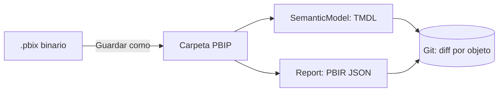

# TMDL y proyectos PBIP

Parte de: [[17-Power-BI/09 Avanzado/_Índice Avanzado|Avanzado]]

> [!info] Cómo avanzar
> `progreso`: **pendiente** → **viendo** (estudiando) → **visto** (contestaste la autoevaluación sin abrir las respuestas) → **dominado** (hiciste el laboratorio o lo aplicaste de verdad).

## Contenido

### Qué es
- **PBIP (Power BI Project)** es un formato de guardado de Power BI Desktop que, en lugar de un solo binario `.pbix`, guarda el trabajo como una **carpeta de archivos de texto**: un archivo `.pbip` que lo abre, una carpeta `*.SemanticModel` con el modelo y una carpeta `*.Report` con el informe.
- **TMDL (Tabular Model Definition Language)** es el lenguaje de texto, legible por humanos, en el que se escribe la definición del **modelo semántico** dentro del proyecto: tablas, columnas, medidas, relaciones, roles, expresiones de Power Query, cada objeto en archivos separados con sintaxis indentada, parecida a YAML.
- Para el informe se usa **PBIR**, un formato JSON con un archivo por página y por visual.

Según el centro de mensajes de Microsoft (MC1465770, septiembre de 2026), el **modo de desarrollador y PBIP pasaron a disponibilidad general**, y PBIR queda como formato predeterminado de informes en Desktop y el Service (los informes en el formato anterior se actualizan al editarse). PBIX sigue siendo el formato principal de archivo.

### Cómo funciona
1. En Desktop: *Archivo → Guardar como → Proyecto de Power BI (*.pbip)*. (Si tu versión lo pide, activa TMDL/PBIR en las opciones de versión preliminar.)
2. Se crea la estructura:

```text
Ventas.pbip
Ventas.SemanticModel/
  definition.pbism
  definition/
    database.tmdl
    model.tmdl
    relationships.tmdl
    expressions.tmdl
    tables/
      Ventas.tmdl
      Cliente.tmdl
      Calendario.tmdl
    roles/
      Region.tmdl
  .pbi/ (localSettings.json, cache.abf: no se versionan)
Ventas.Report/
  definition.pbir
  definition/ (report.json, pages/<pagina>/visuals/<visual>/visual.json)
.gitignore
```

3. Puedes editar los archivos con VS Code (hay extensión de TMDL con resaltado), con **Tabular Editor** o en la **vista TMDL** de Desktop, que permite escribir y aplicar scripts TMDL directamente al modelo.
4. Desktop vuelve a leer los cambios al reabrir el proyecto (o los aplica desde la vista TMDL).

Ejemplo de `tables/Ventas.tmdl` (indentación con tabulaciones):

```text
table Ventas

	measure 'Ventas $' = SUM ( Ventas[Importe] )
		formatString: #,0.00
		displayFolder: Ventas

	measure 'Margen %' = DIVIDE ( [Margen $], [Ventas $] )
		formatString: 0.0%

	column Importe
		dataType: decimal
		sourceColumn: Importe
		summarizeBy: none

	column FechaKey
		dataType: int64
		isHidden
		sourceColumn: FechaKey
```



### ¿Por qué importa para el trabajo en equipo?
- **Diffs legibles**: en un pull request ves "cambió la expresión de `Margen %`" en lugar de "cambió un binario de 80 MB".
- **Fusión de cambios**: dos personas pueden modificar tablas distintas (archivos distintos) y Git combina sin conflictos.
- **Revisión de código** del modelo como cualquier otro código, en Azure DevOps.
- **Automatización**: scripts que generan o validan medidas, reglas de buenas prácticas en el pipeline, despliegue por XMLA o integración de Git del workspace (ver [[Power BI con Git y control de versiones]]).
- **Sin datos en el repo**: la caché (`cache.abf`) se excluye; se versiona la definición, no la información.
- **Edición masiva**: renombrar 50 medidas o cambiar formatos con buscar y reemplazar o un script.

### Ejemplo
En el repo `bi-comercial`, un compañero abre un PR "Corrige Margen % con ventas en cero". El diff de `Ventas.tmdl` muestra solo:

```diff
-	measure 'Margen %' = DIVIDE ( [Margen $], [Ventas $] )
+	measure 'Margen %' = DIVIDE ( [Margen $], [Ventas $], 0 )
```

Lo revisas, el pipeline corre las reglas de Tabular Editor, se fusiona y el workspace DEV se actualiza desde Git.

### Cuándo usarlo y cuándo no
- **Úsalo** en todo modelo que mantenga un equipo o que viva en Git.
- Para un análisis personal desechable, `.pbix` es suficiente.
- Algunas funciones o escenarios pueden tener limitaciones con PBIP/PBIR; revisa la página de limitaciones de proyectos en Learn antes de migrar un informe crítico.

### Errores comunes
1. **Versionar la carpeta `.pbi`** con la caché de datos.
2. **Editar TMDL con espacios en lugar de tabulaciones** o romper la indentación: el modelo no carga.
3. **Editar archivos con Desktop abierto**: Desktop no detecta el cambio y puede sobrescribirlo al guardar.
4. **Mover o renombrar carpetas** a mano rompiendo la referencia del informe al modelo (`definition.pbir`).
5. **Mezclar `.pbix` y `.pbip`** del mismo informe en el repo: dos fuentes de verdad.

### Para profundizar
- [Proyectos de Power BI Desktop (Microsoft Learn)](https://learn.microsoft.com/en-us/power-bi/developer/projects/projects-overview)
- [Tabular Model Definition Language (TMDL)](https://learn.microsoft.com/en-us/analysis-services/tmdl/tmdl-overview)
- [Modelo semántico en proyectos (TMDL)](https://learn.microsoft.com/en-us/power-bi/developer/projects/projects-dataset)

## Autoevaluación

Contesta primero en voz alta o en papel; luego despliega la respuesta.

> [!question]- ¿Qué es un proyecto PBIP?
> Guardar el informe y el modelo como carpetas de archivos de texto (en lugar de un .pbix binario), aptos para Git: definición del informe en JSON (PBIR) y del modelo en TMDL.

> [!question]- ¿Qué es TMDL?
> Tabular Model Definition Language: formato de texto legible para definir tablas, columnas, medidas y relaciones, con un archivo por tabla.

> [!question]- ¿Por qué importa para el trabajo en equipo?
> Permite ver diferencias (diffs), revisar cambios en pull requests y resolver conflictos, imposible con un .pbix.

