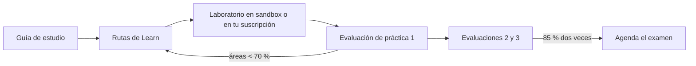

# Cómo estudiar con Microsoft Learn y evaluaciones de práctica

Parte de: [[18-Certificaciones/01 Azure ruta hasta arquitecto/_Índice Azure ruta hasta arquitecto|Azure ruta hasta arquitecto]]

> [!info] Cómo avanzar
> `progreso`: **pendiente** → **viendo** (estudiando) → **visto** (contestaste la autoevaluación sin abrir las respuestas) → **dominado** (hiciste el laboratorio o lo aplicaste de verdad).

## Contenido

### Qué es

Microsoft publica, gratis, casi todo lo que necesitas para preparar sus exámenes. El método consiste en usar esos recursos en un orden concreto: temario oficial → aprendizaje guiado → práctica en sandbox → evaluaciones de práctica → repaso dirigido. Sirve para cualquier examen de esta sección ([[AZ-104 Azure Administrator Associate]], [[AI-200 Azure AI Cloud Developer Associate (sucesor de AZ-204)]], [[AZ-305 Azure Solutions Architect Expert]], [[AZ-500 y SC-500 (seguridad en Azure)]], etc.).

### Los recursos oficiales

| Recurso | Qué te da | Cómo usarlo |
|---|---|---|
| **Guía de estudio** (study guide) | Temario con porcentajes, fecha de la última actualización y cambios | Tu lista maestra; cada punto debe acabar con una nota tuya |
| **Rutas de aprendizaje** | Módulos con lecturas y a veces sandbox gratuito | Primera pasada del contenido |
| **Evaluación de práctica** | Preguntas tipo examen con explicación y enlaces | Medir avance; Microsoft las está moviendo a *AI Skills Navigator* |
| **Exam Sandbox** (aka.ms/examdemo) | La interfaz real: tipos de pregunta, navegación, marcar para revisión | Una vez antes del examen para no sorprenderte |
| **Exam Readiness Zone** | Videos de repaso por examen | Repaso final de áreas flojas |

Para un examen **nuevo**, la evaluación de práctica suele aparecer unas 8 semanas después de que sale de beta. Mientras tanto usa simulacros de fuentes confiables (nunca *dumps*).

### Microsoft Learn durante el examen

La página oficial de experiencia del examen indica que en los exámenes **associate y expert** puedes abrir Microsoft Learn dentro del examen. Condiciones:

- No aplica en Fundamentals ni en los exámenes de GitHub.
- Solo el dominio learn.microsoft.com; no Q&A, ni evaluaciones de práctica, ni tu perfil.
- **El reloj no se detiene** y no te dan tiempo extra. Sirve para confirmar un parámetro, no para aprender en el momento.

### Cómo funciona el método (6–10 semanas)

1. **Semana 1:** descarga la guía de estudio; crea una tabla con cada punto, su peso y tu nivel (0–3).
2. **Semanas 2–5:** recorre las rutas; por cada módulo haz el laboratorio y escribe una nota en tu bóveda con tus palabras.
3. **Semana 6:** primera evaluación de práctica **sin** haber visto preguntas antes. Anota el resultado en la tabla "Exámenes de práctica" de la nota del examen.
4. **Semanas 7–8:** refuerza las áreas débiles y repite la evaluación en modo práctica (con explicaciones) y luego en modo examen.
5. **Criterio para agendar:** 85 % o más dos veces seguidas en modo examen, y la sección "¿Cuándo estoy listo?" de la nota del examen completa.

### Ejemplo con AI-200

La guía de AI-200 pesa contenedores 20–25 %, datos con IA 25–30 %, consumo de servicios 20–25 % y seguridad y monitoreo 20–25 %. Tu tabla te muestra que en Cosmos DB y pgvector estás en 1. Inviertes ahí dos semanas: un endpoint en Itzamna.Dionisio que genera embeddings y consulta por similitud. En la evaluación de práctica esa área sube de 55 % a 88 %; ya puedes enfocarte en Event Grid.

### Cuándo usarlo y cuándo no

- **Sí:** como base de cualquier examen de Microsoft; cuesta cero.
- **Complementa** con un libro o curso si un tema no te queda claro, o con laboratorios largos para AZ-104 y AZ-305.
- **No** dependas solo de leer módulos: los exámenes con laboratorios y casos de estudio premian haberlo hecho con tus manos.

### Errores comunes

1. **Memorizar las preguntas de la evaluación de práctica.** Al tercer intento sacas 95 % por memoria, no por conocimiento. Varía el orden y explica en voz alta por qué cada opción incorrecta es incorrecta.
2. **Usar *dumps*.** Viola el acuerdo del candidato (pueden revocarte la certificación) y no te prepara para laboratorios.
3. **No revisar la fecha de la guía.** Los temarios cambian; la guía lista los cambios recientes.
4. **Confiar en buscar todo en Learn durante el examen.** Te quedas sin tiempo.

### Para profundizar

- [Duración y experiencia del examen (incluye acceso a Learn y descansos)](https://learn.microsoft.com/en-us/credentials/support/exam-duration-exam-experience)
- [Política de reintentos](https://learn.microsoft.com/en-us/credentials/support/retake-policy)
- [Exámenes retirados](https://learn.microsoft.com/en-us/credentials/support/retired-certification-exams)

## Autoevaluación

Contesta primero en voz alta o en papel; luego despliega la respuesta.

> [!question]- ¿Qué recursos oficiales y gratuitos tiene cada examen?
> Guía de estudio (temario con porcentajes y cambios), rutas de aprendizaje, evaluación de práctica gratuita (cada vez más en AI Skills Navigator), Exam Sandbox para conocer la interfaz y videos Exam Readiness Zone.

> [!question]- ¿Cuándo hay evaluación de práctica de un examen nuevo?
> Normalmente unas 8 semanas después de que el examen sale de beta (por ejemplo, SC-500 aún no tenía cuando se revisó).

> [!question]- ¿Puedes consultar Microsoft Learn durante el examen?
> En los exámenes role-based Microsoft permite abrir Microsoft Learn durante el examen (no en las Fundamentals), pero consume tu tiempo. Pendiente de confirmar las condiciones actuales en la página de experiencia del examen.

> [!question]- Error común al estudiar
> Memorizar preguntas de *dumps*: viola el acuerdo del candidato y no te prepara para los laboratorios ni los casos de estudio.

