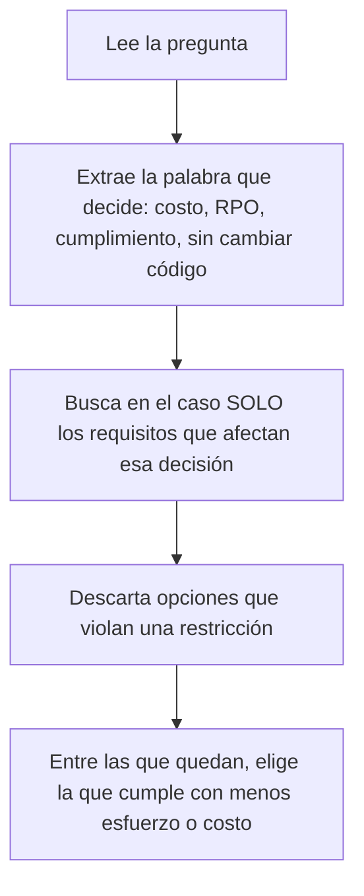

# Cómo prepararse para los casos de estudio de AZ-305

Parte de: [[18-Certificaciones/01 Azure ruta hasta arquitecto/_Índice Azure ruta hasta arquitecto|Azure ruta hasta arquitecto]]

> [!info] Cómo avanzar
> `progreso`: **pendiente** → **viendo** (estudiando) → **visto** (contestaste la autoevaluación sin abrir las respuestas) → **dominado** (hiciste el laboratorio o lo aplicaste de verdad).

## Contenido

### Qué es

Un **caso de estudio** es un bloque del examen con un escenario largo de una empresa ficticia (situación actual, requisitos de negocio, requisitos técnicos, restricciones) seguido de varias preguntas que se responden usando ese escenario. En [[AZ-305 Azure Solutions Architect Expert]] son clave porque el examen mide decisiones de diseño, y el caso te da el contexto para que haya una respuesta "más correcta" entre varias que funcionan.

### Cómo funciona dentro del examen

- El caso se presenta en pestañas: *Overview*, *Existing environment*, *Requirements* (negocio y técnicos), a veces *Problem statements*. Las preguntas están aparte y puedes consultar el texto del caso mientras contestas. Si puedes revisar tus respuestas del caso antes de salir de él y si después puedes volver: Pendiente de confirmar (la página oficial no lo detalla; revísalo en el Exam Sandbox).
- Puede haber más de un caso en un examen; Microsoft no publica cuántos.
- **Descansos:** puedes tomar descansos no programados, incluso durante un caso de estudio, pero **no puedes volver a ninguna pregunta que viste antes del descanso**, aunque esté sin contestar o marcada. El reloj sigue corriendo.
- No puedes tomar descanso **durante** un laboratorio ni dentro de un grupo de preguntas problema-solución.
- El examen dura 100 minutos (120 si incluye laboratorios), según la página oficial de experiencia del examen.

### Técnica de lectura

1. **Primero la pregunta, luego el caso.** Si lees el caso completo al inicio gastas 10 minutos y olvidas detalles.
2. **Subraya modificadores:** *minimizar costos*, *minimizar esfuerzo administrativo*, *sin cambios en la aplicación*, *debe cumplir con residencia de datos*, *RPO de 5 minutos*. Esos modificadores eliminan opciones.
3. **Distingue requisito de deseo.** "Debe" (must) es obligatorio; "le gustaría" no pesa igual.
4. **Haz una tabla mental:** identidad, datos, continuidad, infraestructura (los cuatro dominios del temario de AZ-305). Cada pregunta cae en uno.
5. **Cuida el tiempo:** Microsoft dice que la mayoría de sus exámenes tienen entre 40 y 60 preguntas; con 100 minutos son unos 2 minutos por pregunta; un caso de 6 preguntas no debería tomarte más de 15 minutos.

### Ejemplo

Caso: *Contoso Lending* tiene una API .NET en dos VMs en una sola región, SQL Server en una VM y usuarios en México y España. Requisitos: RPO de 15 minutos, RTO de 1 hora, minimizar administración, los datos de clientes españoles deben quedarse en la UE.

Pregunta: ¿qué recomiendas para la base de datos?

- *SQL Server en VM con Always On en dos regiones*: cumple RPO/RTO pero **no minimiza administración**.
- *Azure SQL Database con grupos de conmutación por error*: cumple RPO/RTO y es PaaS; ahora revisa residencia: necesitas instancias separadas o una en región de la UE para los datos españoles.
- *Cosmos DB*: obliga a cambiar la aplicación; el caso no lo permite.

La respuesta sale de cruzar **tres** líneas del caso, no de saber qué servicio es "el mejor". Es el mismo razonamiento que usarías para diseñar Pochteca.Nomisma o Xolotl.Hecate con alta disponibilidad.

### Cómo practicar

- La **evaluación de práctica gratuita** de AZ-305 en Microsoft Learn incluye preguntas de escenario.
- Toma una arquitectura de referencia del Azure Architecture Center, inventa requisitos (RPO, presupuesto, región) y justifica por escrito tu diseño y dos alternativas descartadas.
- Usa los pilares del **Well-Architected Framework** (confiabilidad, seguridad, costo, excelencia operativa, rendimiento) como lista de verificación.
- Haz al menos tres casos completos con cronómetro.

### Cuándo usarlo y cuándo no

Esta técnica aplica a todo examen con escenarios: AZ-305, [[SC-100 Cybersecurity Architect Expert]] y el examen de [[Google Cloud Professional Cloud Architect]], que publica sus casos de antemano. En exámenes de conocimiento puntual (Fundamentals) no hace falta.

### Errores comunes

1. **Elegir el servicio "más potente"** en lugar del que cumple con menos costo o administración.
2. **Ignorar una restricción escondida** en "Existing environment" (por ejemplo, una licencia o una app que no se puede modificar).
3. **Tomar un descanso a mitad del caso** con preguntas marcadas para revisar: ya no podrás volver.
4. **Leer el caso completo antes de cada pregunta**: te comes el tiempo.

### Para profundizar

- [Duración y experiencia del examen (descansos y casos de estudio)](https://learn.microsoft.com/en-us/credentials/support/exam-duration-exam-experience)
- [Azure Well-Architected Framework](https://learn.microsoft.com/en-us/azure/well-architected/)
- [Azure Architecture Center](https://learn.microsoft.com/en-us/azure/architecture/)

## Autoevaluación

Contesta primero en voz alta o en papel; luego despliega la respuesta.

> [!question]- ¿Qué es un caso de estudio en un examen de Microsoft?
> Un escenario largo (empresa, requisitos técnicos y de negocio, situación actual) seguido de varias preguntas. Puede haber varios en un examen.

> [!question]- ¿Qué pasa si tomas un descanso durante el caso?
> Puedes tomar el descanso, pero no podrás volver a ninguna pregunta que viste antes del descanso. El reloj sigue corriendo.

> [!question]- Técnica para leerlos
> Lee primero la pregunta, luego busca en el caso solo los requisitos que la afectan (RPO/RTO, costo, cumplimiento, regiones). Subraya palabras como *minimizar costo* o *sin cambios de código*: deciden la respuesta.

> [!question]- ¿Con qué practicas?
> Con la evaluación de práctica gratuita de AZ-305 y diseñando tú mismo soluciones con el Azure Well-Architected Framework y el Azure Architecture Center.

