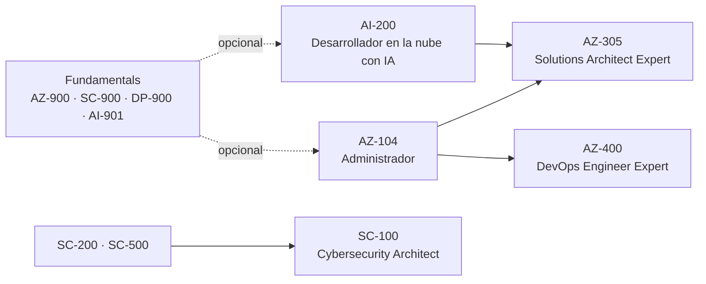

# Mapa de certificaciones de Azure y cómo elegir

Parte de: [[18-Certificaciones/01 Azure ruta hasta arquitecto/_Índice Azure ruta hasta arquitecto|Azure ruta hasta arquitecto]]

> [!info] Cómo avanzar
> `progreso`: **pendiente** → **viendo** (estudiando) → **visto** (contestaste la autoevaluación sin abrir las respuestas) → **dominado** (hiciste el laboratorio o lo aplicaste de verdad).

## Contenido

### Qué es

El programa de certificaciones de Microsoft está organizado por **rol** (lo que haces en el trabajo) y por **nivel** (qué tan profundo). El "mapa" es simplemente la forma de ubicar cada examen en esa cuadrícula para no gastar tiempo ni dinero en uno que no te acerca a tu meta. Para ti, que vas de desarrollador .NET a senior y luego a arquitecto, el mapa sirve para decidir el orden y saber cuáles exámenes cambiaron en 2026.

### Cómo funciona

Hay tres niveles:

| Nivel | Qué valida | Duración típica | ¿Vence? |
|---|---|---|---|
| **Fundamentals** | Conceptos y vocabulario | 45 min de examen | No |
| **Associate** | Un rol concreto (administrador, desarrollador, seguridad, datos, IA) | 100–120 min | Sí, al año (renovación gratis) |
| **Expert** | Diseño de soluciones o DevOps; pide una associate como requisito | 100–120 min, con casos de estudio | Sí, al año (renovación gratis) |

Las duraciones salen de la página oficial de experiencia del examen: Fundamentals 45 min, associate/expert sin laboratorios 100 min y con posibles laboratorios 120 min.

Las Fundamentals **no son requisito de nada**: sirven para arrancar o para perfiles no técnicos. Las Expert sí tienen requisitos; por ejemplo, [[AZ-305 Azure Solutions Architect Expert]] exige tener [[AZ-104 Azure Administrator Associate]], y [[AZ-400 DevOps Engineer Expert]] exige Azure Administrator o Azure Developer Associate.

### Qué cambió en 2026

Según la lista oficial de exámenes retirados de Microsoft (revisada el 2026-11-09):

- **AZ-204** se retiró el 31 de julio de 2026. En la práctica su lugar lo ocupa [[AI-200 Azure AI Cloud Developer Associate (sucesor de AZ-204)]], que cubre contenedores, servicios de datos con IA, mensajería y seguridad.
- **AZ-500** se retiró el 31 de agosto de 2026; la certificación de seguridad en la nube vigente es **SC-500** (ver [[AZ-500 y SC-500 (seguridad en Azure)]]).
- **AI-102** se retiró; hoy se presenta **AI-103** (ver [[AI-102 Azure AI Engineer Associate]]).
- El **examen AI-900** se retiró; la certificación Azure AI Fundamentals ahora se obtiene con **AI-901** (ver [[AI-900 Azure AI Fundamentals]]).
- **DP-100** (Data Scientist) también salió de la lista activa.

Ojo: las páginas oficiales no siempre dicen "X reemplaza a Y". Cuando una nota de esta sección dice "sucesor", es la interpretación práctica de cubrir el mismo rol.

### Ejemplo: elegir tu ruta

Tu trabajo diario es construir APIs ASP.NET Core con Dapper (Itzamna.Dionisio), un front React (Itzamna.Clio) y pipelines en Azure DevOps. Tu meta a 18 meses es diseñar soluciones completas. Con el mapa:

1. **Meta final:** Azure Solutions Architect Expert (AZ-305).
2. **Requisito duro:** AZ-104. No hay atajo.
3. **Lo que refuerza tu perfil de desarrollador:** AI-200, porque AZ-204 ya no existe.
4. **Opcional según tu equipo:** AZ-400 si eres quien mantiene los pipelines.
5. **AZ-900:** sáltalo si ya trabajas con Azure; tómalo solo si quieres un primer examen fácil para conocer la mecánica.

El orden detallado está en [[Requisitos y orden recomendado hasta Azure Solutions Architect]].

### Cuándo usarlo y cuándo no

- **Úsalo** antes de comprar cualquier examen, y cada vez que Microsoft anuncie retiros (revisa la lista de retirados cada trimestre).
- **No lo uses** como lista de compras: tener seis Fundamentals no pesa tanto como una Associate bien hecha y experiencia real.
- Si tu empresa usa AWS o Google Cloud, compara con [[AWS Solutions Architect Associate]] o [[Google Cloud Professional Cloud Architect]].

### Errores comunes

1. **Creer que AZ-900 es requisito de AZ-104.** No lo es; ninguna Fundamentals es requisito de otra.
2. **Estudiar con material de un examen retirado** (por ejemplo, cursos viejos de AZ-204 o AZ-500). Revisa siempre la fecha de la guía de estudio oficial.
3. **Presentar AZ-305 sin AZ-104** pensando que te darán el título. Apruebas el examen, pero la certificación no se otorga hasta cumplir el requisito.
4. **Ignorar la renovación.** Las associate y expert vencen al año; ver [[Renovación anual de certificaciones de Microsoft]].

### Para profundizar

- [Exámenes y certificaciones retirados (Microsoft Learn)](https://learn.microsoft.com/en-us/credentials/support/retired-certification-exams)
- [Duración y experiencia del examen](https://learn.microsoft.com/en-us/credentials/support/exam-duration-exam-experience)
- [Azure Solutions Architect Expert: requisitos](https://learn.microsoft.com/en-us/credentials/certifications/azure-solutions-architect/)

## Autoevaluación

Contesta primero en voz alta o en papel; luego despliega la respuesta.

> [!question]- ¿Qué niveles de certificación tiene Microsoft y en qué se diferencian?
> **Fundamentals** (conceptos, 45 min, no vencen), **Associate** (un rol concreto: administrador, desarrollador, seguridad, datos) y **Expert** (diseño o DevOps; exigen una associate previa). Las associate y expert vencen al año y se renuevan gratis.

> [!question]- Eres desarrollador .NET y quieres llegar a arquitecto. ¿Qué ruta tomas hoy?
> AZ-104 (requisito de AZ-305) → [[AI-200 Azure AI Cloud Developer Associate (sucesor de AZ-204)]] para el lado de desarrollo → [[AZ-305 Azure Solutions Architect Expert]]. AZ-204 ya no es opción: se retiró el 31 de julio de 2026.

> [!question]- ¿Qué exámenes del temario cambiaron en 2026?
> Según la lista oficial de exámenes retirados: AZ-204 (31 jul 2026), AZ-500 (31 ago 2026), AI-102 y el examen AI-900 (30 jun 2026), DP-100 (1 jun 2026). Los nuevos son AI-200, SC-500, AI-103 y AI-901.

> [!question]- Error común: ¿AZ-900 es requisito de AZ-104?
> No. Ninguna Fundamentals es requisito de otra certificación; AZ-900 es opcional y solo sirve como primer contacto.

