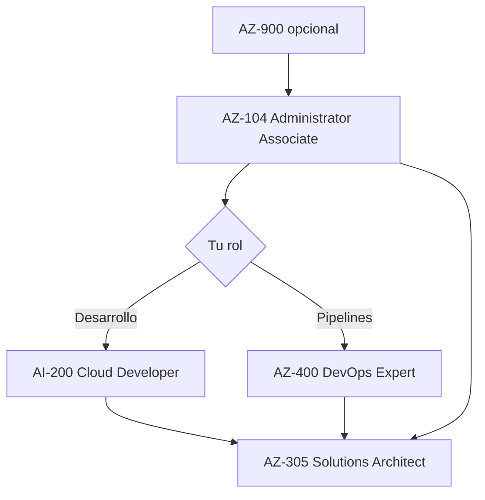

# Requisitos y orden recomendado hasta Azure Solutions Architect

Parte de: [[18-Certificaciones/01 Azure ruta hasta arquitecto/_Índice Azure ruta hasta arquitecto|Azure ruta hasta arquitecto]]

> [!info] Cómo avanzar
> `progreso`: **pendiente** → **viendo** (estudiando) → **visto** (contestaste la autoevaluación sin abrir las respuestas) → **dominado** (hiciste el laboratorio o lo aplicaste de verdad).

## Contenido

### Qué es

Es la secuencia de exámenes que te lleva a **Microsoft Certified: Azure Solutions Architect Expert**, con sus requisitos formales y un orden que tiene sentido para un desarrollador .NET. La certificación Expert valida que puedes diseñar soluciones en Azure (identidad, gobierno, datos, continuidad e infraestructura), no solo construirlas.

### Cómo funciona el requisito

La página oficial de la certificación pide dos cosas:

1. **Aprobar AZ-305** (Designing Microsoft Azure Infrastructure Solutions).
2. **Tener Azure Administrator Associate** ([[AZ-104 Azure Administrator Associate]]).

Puedes presentar AZ-305 antes que AZ-104; el examen queda aprobado, pero el título de Expert aparece en tu perfil hasta que tengas también la associate. Por eso conviene hacer AZ-104 primero: además, AZ-305 da por hecho que conoces redes virtuales, RBAC, almacenamiento y máquinas virtuales a nivel de administrador.

### Orden recomendado (realista)

| Paso | Examen | Por qué en este punto | Tiempo de estudio orientativo |
|---|---|---|---|
| 0 | [[AZ-900 Azure Fundamentals (opcional)]] | Solo si nunca has presentado un examen de Microsoft | 2–3 semanas |
| 1 | [[AZ-104 Azure Administrator Associate]] | Requisito obligatorio; base de redes, identidad y gobierno | 8–12 semanas |
| 2 | [[AI-200 Azure AI Cloud Developer Associate (sucesor de AZ-204)]] o [[AZ-400 DevOps Engineer Expert]] | Refuerza tu lado de desarrollo o de DevOps | 8–10 semanas |
| 3 | [[AZ-305 Azure Solutions Architect Expert]] | La meta; requiere pensar en diseño y alternativas | 10–12 semanas |

Los tiempos son una estimación para alguien que trabaja tiempo completo y estudia 5–7 horas por semana; ajústalos con tus resultados en las evaluaciones de práctica.

### Sobre AZ-400 y AI-200

La página oficial de DevOps Engineer Expert (AZ-400) acepta como requisito **Azure Administrator Associate o Azure Developer Associate**. Como AZ-204 se retiró el 31 de julio de 2026, la vía nueva para un desarrollador sería AI-200, pero la página de AZ-400 todavía **no menciona** Azure AI Cloud Developer Associate como requisito (Pendiente de confirmar si Microsoft la agregará). La opción segura es AZ-104, que te sirve para las dos Expert.

### Mantener vigente la cadena

Las associate y expert vencen al año. Si dejas que se venza AZ-104 mientras preparas AZ-305, tendrías que volver a presentar su examen completo. Renueva cada una en su ventana de 6 meses (es gratis y en línea). Qué pasa exactamente con una Expert ya otorgada si su associate requisito vence después: Pendiente de confirmar en la política de expiración; lo sensato es renovar ambas.

### Ejemplo: tu calendario

- **Meses 1–3:** AZ-104. Laboratorios en tu propia suscripción (cuenta gratuita o créditos, con presupuesto y borrando el grupo de recursos al terminar; los sandboxes de Microsoft Learn ya se retiraron): VNet con subredes, NSG, VM, cuenta de almacenamiento, RBAC y Azure Policy.
- **Meses 4–6:** AI-200. Aprovechas Itzamna.Dionisio: lo contenerizas, lo publicas en Azure Container Apps, lees secretos de Key Vault con identidad administrada y mandas eventos a Service Bus.
- **Mes 7:** descanso y renovaciones pendientes.
- **Meses 8–10:** AZ-305. Diseñas en papel la arquitectura de Xolotl.Hecate en alta disponibilidad (RPO/RTO, regiones, identidad) y practicas casos de estudio ([[Cómo prepararse para los casos de estudio de AZ-305]]).

### Cuándo usarlo y cuándo no

- **Sí:** si tu meta es arquitecto de soluciones en una empresa que usa Azure.
- **No:** si tu empresa vive en AWS; ahí el equivalente es [[AWS Solutions Architect Associate]]. Tampoco si tu meta inmediata es ser senior en desarrollo: ahí pesa más AI-200 y tu portafolio.

### Errores comunes

1. **Saltarse AZ-104 "porque soy desarrollador".** Es requisito y además cubre lo que AZ-305 asume.
2. **Encadenar exámenes sin pausa.** El agotamiento hace que repruebes el tercero; deja respiro entre uno y otro.
3. **Contar con AI-200 como requisito de AZ-400** sin revisar la página oficial.
4. **Olvidar renovar** la associate mientras estudias la Expert.

### Para profundizar

- [Azure Solutions Architect Expert (Microsoft Learn)](https://learn.microsoft.com/en-us/credentials/certifications/azure-solutions-architect/)
- [DevOps Engineer Expert y sus requisitos](https://learn.microsoft.com/en-us/credentials/certifications/devops-engineer/)
- [Preguntas frecuentes de renovación](https://learn.microsoft.com/en-us/credentials/certifications/renew-your-microsoft-certification-faq)

## Autoevaluación

Contesta primero en voz alta o en papel; luego despliega la respuesta.

> [!question]- ¿Qué necesitas para obtener Azure Solutions Architect Expert?
> Aprobar AZ-305 **y** tener vigente Azure Administrator Associate ([[AZ-104 Azure Administrator Associate]]). Puedes presentar AZ-305 antes, pero el título no se otorga hasta tener AZ-104.

> [!question]- Propón un orden realista.
> (Opcional) AZ-900 → AZ-104 → AI-200 o AZ-400 según tu rol → AZ-305. Entre cada uno, deja que la anterior siga vigente: renuévala en su ventana de 6 meses.

> [!question]- ¿Qué pasa si se vence AZ-104 después de obtener AZ-305?
> La expert se mantiene con su propia renovación anual, pero conviene renovar ambas; si se vence una certificación tienes que volver a presentar su examen. Confírmalo en la política de expiración de Microsoft (Pendiente de confirmar el caso exacto).

> [!question]- ¿Cuenta AI-200 como requisito de AZ-400 en lugar de AZ-204?
> Hoy la página oficial de AZ-400 solo menciona Azure Administrator Associate o Azure Developer Associate. No menciona AI-200 (Pendiente de confirmar). La opción segura es AZ-104.

