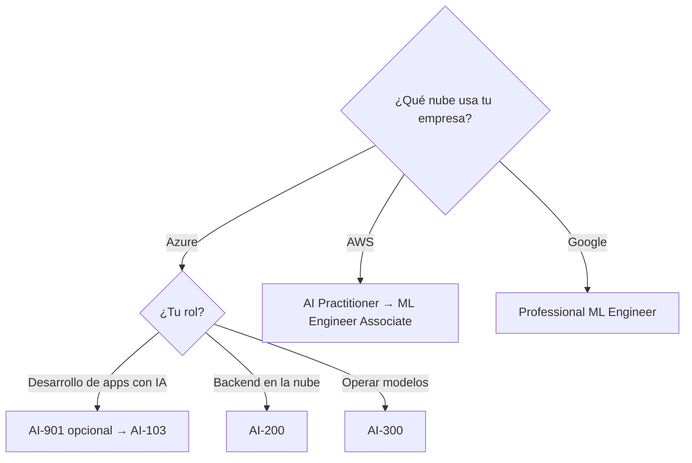

# Certificaciones de machine learning (Azure, AWS y Google)

Parte de: [[18-Certificaciones/02 IA y datos/_Índice IA y datos|IA y datos]]

> [!info] Cómo avanzar
> `progreso`: **pendiente** → **viendo** (estudiando) → **visto** (contestaste la autoevaluación sin abrir las respuestas) → **dominado** (hiciste el laboratorio o lo aplicaste de verdad).

## Contenido

### Qué es

Es el panorama de certificaciones de **machine learning e IA** de los tres grandes proveedores de nube. Validan que sabes construir, desplegar u operar soluciones de IA en **su** plataforma; no son certificados de teoría de ML. Para un desarrollador .NET que trabaja en Azure, lo útil es saber cuál corresponde a cada rol y qué cambió en 2026.

### Microsoft (Azure)

| Examen | Certificación | Para quién | Estado (revisado 2026-11-09) |
|---|---|---|---|
| AI-901 | Azure AI Fundamentals | Conceptos de IA y Microsoft Foundry | Vigente; reemplazó al examen AI-900 ([[AI-900 Azure AI Fundamentals]]) |
| AI-103 | Azure AI Apps and Agents Developer Associate | Desarrollador de apps y agentes de IA | Vigente; AI-102 se retiró ([[AI-102 Azure AI Engineer Associate]]) |
| AI-200 | Azure AI Cloud Developer Associate | Desarrollador en la nube con IA | Vigente ([[AI-200 Azure AI Cloud Developer Associate (sucesor de AZ-204)]]) |
| AI-300 | Machine Learning Operations (MLOps) Engineer Associate | Desplegar y operar modelos de ML e IA generativa en producción | Anunciado en el blog oficial de Microsoft en 2026; temario y fechas: Pendiente de confirmar en Microsoft Learn |
| DP-100 | Azure Data Scientist Associate | Ciencia de datos con Azure ML | **Retirado** (lista oficial de exámenes retirados) |

### AWS

En la página oficial de certificaciones de AWS aparecen, en IA: **AI Practitioner** (fundamental), **Machine Learning Engineer – Associate** y la nueva **AI Business Strategist** (en beta, enfocada en negocio). AWS también tiene **Data Engineer – Associate** y una **Generative AI Developer – Professional** (Pendiente de confirmar precio y estado actual). La antigua **Machine Learning – Specialty** ya no aparece en la lista y solo se pudo presentar hasta el 31 de marzo de 2026.

### Google Cloud

**Professional Machine Learning Engineer**: 200 USD más impuestos, 2 horas, 50–60 preguntas de opción múltiple, en inglés y japonés, vigencia de 2 años, sin requisitos formales (recomiendan 3+ años de industria y 1+ en Google Cloud). Se presenta en línea con supervisión o en un centro Pearson VUE.

### Cómo funciona la elección

La regla práctica: **la certificación de la nube donde vas a desplegar**. Saber MLOps en AWS no te ayuda tanto si tu empresa vive en Azure, porque cada examen pregunta por los servicios y nombres propios del proveedor.

### Ejemplo: tu caso

Trabajas con .NET y Azure, y quieres agregar un asistente con RAG a Itzamna.Clio que consulte documentación interna. La secuencia sensata:

1. **AI-901** si quieres el vocabulario (opcional; las Fundamentals no vencen).
2. **AI-103** para construir el agente en Microsoft Foundry: prompts, herramientas, RAG, evaluación.
3. **AI-200** si además tu trabajo es el backend: Container Apps, Cosmos DB o PostgreSQL con vectores, Service Bus, Key Vault.

AWS o Google solo si cambias a un empleador que use esa nube.

### Cuándo usarlo y cuándo no

- **Sí:** si tu trabajo incluye construir o desplegar IA en la nube y quieres que RR. HH. lo vea.
- **No:** si quieres demostrar que entiendes ML a fondo (modelos, estadística, entrenamiento); ahí pesa más un proyecto propio o un certificado como [[TensorFlow y PyTorch - certificados y cursos reconocidos]].
- No juntes las tres nubes: una bien hecha vale más que tres Fundamentals.

### Errores comunes

1. **Preparar DP-100 o AI-102 con cursos viejos.** Ya no se pueden presentar.
2. **Confundir AI-103 con AI-200.** AI-103 es de apps y agentes de IA; AI-200 es desarrollo en la nube con servicios de datos y mensajería.
3. **Elegir por "prestigio"** en lugar de por la nube que usas.
4. **No revisar el idioma**: el examen de Google solo está en inglés y japonés.

### Para profundizar

- [Exámenes retirados de Microsoft](https://learn.microsoft.com/en-us/credentials/support/retired-certification-exams)
- [Certificaciones de AWS](https://aws.amazon.com/certification/)
- [Google Cloud Professional Machine Learning Engineer](https://cloud.google.com/learn/certification/machine-learning-engineer)

## Autoevaluación

Contesta primero en voz alta o en papel; luego despliega la respuesta.

> [!question]- ¿Qué pasó con DP-100 (Azure Data Scientist)?
> Microsoft lo retiró el 1 de junio de 2026. Para IA en Azure hoy están AI-103 (apps y agentes) y AI-200 (desarrollo en la nube con IA); se menciona un AI-300 de MLOps (Pendiente de confirmar en Microsoft Learn).

> [!question]- ¿Qué ofrece AWS en IA/ML?
> AI Practitioner, Machine Learning Engineer – Associate, Data Engineer – Associate y Generative AI Developer – Professional. La Machine Learning – Specialty se pudo presentar solo hasta el 31 de marzo de 2026.

> [!question]- ¿Y Google Cloud?
> Professional Machine Learning Engineer (detalles de precio y duración: revisa su página oficial).

> [!question]- ¿Cuál eliges si trabajas con .NET y Azure?
> Las de Microsoft (AI-901 → AI-103 o AI-200), porque cubren los servicios que vas a usar; AWS o Google solo si tu empresa usa esa nube.

