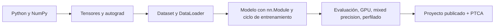

# TensorFlow y PyTorch - certificados y cursos reconocidos

Parte de: [[18-Certificaciones/02 IA y datos/_Índice IA y datos|IA y datos]]

> [!info] Cómo avanzar
> `progreso`: **pendiente** → **viendo** (estudiando) → **visto** (contestaste la autoevaluación sin abrir las respuestas) → **dominado** (hiciste el laboratorio o lo aplicaste de verdad).

## Contenido

### Qué es

TensorFlow y PyTorch son los dos frameworks principales de deep learning. A diferencia de las certificaciones de nube, aquí las credenciales validan que sabes **usar el framework** (tensores, entrenamiento, optimización), independientemente de dónde despliegues. En 2026 el panorama cambió: el certificado de TensorFlow está cerrado y apareció uno oficial de PyTorch.

### TensorFlow Developer Certificate

- **Estado:** el examen está **cerrado**. La página oficial de TensorFlow dice que Google está evaluando el siguiente paso del programa y que el examen no está disponible; no da fecha de regreso.
- **Si ya lo tienes:** la credencial sigue válida **3 años** desde la fecha en que aprobaste, y puedes aparecer en la *Certificate Network* de TensorFlow.
- **Qué hacer hoy:** estudiar con los tutoriales oficiales de tensorflow.org y Keras, y demostrarlo con un proyecto.

### PyTorch Certified Associate (PTCA)

Lanzado por la Linux Foundation junto con la PyTorch Foundation. Datos de la página oficial (revisada el 2026-11-09):

| Dato | Valor |
|---|---|
| Precio | 250 USD solo examen; 299 USD con ruta de aprendizaje; 495 USD con suscripción anual THRIVE-ONE |
| Formato | En línea, supervisado, opción múltiple |
| Duración | 120 minutos |
| Reintento | Uno incluido |
| Plazo para presentarlo | 12 meses desde la compra |
| Vigencia | 2 años |

**Temario y pesos:** fundamentos de PyTorch 38 %, rendimiento y optimización 26 %, desarrollo de modelos 20 %, manejo de datos 16 %.

### Cómo funciona la preparación

Para el temario de PTCA tienes que dominar: tensores y operaciones, `autograd`, construir modelos con `nn.Module`, funciones de pérdida y optimizadores, `Dataset`/`DataLoader` y transformaciones, y lo de rendimiento: mover a GPU, lotes, precisión mixta y detectar cuellos de botella.

### Ejemplo con tu equipo

Tu PC tiene una **GTX 1660 Ti de 6 GB**: suficiente para entrenar modelos pequeños y hacer *fine-tuning* ligero. Un proyecto que demuestra más que cualquier certificado:

1. Clasificador de imágenes de tus fotos de la Sony a6700 (paisaje, retrato, nocturna) con transfer learning sobre un modelo preentrenado.
2. Mides precisión, matriz de confusión y tiempo por época con y sin precisión mixta (la 6 GB obliga a lotes chicos: ese ajuste es justo el dominio de rendimiento del examen).
3. Exportas el modelo a ONNX y lo consumes desde una API .NET con ONNX Runtime, así lo conectas con tu stack.
4. Publicas el repo con un README que explica decisiones y métricas.

### Qué demuestra más que un certificado

Un proyecto público que **entrena, evalúa y despliega**, con métricas y explicación de por qué elegiste cada cosa. Los cursos con certificado de terminación (Coursera, DeepLearning.AI, fast.ai, etc.) sirven como estructura de estudio, pero acreditan haber terminado un curso, no haber pasado un examen supervisado.

### Cuándo usarlo y cuándo no

- **PTCA sí:** si quieres moverte hacia ingeniería de ML y buscas una credencial neutral (no atada a una nube).
- **No:** si tu trabajo es integrar IA vía API (Azure OpenAI, Foundry); ahí te conviene más AI-103 o AI-200 (ver [[Certificaciones de machine learning (Azure, AWS y Google)]]).
- **TensorFlow:** hoy no hay examen; no pagues cursos que prometen "prepararte para el certificado".

### Errores comunes

1. **Comprar preparación para el TensorFlow Certificate** sin revisar que el examen está cerrado.
2. **Estudiar solo teoría** y no el código: PTCA pregunta por la API real de PyTorch.
3. **Ignorar el dominio de rendimiento** (26 %): perfilar, GPU y precisión mixta no salen en tutoriales básicos.
4. **Dejar pasar los 12 meses** de elegibilidad del examen.

### Para profundizar

- [PyTorch Certified Associate (Linux Foundation)](https://training.linuxfoundation.org/certification/pytorch-certified-associate-ptca/)
- [TensorFlow Certificate: estado del programa](https://www.tensorflow.org/certificate)
- [Tutoriales oficiales de PyTorch](https://pytorch.org/tutorials/)

## Autoevaluación

Contesta primero en voz alta o en papel; luego despliega la respuesta.

> [!question]- ¿Existe todavía el TensorFlow Developer Certificate?
> No se puede presentar: Google cerró el examen mientras evalúa el programa. Quien lo obtuvo conserva su credencial por 3 años desde que aprobó.

> [!question]- ¿Hay certificación oficial de PyTorch?
> Sí: **PyTorch Certified Associate (PTCA)** de la Linux Foundation/PyTorch Foundation: 250 USD, 120 min en línea, opción múltiple, vale 2 años e incluye un reintento.

> [!question]- ¿Qué demuestra más que un certificado de curso?
> Un proyecto público (notebook o repo) que entrena, evalúa y despliega un modelo, con métricas y explicación de decisiones.

