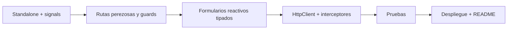

# Angular - certificaciones y cómo demostrar el nivel

Parte de: [[18-Certificaciones/07 Desarrollo/_Índice Desarrollo|Desarrollo]]

> [!info] Cómo avanzar
> `progreso`: **pendiente** → **viendo** (estudiando) → **visto** (contestaste la autoevaluación sin abrir las respuestas) → **dominado** (hiciste el laboratorio o lo aplicaste de verdad).

## Contenido

### Qué es

Angular es el framework de front de Google. **Google no ofrece una certificación oficial de Angular.** Existen certificaciones de empresas privadas y certificados de cursos; su reconocimiento varía mucho (Pendiente de confirmar cuáles se piden en vacantes de tu mercado; revisa ofertas reales antes de pagar). Lo que de verdad demuestra tu nivel es una aplicación moderna bien construida.

### Cómo funciona demostrar nivel en Angular

Angular cambió mucho en sus versiones recientes. Un revisor técnico mira si usas el Angular **actual**:

| Tema | Qué demostrar |
|---|---|
| **Componentes standalone** | Sin `NgModule` para todo; importaciones directas en el componente |
| **Signals** | Estado reactivo con `signal`, `computed` y `effect`; saber cuándo usar RxJS y cuándo signals |
| **Control de flujo** | Sintaxis `@if`, `@for` (con `track`) y `@switch` en plantillas |
| **Routing** | Carga perezosa de rutas, guards funcionales y resolvers |
| **Formularios reactivos** | Tipados, con validadores propios y mensajes de error |
| **HTTP** | `HttpClient` con interceptores funcionales (token, errores) |
| **Pruebas** | Pruebas de componentes y servicios |
| **Rendimiento** | Detección de cambios eficiente, vistas diferidas (`@defer`) |



### Ejemplo: tu app de portafolio

Haz el mismo dominio que ya conoces para comparar con tu versión React: un listado de clientes contra la API de Itzamna.Dionisio.

```typescript
import { Component, computed, inject, signal } from '@angular/core';
import { HttpClient } from '@angular/common/http';

type Cliente = { id: number; nombre: string };

@Component({
  selector: 'app-clientes',
  standalone: true,
  template: `
    <input placeholder="Buscar" (input)="filtro.set($any($event.target).value)" />
    @if (error()) {
      <p role="alert">{{ error() }}</p>
    } @else {
      <ul>
        @for (c of visibles(); track c.id) {
          <li>{{ c.nombre }}</li>
        } @empty {
          <li>Sin resultados</li>
        }
      </ul>
    }
  `,
})
export class ClientesComponent {
  private http = inject(HttpClient);
  clientes = signal<Cliente[]>([]);
  filtro = signal('');
  error = signal<string | null>(null);
  // computed se recalcula solo cuando cambian clientes o filtro
  visibles = computed(() =>
    this.clientes().filter(c => c.nombre.toLowerCase().includes(this.filtro().toLowerCase())));

  constructor() {
    this.http.get<Cliente[]>('/api/clientes').subscribe({
      next: d => this.clientes.set(d),
      error: e => this.error.set(e.error?.codigo ?? 'Error al cargar'),
    });
  }
}
```

Agrega un interceptor funcional que ponga el token de Xolotl.Hecate y traduzca errores de ProblemDetails, pruebas del componente y un pipeline que publique la app.

Fíjate en tres detalles que un revisor nota: `computed` evita recalcular el filtro en cada render, `@for` lleva `track` para que Angular reutilice los elementos de la lista, y el error muestra el `codigo` que devuelve tu API en lugar de un mensaje genérico.

### Cómo prepararte

1. **Recorre la documentación oficial** de angular.dev en orden: componentes, plantillas, signals, inyección de dependencias, routing, formularios y HTTP. Tiene tutoriales interactivos en el navegador.
2. **Crea el proyecto con Angular CLI** (`ng new`) en la versión actual y mantenlo actualizado con `ng update`; actualizar entre versiones también es una habilidad que se pregunta en entrevistas.
3. **Escribe una nota por tema** en tu bóveda con un ejemplo propio, igual que harías para un examen.
4. **Pide una revisión de código** a alguien que trabaje con Angular y corrige lo que te señale.
5. **Documenta decisiones** en el README: por qué signals o RxJS en cada caso, cómo organizaste las rutas y cómo manejas errores.

### Cuándo usarlo y cuándo no

- **Portafolio en Angular:** sí si apuntas a empresas que usan Angular (común en banca y gobierno en México).
- **Certificación privada:** solo si una vacante concreta la pide o tu empresa la paga.
- Si tu stack principal es React, no dupliques esfuerzo: una app en cada uno basta para mostrar que te adaptas.

### Errores comunes

1. **Mostrar proyectos en AngularJS** o con módulos sin migrar, sin explicar el contexto.
2. **Usar `subscribe` anidados** y no limpiar suscripciones; con signals y `takeUntilDestroyed` se evita.
3. **Pagar una certificación sin verificar su reconocimiento** en vacantes reales.
4. **Ignorar `track` en `@for`**: provoca renders de más en listas grandes.

### Para profundizar

- [Documentación oficial de Angular](https://angular.dev/overview)
- [Guía de signals](https://angular.dev/guide/signals)
- [Control de flujo en plantillas](https://angular.dev/guide/templates/control-flow)

## Autoevaluación

Contesta primero en voz alta o en papel; luego despliega la respuesta.

> [!question]- ¿Google tiene certificación oficial de Angular?
> No. Hay certificaciones de terceros (Pendiente de confirmar cuáles tienen reconocimiento en tu mercado).

> [!question]- ¿Cómo demuestras nivel en Angular?
> Una app con componentes standalone, signals, routing con lazy loading, formularios reactivos, interceptores HTTP y pruebas, publicada con su código.

> [!question]- Error común
> Mostrar proyectos con versiones viejas (AngularJS o módulos sin migrar) sin explicar por qué.

