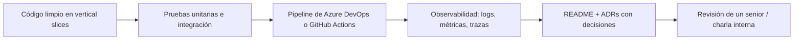

# Certificaciones de CSharp y .NET

Parte de: [[18-Certificaciones/07 Desarrollo/_Índice Desarrollo|Desarrollo]]

> [!info] Cómo avanzar
> `progreso`: **pendiente** → **viendo** (estudiando) → **visto** (contestaste la autoevaluación sin abrir las respuestas) → **dominado** (hiciste el laboratorio o lo aplicaste de verdad).

## Contenido

### Qué es

Es la respuesta a "¿cómo certifico mi C# y .NET?". Hoy Microsoft **no tiene un examen role-based de C#** ni de ASP.NET Core. Lo que existe es una credencial gratuita de nivel básico y, para el lado de nube, las certificaciones de Azure para desarrolladores. Para un perfil senior, la evidencia fuerte es un portafolio bien hecho.

### Qué opciones hay

| Opción | Qué es | Nivel | Costo |
|---|---|---|---|
| **Foundational C# with Microsoft** | Ruta de ~35 h de Microsoft Learn en freeCodeCamp + examen en línea de 80 preguntas en 1 hora | Básico | Gratis |
| [[AI-200 Azure AI Cloud Developer Associate (sucesor de AZ-204)]] | Azure AI Cloud Developer Associate: contenedores, datos con IA, mensajería, seguridad | Intermedio-avanzado | Precio de examen associate en México (se ve al agendar) |
| [[AZ-204 Azure Developer Associate (retirado el 31 de julio de 2026)]] | Azure Developer Associate | — | **Retirado** el 31 de julio de 2026 |
| Portafolio | Repos públicos con pruebas, CI/CD y documentación | Lo que tú demuestres | Tu tiempo |

**Foundational C#:** la desarrollaron Microsoft y freeCodeCamp. Recorres módulos de Microsoft Learn (primera app, lógica, métodos, datos variables, depuración), ganas un trofeo en Learn por curso, firmas el compromiso de honestidad académica de freeCodeCamp y presentas el examen. Es útil para alguien que empieza; para ti, que ya trabajas con .NET 10, aporta poco al CV. Si sigue activa en freeCodeCamp: Pendiente de confirmar al momento de inscribirte.

### Cómo funciona demostrar nivel senior sin examen

Un reclutador técnico o un líder revisa: estructura, manejo de errores, pruebas, cómo despliegas y **por qué** tomaste decisiones. Eso no lo mide ningún examen de opción múltiple.

### Ejemplo: tu repositorio de muestra

Toma una versión pública y sin secretos de Itzamna.Dionisio:

- **API ASP.NET Core con controllers** organizada por vertical slice, una interfaz por consulta y SQL en archivos `.sql` ejecutados con Dapper contra procedimientos de SQL Server.
- **Validación** con FluentValidation y errores como ProblemDetails con tu campo `codigo`.
- **Pruebas:** unitarias de los validadores y handlers; de integración con `WebApplicationFactory` y una base de SQL Server en contenedor.
- **Pipeline YAML** que compila, corre pruebas y publica a Azure App Service o Container Apps.
- **Secretos** fuera del repo (Key Vault o variables del pipeline).
- **README** con diagrama, cómo correrlo y 3–4 ADRs ("por qué Dapper y no EF Core", "por qué procedimientos").

Con ese repo más AI-200 tienes evidencia de código y de nube.

### Cuándo usarlo y cuándo no

- **Foundational C#:** sí si estás enseñando a alguien o cambias de lenguaje; no como credencial de senior.
- **AI-200:** sí si tu trabajo incluye desplegar y operar en Azure.
- **Certificados de pago de sitios desconocidos** ("C# Master Certified"): no; no los reconoce nadie.

### Errores comunes

1. **Seguir preparando AZ-204.** Se retiró; el material viejo no te sirve para AI-200 sin actualizarlo.
2. **Pensar que un certificado sustituye experiencia.** En entrevistas de senior te piden explicar decisiones y trade-offs.
3. **Publicar un repo con secretos** o cadenas de conexión reales. Revisa el historial de Git antes de hacerlo público.
4. **Portafolio sin pruebas ni README**: parece un ejercicio a medias.

### Para profundizar

- [Certificación gratuita Foundational C# (freeCodeCamp)](https://www.freecodecamp.org/news/free-microsoft-c-sharp-certification/)
- [Exámenes retirados de Microsoft](https://learn.microsoft.com/en-us/credentials/support/retired-certification-exams)
- [Documentación de ASP.NET Core](https://learn.microsoft.com/en-us/aspnet/core/)

## Autoevaluación

Contesta primero en voz alta o en papel; luego despliega la respuesta.

> [!question]- ¿Microsoft tiene hoy un examen de C#?
> No hay examen role-based de C#. La credencial gratuita *Foundational C# with Microsoft* (freeCodeCamp + Microsoft Learn) existe como certificado de curso (Pendiente de confirmar que siga activa).

> [!question]- ¿Qué certificación de Azure demuestra desarrollo .NET hoy?
> [[AI-200 Azure AI Cloud Developer Associate (sucesor de AZ-204)]], porque AZ-204 se retiró el 31 de julio de 2026.

> [!question]- ¿Cómo demuestras nivel senior en .NET sin examen?
> Repositorio con API ASP.NET Core probada (pruebas unitarias y de integración), CI/CD, observabilidad y un README con decisiones de arquitectura.

