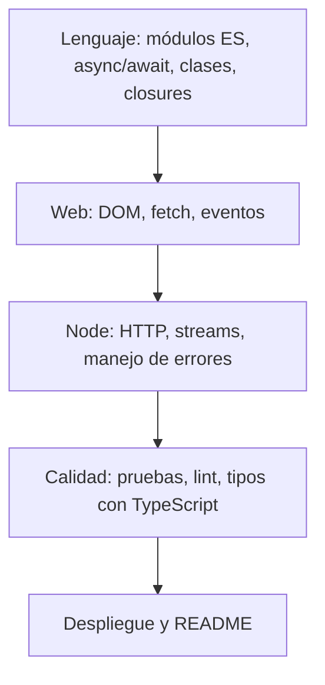

# Certificaciones de JavaScript y Node.js

Parte de: [[18-Certificaciones/07 Desarrollo/_Índice Desarrollo|Desarrollo]]

> [!info] Cómo avanzar
> `progreso`: **pendiente** → **viendo** (estudiando) → **visto** (contestaste la autoevaluación sin abrir las respuestas) → **dominado** (hiciste el laboratorio o lo aplicaste de verdad).

## Contenido

### Qué es

JavaScript no tiene un dueño único que emita una certificación "oficial" del lenguaje. Durante años la referencia fueron las certificaciones de Node.js de la **OpenJS Foundation** con la Linux Foundation: **JSNAD** (Node.js Application Developer) y **JSNSD** (Node.js Services Developer). Eso cambió: hoy no cuentes con ellas. Esta nota explica qué queda y qué hacer en su lugar.

### Estado actual

- **JSNAD:** la página oficial de la Linux Foundation dice que el examen **se retiró el 30 de septiembre de 2025** y ya no se vende.
- **JSNSD:** aparece igualmente como inactiva en el catálogo de la Linux Foundation (fecha exacta de retiro: Pendiente de confirmar).
- **Quien ya la tiene** conserva la credencial hasta su vencimiento (Pendiente de confirmar la política exacta de vigencia tras el retiro).
- **Otras opciones:** certificados de curso gratuitos como los de freeCodeCamp (por ejemplo, su certificación de JavaScript con proyectos). Son de curso, no exámenes supervisados; el nombre y formato exactos de cada una: Pendiente de confirmar en freecodecamp.org.

### Cómo funciona demostrar JavaScript

Sin una certificación de peso, el criterio de un equipo técnico es tu código. Lo que buscan:



### Ejemplo: dos proyectos que valen más que un certificado

1. **Front sin bundler (JavaScript ES2022):** un panel ligero para Wee.Reporteria que carga reportes con `fetch`, usa módulos nativos (`<script type="module">`), `async/await`, manejo de errores con `try/catch` y muestra estados de carga. Sin frameworks, para demostrar que dominas el lenguaje.
2. **SPA con React + Vite + TypeScript:** lo que ya haces en Itzamna.Clio: rutas, estado, llamadas a tu API, pruebas con Testing Library y Vitest, y un pipeline que la publica.

Un ejemplo pequeño de lo que un revisor quiere ver: manejo correcto de errores en llamadas asíncronas.

```javascript
// Carga un reporte y distingue errores HTTP de errores de red
export async function cargarReporte(id, { signal } = {}) {
  const resp = await fetch(`/api/reportes/${encodeURIComponent(id)}`, { signal });
  if (!resp.ok) {
    const problema = await resp.json().catch(() => ({}));
    throw new Error(problema.codigo ?? `HTTP ${resp.status}`);
  }
  return resp.json();
}
```

Fíjate que lee el `codigo` del ProblemDetails que devuelve tu API, como en tus reglas de proyecto.

### Cuándo usarlo y cuándo no

- **Certificados de freeCodeCamp:** sí como estructura si estás aprendiendo o para alguien junior.
- **Para senior:** no busques certificación; invierte el tiempo en un proyecto con pruebas y en contribuir a uno de código abierto.
- **Si tu rol es nube**, una certificación de Azure o AWS sí pesa más que cualquier certificado de JavaScript.
- **Para medirte sin examen**, pide a un compañero senior una revisión de código de tu proyecto o resuelve una prueba técnica cronometrada; anota en tu bóveda los temas que te cuesten (por ejemplo, el ciclo de eventos o el manejo de streams en Node).

### Errores comunes

1. **Comprar preparación para JSNAD** en sitios que siguen vendiendo cursos de un examen retirado.
2. **Pagar "certificaciones" de sitios sin reconocimiento.** Ningún reclutador serio las filtra.
3. **Portafolio solo con tutoriales** (la app de tareas): agrega un problema real, como tus reportes.
4. **Ignorar TypeScript**: muchas vacantes lo piden aunque digan "JavaScript".

### Para profundizar

- [JSNAD: aviso de retiro (Linux Foundation)](https://training.linuxfoundation.org/certification/jsnad)
- [MDN: guía de JavaScript](https://developer.mozilla.org/es/docs/Web/JavaScript/Guide)
- [Documentación de Node.js](https://nodejs.org/docs/latest/api/)

## Autoevaluación

Contesta primero en voz alta o en papel; luego despliega la respuesta.

> [!question]- ¿Siguen las certificaciones de Node.js de la OpenJS Foundation (JSNAD y JSNSD)?
> La Linux Foundation las marca como **inactivas** (“JSNAD Cert Inactive”, “JSNSD Cert Inactive”): no cuentes con poder presentarlas.

> [!question]- ¿Qué alternativa tienes para demostrar JavaScript?
> Proyectos públicos (por ejemplo, una SPA y una API en Node) con pruebas y despliegue, y certificados gratuitos de cursos como los de freeCodeCamp (son de curso, no exámenes supervisados).

> [!question]- Error común
> Pagar certificados de sitios sin reconocimiento: en entrevistas pesa más el código que puedes mostrar.

