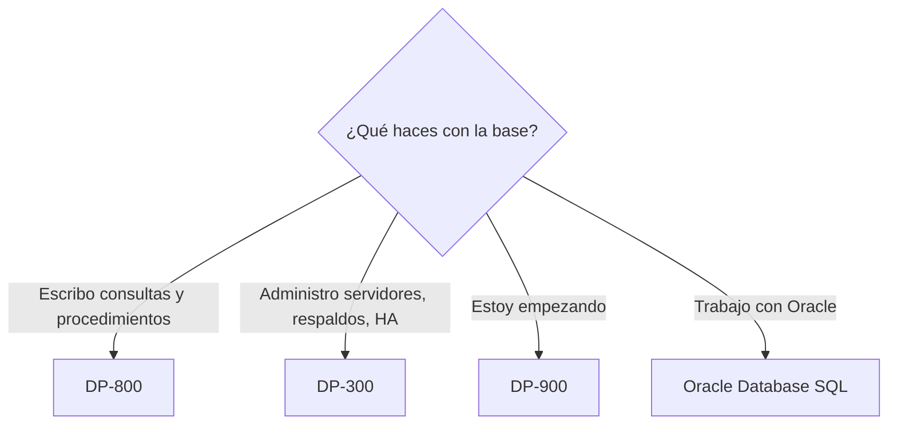

# Certificaciones de SQL y bases de datos

Parte de: [[18-Certificaciones/07 Desarrollo/_Índice Desarrollo|Desarrollo]]

> [!info] Cómo avanzar
> `progreso`: **pendiente** → **viendo** (estudiando) → **visto** (contestaste la autoevaluación sin abrir las respuestas) → **dominado** (hiciste el laboratorio o lo aplicaste de verdad).

## Contenido

### Qué es

Es el mapa de certificaciones que validan SQL y bases de datos, pensado para alguien que escribe T-SQL y procedimientos todos los días (Itzamna.Dionisio con Dapper) y también usa PostgreSQL (Pochteca.Nomisma). Las opciones principales son de Microsoft, con una novedad de 2026 orientada a desarrolladores, más la de Oracle.

### Opciones de Microsoft

| Examen | Certificación | Enfoque | Para ti |
|---|---|---|---|
| DP-900 | Azure Data Fundamentals ([[DP-900 Azure Data Fundamentals]]) | Conceptos: relacional vs. no relacional, OLTP/OLAP | Opcional, no vence |
| DP-300 | Azure Database Administrator Associate ([[DP-300 Azure Database Administrator]]) | Administración: seguridad, rendimiento, automatización, HA/DR | Útil para rendimiento y alta disponibilidad, pero es de DBA |
| **DP-800** | **SQL AI Developer Associate** (examen *Developing AI-Enabled Database Solutions*) | Desarrollo de bases de datos con T-SQL avanzado, CI/CD e IA | La más alineada a tu trabajo |

### DP-800 en detalle

Según la guía de estudio oficial (temario vigente desde el 12 de marzo de 2026; calificación mínima 700):

- **Diseñar y desarrollar soluciones de base de datos (35–40 %):** tablas especiales (temporales, ledger, grafos, in-memory), JSON, particionamiento, vistas, funciones, **procedimientos almacenados**, triggers, CTE, funciones de ventana, manejo de errores y herramientas de IA como GitHub Copilot y servidores MCP.
- **Asegurar, optimizar y desplegar (35–40 %):** Always Encrypted, enmascaramiento dinámico, **Row-Level Security**, acceso sin contraseña, auditoría; planes de ejecución, **Query Store**, bloqueos y deadlocks, niveles de aislamiento; CI/CD con **SQL Database Projects**; Data API builder, CDC y Change Tracking.
- **Implementar IA en la base de datos (25–30 %):** embeddings, búsqueda vectorial, de texto completo e híbrida, RAG llamando modelos con `sp_invoke_external_rest_endpoint`.

Cubre SQL Server, Azure SQL y bases SQL en Microsoft Fabric. La guía menciona una evaluación de práctica nueva en AI Skills Navigator.

### Cómo funciona la elección

### Ejemplo: cómo se cruza con tu trabajo

Tu regla de "SQL en archivos `.sql` con una interfaz por consulta" encaja con lo que mide DP-800:

- Tus procedimientos usan `TRY...CATCH` y `THROW` → dominio de manejo de errores.
- Versionas el esquema en un **SQL Database Project** y lo publicas desde Azure DevOps → dominio de CI/CD y detección de *schema drift*.
- Un reporte lento de Wee.Reporteria lo diagnosticas con **Query Store** y el plan de ejecución → dominio de rendimiento.
- Agregas búsqueda semántica de productos con columnas de vectores → dominio de IA.

Para prepararte, haz cada uno de esos puntos en una copia de tu base de desarrollo y documenta el resultado en tu bóveda.

### Oracle y PostgreSQL

- **Oracle Database SQL Certified Associate:** existe; código, precio y duración actuales Pendiente de confirmar en education.oracle.com. Solo vale la pena si trabajas con Oracle.
- **PostgreSQL:** no hay una certificación de la comunidad del proyecto; existen de proveedores comerciales (Pendiente de confirmar cuáles tienen reconocimiento en México).

### Cuándo usarlo y cuándo no

- **DP-800:** sí, si escribes T-SQL serio y quieres algo que hable de tu trabajo real.
- **DP-300:** sí si te toca operar Azure SQL (respaldos, réplicas, rendimiento de la instancia).
- **No** tomes DP-300 creyendo que es "la de SQL para desarrolladores": es de administración.

### Errores comunes

1. **Confundir DP-300 con un examen de T-SQL.** Pregunta mucho de configuración, HA/DR y automatización.
2. **Estudiar solo SQL Server local** para DP-800: también pregunta por Azure SQL y Fabric.
3. **Ignorar la parte de IA** (25–30 %): vectores y RAG en la base son nuevos para muchos.
4. **No practicar SQL Database Projects**: la mayoría de equipos despliega scripts a mano.

### Para profundizar

- [Guía de estudio DP-800](https://learn.microsoft.com/credentials/certifications/resources/study-guides/dp-800)
- [Azure Database Administrator Associate (DP-300)](https://learn.microsoft.com/en-us/credentials/certifications/azure-database-administrator-associate/)
- [Documentación de Query Store](https://learn.microsoft.com/en-us/sql/relational-databases/performance/monitoring-performance-by-using-the-query-store)

## Autoevaluación

Contesta primero en voz alta o en papel; luego despliega la respuesta.

> [!question]- ¿Qué certificaciones de Microsoft cubren SQL?
> [[DP-900 Azure Data Fundamentals]] (fundamentos), [[DP-300 Azure Database Administrator]] (administración en Azure) y la nueva DP-800 *Developing AI-Enabled Database Solutions* (SQL AI Developer Associate).

> [!question]- Eres desarrollador, no DBA. ¿DP-300 te sirve?
> Sí para rendimiento, seguridad y alta disponibilidad, pero es de administración; DP-800 está más orientada a desarrolladores (Pendiente de confirmar su temario final).

> [!question]- ¿Oracle tiene un examen de SQL?
> Sí, Oracle Database SQL (Pendiente de confirmar código y precio en education.oracle.com).

