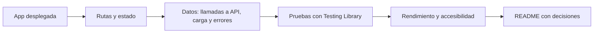

# React - por qué no hay certificación oficial y qué hacer en su lugar

Parte de: [[18-Certificaciones/07 Desarrollo/_Índice Desarrollo|Desarrollo]]

> [!info] Cómo avanzar
> `progreso`: **pendiente** → **viendo** (estudiando) → **visto** (contestaste la autoevaluación sin abrir las respuestas) → **dominado** (hiciste el laboratorio o lo aplicaste de verdad).

## Contenido

### Qué es

React es una biblioteca de código abierto mantenida por Meta y la comunidad. **No existe un examen oficial de certificación de React.** Lo que circula son certificados de **cursos** (por ejemplo, los programas profesionales de Meta en Coursera) o "certificaciones" de empresas privadas. Esta nota explica por qué y cómo demostrar tu nivel en su lugar.

### Por qué no hay certificación oficial

- React es una biblioteca, no una plataforma con servicios de pago; el proyecto no tiene un programa de exámenes.
- El ecosistema cambia rápido (Hooks, Server Components, compiladores, frameworks como Next.js o React Router): un examen fijo quedaría viejo pronto.
- En la práctica, los equipos evalúan React con **código**: una prueba técnica, un repo o una sesión de *pair programming*.

Un **certificado de curso** acredita que terminaste un curso y sus tareas. Un **examen de certificación** se presenta supervisado y mide conocimiento contra un temario. No son lo mismo y en entrevistas pesan distinto.

### Cómo funciona demostrar React



### Ejemplo: tu app de portafolio

Construye una versión pública de una pantalla de Itzamna.Clio con **React + Vite + TypeScript**:

- **Rutas** con carga perezosa de páginas.
- **Estado:** estado local con `useState`/`useReducer`, estado de servidor con una biblioteca de caché de datos o un hook propio, y contexto solo para lo global (sesión).
- **Datos:** llamadas a tu API .NET, manejo de `codigo` de ProblemDetails para mostrar mensajes, estados de carga y vacío.
- **Autenticación** con PKCE contra Xolotl.Hecate (o un mock), sin guardar tokens en `localStorage`.
- **Pruebas** con Vitest y React Testing Library: probar lo que ve el usuario, no la implementación.
- **Rendimiento:** medir con el Profiler de React DevTools, evitar renders innecesarios y dividir el bundle.
- **Accesibilidad:** etiquetas, foco y navegación con teclado.

Un componente de ejemplo con lo que un revisor busca (tipos, estados y cancelación):

```tsx
import { useEffect, useState } from "react";

type Cliente = { id: number; nombre: string };

export function ListaClientes() {
  const [datos, setDatos] = useState<Cliente[] | null>(null);
  const [error, setError] = useState<string | null>(null);

  useEffect(() => {
    const ctrl = new AbortController();
    fetch("/api/clientes", { signal: ctrl.signal })
      .then(async (r) => {
        if (!r.ok) throw new Error((await r.json()).codigo ?? `HTTP ${r.status}`);
        return r.json() as Promise<Cliente[]>;
      })
      .then(setDatos)
      .catch((e: Error) => { if (e.name !== "AbortError") setError(e.message); });
    return () => ctrl.abort(); // cancela si el componente se desmonta
  }, []);

  if (error) return <p role="alert">No se pudo cargar: {error}</p>;
  if (!datos) return <p>Cargando…</p>;
  if (datos.length === 0) return <p>Sin clientes.</p>;
  return <ul>{datos.map((c) => <li key={c.id}>{c.nombre}</li>)}</ul>;
}
```

### Cuándo sí vale un certificado de curso

- Cuando empiezas y necesitas un plan con orden y fechas.
- Cuando tu empresa paga la plataforma y el certificado cuenta para tu evaluación interna.
- Nunca como sustituto del portafolio.

### Cuándo usarlo y cuándo no

- **Portafolio:** siempre, si buscas un puesto de front o full stack.
- **Certificación de nube** (por ejemplo [[AI-200 Azure AI Cloud Developer Associate (sucesor de AZ-204)]]): si quieres una credencial formal, aporta más que un certificado de React.

### Errores comunes

1. **Pagar "certificaciones de React"** de sitios sin reconocimiento.
2. **Mostrar solo apps de tutorial** sin pruebas ni manejo de errores.
3. **Código viejo** con componentes de clase sin explicar por qué.
4. **No desplegar**: un repo sin demo en línea pierde la mitad del impacto.

### Para profundizar

- [Documentación oficial de React](https://react.dev/learn)
- [React Testing Library](https://testing-library.com/docs/react-testing-library/intro/)
- [Guía de Vite](https://vite.dev/guide/)

## Autoevaluación

Contesta primero en voz alta o en papel; luego despliega la respuesta.

> [!question]- ¿Meta ofrece una certificación oficial de React?
> No hay examen oficial de React. Existen certificados de curso (por ejemplo, programas de Meta en Coursera), que acreditan haber terminado un curso, no un examen supervisado.

> [!question]- ¿Qué muestras en lugar de una certificación?
> Una app desplegada con rutas, estado, llamadas a API, pruebas (Testing Library) y buen rendimiento; enlázala en tu CV.

> [!question]- ¿Cuándo sí vale un certificado de curso?
> Cuando empiezas y necesitas estructura; no sustituye al portafolio.

