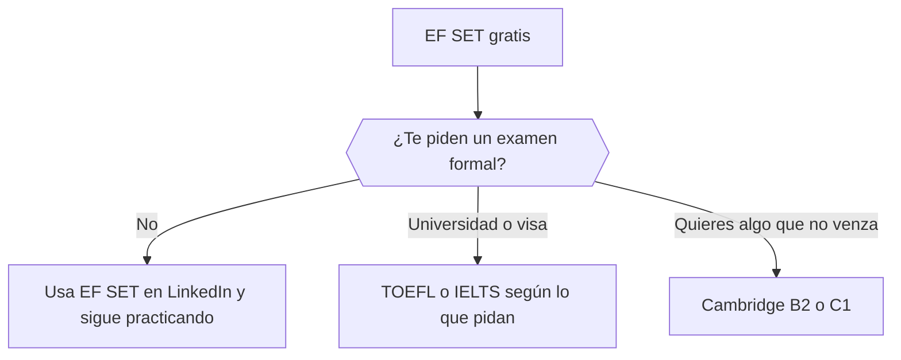

# Certificaciones de inglés (TOEFL, IELTS, Cambridge y EF SET)

Parte de: [[18-Certificaciones/08 Arquitectura, gestión y liderazgo/_Índice Arquitectura, gestión y liderazgo|Arquitectura, gestión y liderazgo]]

> [!info] Cómo avanzar
> `progreso`: **pendiente** → **viendo** (estudiando) → **visto** (contestaste la autoevaluación sin abrir las respuestas) → **dominado** (hiciste el laboratorio o lo aplicaste de verdad).

## Contenido

### Qué es

Son exámenes que miden tu nivel de inglés con una escala reconocida. Casi todos se alinean al **MCER** (Marco Común Europeo de Referencia: A1, A2, B1, B2, C1, C2). Para un desarrollador en México sirven para trabajo remoto con empresas de fuera, para puestos que piden "inglés avanzado comprobable" y para estudios en el extranjero. Además, casi todas las certificaciones de esta área se presentan en inglés o tienen mejor material en inglés.

### Comparación

| Examen | Costo | Formato | Vigencia | Para qué sirve |
|---|---|---|---|---|
| **EF SET 50** | Gratis (certificado incluido) | En línea, 50 min, comprensión de lectura y auditiva | No aplica (lo repites cuando quieras) | Medirte y poner un enlace en LinkedIn |
| **TOEFL iBT** | Pendiente de confirmar en México (consúltalo en ets.org) | 4 secciones; desde el 21 de enero de 2026 se califica en escala **1–6** alineada al MCER | **2 años** desde la fecha del examen | Universidades, visas, algunas empresas |
| **IELTS** | Pendiente de confirmar en México | 4 habilidades, en papel o computadora | Oficialmente **2 años** desde la fecha del examen | Universidades, migración (Reino Unido, Canadá, Australia) |
| **Cambridge** (B2 First, C1 Advanced, C2 Proficiency) | Pendiente de confirmar | 4 habilidades, examen por nivel | **El certificado no vence** (cada institución decide qué antigüedad acepta) | Prueba duradera de un nivel |

### Cómo funciona cada escala

- **EF SET** da un resultado en escala MCER; es útil para saber dónde estás antes de pagar un examen.
- **TOEFL iBT:** desde el 21 de enero de 2026 el reporte usa una escala de 1 a 6 en medios puntos, con cuatro calificaciones de sección y una global; durante dos años el reporte también muestra el equivalente en la escala anterior 0–120.
- **IELTS** usa bandas de 0 a 9.
- **Cambridge** otorga un certificado del nivel que acreditas (por ejemplo, C1) con una puntuación en su escala.

### Ejemplo: tu plan

1. Haz el **EF SET 50** este mes. Supón que sale B2.
2. Practica lo que más se usa en tu trabajo: leer documentación, escribir PRs y ADRs en inglés, y hablar en *dailies* (ver [[Inglés técnico - plan de estudio]]).
3. Si una empresa extranjera pide prueba formal, pregunta cuál aceptan **antes** de pagar; muchas aceptan IELTS o TOEFL, y algunas se conforman con una entrevista en inglés.
4. Si quieres algo para tu CV que no caduque, apunta a **C1 Advanced** de Cambridge cuando tu EF SET marque C1 de forma consistente.

### Cuándo usarlo y cuándo no

- **EF SET:** siempre como punto de partida; no siempre lo aceptan universidades o empresas como prueba formal.
- **TOEFL/IELTS:** cuando un trámite lo exige; caducan a los 2 años, así que preséntalo cerca de la fecha en que lo necesitas.
- **Cambridge:** cuando quieres una credencial duradera.
- Para trabajo remoto, muchas veces la entrevista técnica en inglés pesa más que cualquier certificado.

### Errores comunes

1. **Presentar TOEFL o IELTS "por si acaso"** y que se venza antes de usarlo.
2. **No revisar qué examen acepta** la universidad o empresa: cada una tiene su lista y su calificación mínima.
3. **Confundir la escala nueva del TOEFL** (1–6) con la vieja (0–120) al leer requisitos.
4. **Solo estudiar gramática:** en el trabajo te evalúan por cómo explicas una decisión técnica en una llamada.

### Para profundizar

- [EF SET 50 (gratis)](https://www.efset.org/ef-set-50)
- [TOEFL iBT: cómo entender las calificaciones (ETS)](https://www.ets.org/toefl/test-takers/ibt/scores/understand-scores)
- [Cambridge English: preguntas frecuentes (vigencia del certificado)](https://cambridgeenglish.org/exams-and-tests/qualifications/business/faqs)

## Autoevaluación

Contesta primero en voz alta o en papel; luego despliega la respuesta.

> [!question]- ¿Cuál es gratuita?
> EF SET: examen en línea gratis con resultado en la escala del MCER (A1–C2). Sirve para medirte, pero no siempre la aceptan empresas o universidades.

> [!question]- ¿Qué diferencia hay entre TOEFL/IELTS y Cambridge?
> TOEFL e IELTS dan una calificación con vigencia típica de 2 años (Pendiente de confirmar en cada sitio); los exámenes de Cambridge (B2 First, C1 Advanced) dan un certificado de nivel que no vence.

> [!question]- ¿Cuál te conviene para trabajo remoto?
> Primero EF SET para saber tu nivel; si un empleador pide prueba formal, IELTS o TOEFL. Ver [[Inglés técnico - plan de estudio]].

