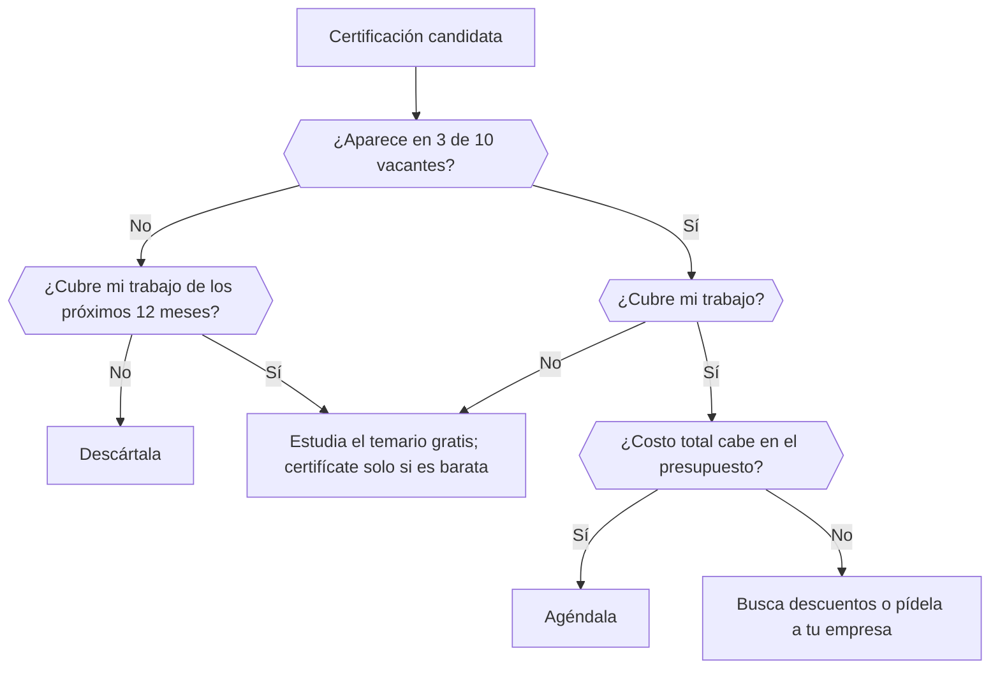

# Cómo decidir qué certificación vale la pena

Parte de: [[18-Certificaciones/08 Arquitectura, gestión y liderazgo/_Índice Arquitectura, gestión y liderazgo|Arquitectura, gestión y liderazgo]]

> [!info] Cómo avanzar
> `progreso`: **pendiente** → **viendo** (estudiando) → **visto** (contestaste la autoevaluación sin abrir las respuestas) → **dominado** (hiciste el laboratorio o lo aplicaste de verdad).

## Contenido

### Qué es

Es un método para decidir **antes de pagar** si una certificación te conviene. Una certificación vale la pena cuando abre una puerta concreta (un filtro de RR. HH., un requisito de cliente, un ascenso) o cuando su temario te obliga a aprender algo que vas a usar. Si no cumple ninguna de las dos, probablemente es gasto.

### Cómo funciona: las tres preguntas

1. **¿Lo piden las vacantes que quiero?** Busca 10 ofertas del puesto al que apuntas (por ejemplo, "Senior .NET Azure" o "Arquitecto de soluciones") y cuenta cuántas mencionan la certificación. Si aparece en 3 o más, pesa.
2. **¿Cubre lo que uso o voy a usar?** Compara el temario oficial con tu trabajo de los próximos 12 meses. Si coinciden más de la mitad de los temas, el estudio te sirve aunque nunca muestres el certificado.
3. **¿El costo total cabe?** Suma examen (precio en México), posible reintento, material, curso obligatorio si lo hay, cuotas anuales y renovación.

### Certificación o proyecto

- **Nube y seguridad:** las certificaciones abren filtros de RR. HH. y a veces son requisito de clientes o de *partners* (Azure, AWS, CompTIA, ISC2).
- **Desarrollo de front y lenguajes:** pesa más el portafolio. React y Angular no tienen certificación oficial, y la de Node.js se retiró (ver [[React - por qué no hay certificación oficial y qué hacer en su lugar]] y [[Certificaciones de JavaScript y Node.js]]).
- **Arquitectura y liderazgo:** combinación; [[AZ-305 Azure Solutions Architect Expert]] o [[TOGAF]] ayudan, pero te piden casos reales.

### Ejemplo: tres candidatas evaluadas

| Candidata | Vacantes (de 10) | Coincide con tu trabajo | Costo y renovación | Decisión |
|---|---|---|---|---|
| [[AZ-104 Azure Administrator Associate]] | 5 | Alto (tus despliegues) y es requisito de AZ-305 | Examen associate; renovación gratis | **Sí** |
| [[CEH]] | 0 para desarrollador | Bajo | Paquetes desde 1,699 USD con curso | **No** por ahora |
| [[Scrum (PSM y PSPO)]] | 2 | Medio (ya trabajas en sprints) | 200 USD, de por vida | Opcional, si te piden liderar el proceso |

La tabla es ilustrativa: haz tu propio conteo con vacantes reales del momento.

### Señales de alerta

- **Curso obligatorio caro** con poco reconocimiento en el mercado.
- **Temario sin actualizar** desde hace años (revisa la fecha de la guía oficial; por ejemplo, la guía de [[Spring Professional]] menciona versiones viejas de Spring Boot).
- **Examen retirado o por retirarse:** revisa listas oficiales de retiros antes de comprar material.
- **Cuotas anuales** que no esperabas (CompTIA, ISC2).
- **Promesas de "aprobado garantizado"** o venta de preguntas reales: son *dumps* y te pueden revocar la certificación.

### Cuándo usarlo y cuándo no

- Usa el método para **cada** certificación antes de comprarla.
- No lo uses para frenar el aprendizaje: estudiar un temario oficial gratuito (Microsoft Learn, Web Security Academy, Packet Tracer) casi siempre vale la pena aunque no presentes el examen.

### Errores comunes

1. **Coleccionar Fundamentals** porque son fáciles; no diferencian tu perfil de senior.
2. **Elegir por lo que dice un video** y no por vacantes reales de tu mercado.
3. **Olvidar el costo de mantenerla** (renovación, CPE, cuotas).
4. **Certificarte en algo que no usarás**: lo olvidas en seis meses.

### Para profundizar

- [Exámenes retirados de Microsoft](https://learn.microsoft.com/en-us/credentials/support/retired-certification-exams)
- [Política de reintentos de Microsoft (para calcular el costo de reprobar)](https://learn.microsoft.com/en-us/credentials/support/retake-policy)
- Plan y presupuesto: [[Plan de certificaciones (calendario y presupuesto)]]

## Autoevaluación

Contesta primero en voz alta o en papel; luego despliega la respuesta.

> [!question]- Tres preguntas antes de pagar un examen
> 1) ¿Lo piden las vacantes que quiero (revisa 10 ofertas)? 2) ¿Cubre lo que uso o voy a usar en el trabajo? 3) ¿Su costo total (examen, renovación, curso obligatorio) cabe en mi presupuesto?

> [!question]- ¿Certificación o proyecto?
> Para roles de nube y seguridad la certificación abre filtros de RR. HH.; para desarrollo (React, Angular, .NET) pesa más el portafolio.

> [!question]- Señal de alerta
> Certificaciones con curso obligatorio caro y poco reconocimiento, o exámenes cuyo temario no se actualiza desde hace años (revisa la fecha de la guía oficial).

