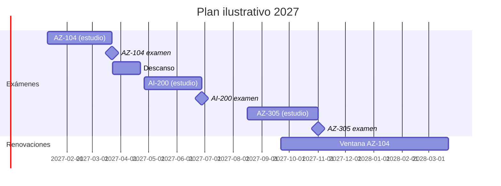

# Plan de certificaciones (calendario y presupuesto)

Parte de: [[18-Certificaciones/08 Arquitectura, gestión y liderazgo/_Índice Arquitectura, gestión y liderazgo|Arquitectura, gestión y liderazgo]]

> [!info] Cómo avanzar
> `progreso`: **pendiente** → **viendo** (estudiando) → **visto** (contestaste la autoevaluación sin abrir las respuestas) → **dominado** (hiciste el laboratorio o lo aplicaste de verdad).

## Contenido

### Qué es

Es tu plan escrito de qué certificaciones vas a presentar, en qué orden, en qué fechas y cuánto te van a costar, incluidas las renovaciones. Sirve para no improvisar exámenes, no encimar renovaciones y saber cuánto dinero apartar o pedir a tu empresa.

### Cómo funciona

**Calendario**

- **Una certificación a la vez.** Agenda la fecha del examen al empezar a estudiar: tener fecha evita que el estudio se alargue.
- **Duración orientativa:** 3–4 semanas para una Fundamentals, 8–12 para una associate, 10–12 para una expert (ajústalo con tus resultados en evaluaciones de práctica).
- **Descanso de 1–2 meses** entre exámenes grandes.
- **Ventanas de renovación:** en Microsoft se abren 6 meses antes del vencimiento; anótalas desde el día que obtienes cada certificación.

**Presupuesto**

Por cada certificación suma:

1. Precio del examen **en México** (Microsoft lo muestra al agendar en Pearson VUE; varía por país y lleva impuestos).
2. Un **posible reintento**. En Microsoft puedes reintentar a las 24 horas y luego cada 14 días, hasta 5 intentos en 12 meses; cada intento se paga.
3. Simulacros o libros si los necesitas.
4. **Cuotas y renovación:** Microsoft renueva gratis; CompTIA e ISC2 cobran cuota anual y piden educación continua; Terraform y Kubernetes se vuelven a presentar.

### Ejemplo: presupuesto en tabla

| Certificación | Examen | Reintento previsto | Material | Renovación anual | Total año 1 |
|---|---|---|---|---|---|
| [[AZ-104 Azure Administrator Associate]] | Precio en MXN al agendar (Pendiente de confirmar) | 1 × mismo precio (reserva) | 0 (Microsoft Learn) | 0 | Examen × 2 en el peor caso |
| [[AI-200 Azure AI Cloud Developer Associate (sucesor de AZ-204)]] | Precio en MXN al agendar (Pendiente de confirmar) | Reserva | 0 | 0 | Igual |
| [[AWS Cloud Practitioner]] (si la necesitas) | 100 USD más cargos | Reserva | 0 (Skill Builder gratis) | 0 (dura 3 años) | 100–200 USD |
| [[Scrum (PSM y PSPO)]] | 200 USD por intento | Reserva | 0 (Guía Scrum) | 0 (de por vida) | 200–400 USD |

Llena la columna de Microsoft con el precio exacto que te muestre Pearson VUE para México y convierte todo a pesos con el tipo de cambio del día. Si tu empresa tiene presupuesto de capacitación, presenta esta tabla con la justificación de [[Cómo decidir qué certificación vale la pena]].

### Cómo bajar costos

- **Ofertas oficiales**: exámenes beta de Microsoft con descuento, promociones de la Linux Foundation, descuento académico de Microsoft si eres estudiante verificado.
- **Recursos gratuitos**: Microsoft Learn y sus evaluaciones de práctica, Cisco Packet Tracer, Web Security Academy, Guía Scrum.
- **Empresa:** muchos *partners* de Microsoft tienen vouchers para empleados.
- Detalles en [[Vouchers y descuentos de examen]].

### Cuándo usarlo y cuándo no

- **Sí:** en cuanto planeas más de una certificación en un año.
- Revísalo **cada trimestre**: los exámenes se retiran y los precios cambian.
- No lo conviertas en una lista rígida: si cambias de empleo y la nueva empresa usa AWS, reordena.

### Errores comunes

1. **No reservar dinero para un reintento** y posponer el examen meses.
2. **Encimar renovaciones** de varias certificaciones en el mismo mes.
3. **Calcular en USD** sin impuestos ni tipo de cambio.
4. **Planear demasiado**: cinco exámenes en un año suele terminar en tres reprobados.

### Para profundizar

- [Política de reintentos de Microsoft](https://learn.microsoft.com/en-us/credentials/support/retake-policy)
- [Renovación de certificaciones de Microsoft](https://learn.microsoft.com/en-us/credentials/certifications/renew-your-microsoft-certification-faq)
- [Descuentos para estudiantes (Microsoft)](https://learn.microsoft.com/en-us/certifications/student-discounts)

## Autoevaluación

Contesta primero en voz alta o en papel; luego despliega la respuesta.

> [!question]- ¿Cómo armas el calendario?
> Una certificación a la vez, con fecha de examen agendada al iniciar (8–12 semanas para associate). Deja al menos 1–2 meses entre exámenes y anota las ventanas de renovación.

> [!question]- ¿Qué entra en el presupuesto?
> Precio del examen en tu país, un posible reintento, simulacros, cuotas anuales (CompTIA, ISC2) y renovaciones (gratis en Microsoft; con costo en otras).

> [!question]- ¿Cómo bajas costos?
> Ofertas oficiales (exámenes beta de Microsoft con descuento, promociones de Linux Foundation, descuentos de estudiante) y recursos gratuitos (Microsoft Learn, Packet Tracer, Web Security Academy). Ver [[Vouchers y descuentos de examen]].

