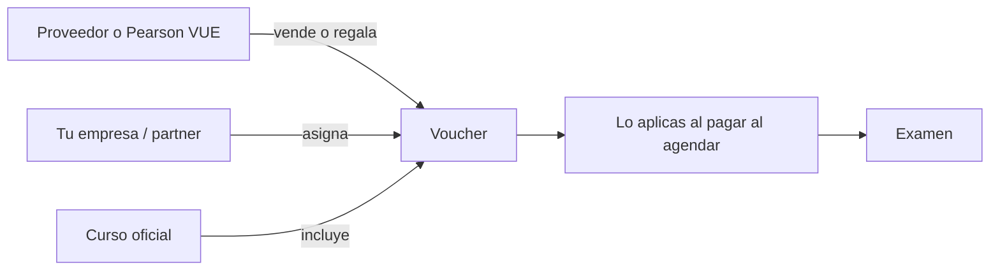

# Vouchers y descuentos de examen

Parte de: [[18-Certificaciones/08 Arquitectura, gestión y liderazgo/_Índice Arquitectura, gestión y liderazgo|Arquitectura, gestión y liderazgo]]

> [!info] Cómo avanzar
> `progreso`: **pendiente** → **viendo** (estudiando) → **visto** (contestaste la autoevaluación sin abrir las respuestas) → **dominado** (hiciste el laboratorio o lo aplicaste de verdad).

## Contenido

### Qué es

Un **voucher** es un código prepagado que cubre todo o parte del costo de un examen. Los **descuentos** pueden venir del proveedor (exámenes beta, promociones, precio académico), de tu empresa (beneficios de *partner*) o de un curso oficial que incluye el examen. Bien usados te ahorran mucho; comprados en el lugar equivocado te pueden costar la certificación.

### Cómo funciona

Al agendar el examen (en Pearson VUE o en el portal del proveedor) escribes el código en el paso de pago. Cada voucher tiene condiciones: qué exámenes cubre, fecha de caducidad, país y si incluye reintento.

### Descuentos de Microsoft

- **Exámenes beta:** Microsoft ofrece descuento a un número limitado de personas que presentan un examen nuevo en beta. Ejemplo real: para **SC-500** en beta, las primeras 300 personas que lo presentaran antes del 8 de junio de 2026 tenían 80 % de descuento. Microsoft anuncia estas ofertas en su blog de Tech Community. Ojo: el resultado de un beta tarda más en llegar y, si repruebas, no puedes reintentar hasta que el examen salga de beta.
- **Precio académico:** Microsoft ofrece descuento a estudiantes verificados en la mayoría de los países (excepto India y China); te identificas como estudiante en tu perfil de Learn y verificas tu estatus. El monto exacto se ve al registrarte.
- **Empresa:** los *partners* de Microsoft suelen tener vouchers para empleados; pregunta a tu líder o a RR. HH.

### Otros proveedores

| Proveedor | Descuento o beneficio | Caducidad |
|---|---|---|
| CompTIA | Descuento para estudiantes con credencial y correo académico | Según el voucher |
| Scrum.org | Un curso oficial incluye un intento del examen | La contraseña de examen no caduca |
| Linux Foundation | Promociones frecuentes y paquetes (CKAD/CKA traen reintento y simulador) | 12 meses para presentar desde la compra |
| INE (eJPT) | Voucher con reintento gratis | Vence a los **180 días** |
| PortSwigger (BSCP) | Crédito de examen | **No caduca** |
| AWS, Cisco NetAcad | Beneficios por cursos o retos | Pendiente de confirmar en sus páginas |

### Ejemplo

Quieres presentar [[AZ-104 Azure Administrator Associate]] y [[AZ-500 y SC-500 (seguridad en Azure)]] este año:

1. Preguntas en tu empresa si hay vouchers de *partner*: te dan uno para AZ-104.
2. Revisas el blog de Tech Community por exámenes beta: si sale uno que te interesa, te registras rápido (los cupos con descuento se acaban).
3. Para el reintento previsto, apartas el precio normal en tu [[Plan de certificaciones (calendario y presupuesto)]].
4. Anotas en la nota de cada examen el código, de dónde salió y su fecha de caducidad.

### Cuándo usarlo y cuándo no

- **Sí:** vouchers del proveedor, de Pearson VUE, de tu empresa o de un curso oficial.
- **Beta con descuento:** sí si ya dominas el tema y no te urge el resultado.
- **No:** vouchers "baratos" en marketplaces, grupos de Telegram o sitios no oficiales.

### Errores comunes

1. **Comprar vouchers en sitios no oficiales.** Pueden ser robados o falsos; el proveedor los cancela, a veces después de que presentaste, y puedes perder la certificación.
2. **Dejar caducar el voucher** (por ejemplo, los 180 días del eJPT).
3. **Presentar un beta sin estar listo** y luego esperar semanas para reintentar.
4. **No verificar el país:** algunos vouchers y descuentos solo valen en ciertas regiones.

### Para profundizar

- [Descuentos para estudiantes de Microsoft](https://learn.microsoft.com/en-us/certifications/student-discounts)
- [Política de reintentos de Microsoft (incluye exámenes beta)](https://learn.microsoft.com/en-us/credentials/support/retake-policy)
- [Professional Scrum Master I (intento incluido con curso)](https://www.scrum.org/assessments/professional-scrum-master-i-certification)

## Autoevaluación

Contesta primero en voz alta o en papel; luego despliega la respuesta.

> [!question]- Ejemplo real de descuento de Microsoft
> En los exámenes beta: por ejemplo, las primeras 300 personas que presentaran SC-500 (beta) antes del 8 de junio de 2026 tenían 80 % de descuento. Microsoft anuncia estas ofertas en su blog de Tech Community.

> [!question]- ¿Qué descuentos permanentes existen?
> CompTIA ofrece descuentos para estudiantes con credencial y correo .edu; un curso oficial de Scrum.org incluye un intento del examen. Otros (AWS, Cisco NetAcad): Pendiente de confirmar en sus páginas.

> [!question]- Error común con vouchers
> Comprar vouchers en sitios no oficiales: pueden ser robados o falsos y el proveedor los cancela. Compra solo al proveedor o a Pearson VUE.

> [!question]- ¿Los vouchers caducan?
> Depende: el de eJPT vence a los 180 días; el crédito de BSCP y las contraseñas de Scrum.org no caducan. Revisa siempre la fecha antes de comprar.

