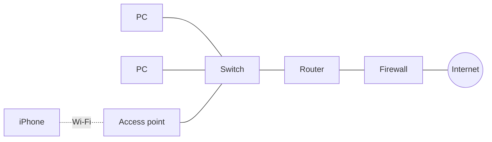

# Dispositivos de red (hub, switch, router, access point, firewall)

Parte de: [[19-Redes/01 Fundamentos/_Índice Fundamentos|Fundamentos]]

> [!info] Cómo avanzar
> `progreso`: **pendiente** → **viendo** (estudiando) → **visto** (contestaste la autoevaluación sin abrir las respuestas) → **dominado** (hiciste el laboratorio o lo aplicaste de verdad).

## Contenido

### Qué es
Los **dispositivos de red** son los equipos que construyen la red. Se dividen en **dispositivos finales** (hosts), que originan o consumen datos —PC, laptop, servidor, impresora, teléfono IP, cámara, tu iPhone—, y **dispositivos intermedios**, que conectan a los finales y mueven el tráfico sin ser su destino final: [[Hub]], [[Switch]], [[Router]], [[Access point]] y [[Firewall]]. Esta nota da el panorama; cada subtema detalla un equipo.

### Cómo funciona
Cada dispositivo intermedio trabaja principalmente en una capa del [[Modelo OSI]], según qué información necesita leer para decidir:

| Dispositivo | Capa principal | Decide con | Qué separa |
|---|---|---|---|
| Hub | 1 | Nada: repite bits | Nada |
| Switch | 2 | MAC destino (tabla MAC) | Dominios de colisión |
| Access point | 2 | MAC; puentea Wi-Fi y Ethernet | Nada por sí solo (puede mapear SSID a VLAN) |
| Router | 3 | IP destino (tabla de rutas) | Dominios de broadcast |
| Firewall | 3 a 7 | Reglas sobre IP, puertos, estado, aplicación | Zonas de seguridad |



Para que **dos redes IP distintas** se comuniquen necesitas un equipo de capa 3: un router o un switch capa 3. Un switch de capa 2 solo conecta equipos de la misma red (o VLAN). En el hogar, el "módem" del proveedor suele ser un combo de router, switch de 4 puertos, access point y firewall en una sola caja, lo que confunde a la hora de aprender: conviene separarlos mentalmente.

Otros dispositivos que verás: **controlador inalámbrico (WLC)**, que gestiona muchos APs (ver [[WLAN - controladores y access points]]); **balanceadores de carga**; **IPS** que inspeccionan y bloquean ataques; y **switches capa 3**, que combinan switching y routing.

### Ejemplo
Red de una oficina pequeña para el equipo de Itzamna:
- 10 PCs y 2 impresoras (finales) conectadas a un switch Cisco de 24 puertos.
- 1 AP en el techo, conectado al switch, para laptops y teléfonos.
- El switch sube a un router, que es la puerta de enlace `192.168.10.1` y hace NAT hacia internet.
- Un firewall entre el router y el proveedor filtra el tráfico entrante y salido.

En [[Cisco Packet Tracer]] puedes armar esta red con un 2960 (switch), un ISR 4331 o 1941 (router), un AccessPoint-PT y PCs. Verifica con `show mac address-table` en el switch y `show ip route` en el router qué "ve" cada uno.

### Cuándo usarlo y cuándo no
- Switch: conectar muchos equipos de la misma LAN.
- Router: unir redes distintas o salir a internet.
- AP: dar acceso inalámbrico a la LAN.
- Firewall: imponer política de seguridad entre zonas.
- Hub: hoy ya no; solo como ejemplo didáctico o en la simulación.
La comparación directa de los tres clásicos está en [[Hub vs switch vs router]].

### Errores comunes
- **Pensar que el switch conecta redes distintas**: uno capa 2 no enruta.
- **Llamar "router" al AP**: el AP extiende la LAN; el que enruta es otro equipo (aunque vengan en la misma caja).
- **Creer que el firewall sustituye a las ACL** o viceversa: se complementan.
- **Olvidar que los dispositivos intermedios también necesitan IP de gestión** para administrarse en remoto.

### Para profundizar
- [Cisco Packet Tracer en Networking Academy](https://www.netacad.com/cisco-packet-tracer)
- [IEEE 802.1 Working Group](https://www.ieee802.org/1/)

## Subtemas

- [[Hub]]
- [[Switch]]
- [[Router]]
- [[Access point]]
- [[Firewall]]

## Autoevaluación

Contesta primero en voz alta o en papel; luego despliega la respuesta.

> [!question]- ¿Qué diferencia hay entre dispositivos finales e intermedios?
> **Finales** (hosts): originan o reciben datos (PC, servidor, celular, impresora). **Intermedios**: conectan y dirigen el tráfico (switch, router, AP, firewall).

> [!question]- Relaciona cada dispositivo con su capa principal.
> Hub: capa 1 · Switch: capa 2 · Router: capa 3 · Access point: capa 2 (puente entre Wi-Fi y Ethernet) · Firewall: capas 3-4 y, si es de nueva generación, capa 7.

> [!question]- ¿Qué equipo necesitas para que dos redes IP distintas se comuniquen?
> Un **router** (o un switch capa 3). Un switch capa 2 por sí solo no enruta entre subredes.

## Progreso de los subtemas

```base
filters:
  and:
    - file.inFolder("19-Redes/01 Fundamentos/Dispositivos de red (hub, switch, router, access point, firewall)")
    - file.name != "Dispositivos de red (hub, switch, router, access point, firewall)"
views:
  - type: table
    name: Progreso
    order:
      - file.name
      - progreso
      - nivel
```
