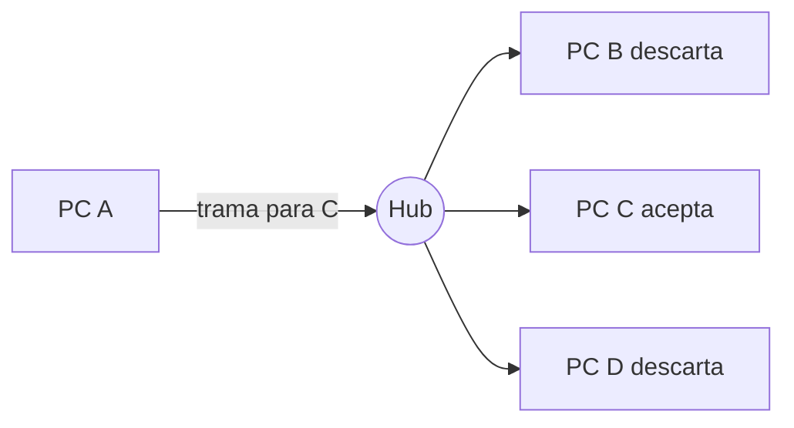

# Hub

Parte de: [[Dispositivos de red (hub, switch, router, access point, firewall)]]

> [!info] Cómo avanzar
> `progreso`: **pendiente** → **viendo** (estudiando) → **visto** (contestaste la autoevaluación sin abrir las respuestas) → **dominado** (hiciste el laboratorio o lo aplicaste de verdad).

## Contenido

### Qué es
Un **hub** (concentrador) es un dispositivo de **capa 1** que conecta varios equipos Ethernet en un punto central. Su trabajo es repetir: lo que entra por un puerto lo regenera y lo saca por **todos** los demás puertos, sin mirar direcciones. Fue la base de las primeras LAN en estrella y hoy se considera obsoleto, pero sigue siendo útil para entender por qué existen los switches y qué es un dominio de colisión.

### Cómo funciona
1. Una PC transmite una trama; el hub recibe la señal eléctrica.
2. El hub regenera esa señal (por eso también se le llama repetidor multipuerto) y la envía por todos los demás puertos al mismo tiempo.
3. Todas las PCs reciben la trama; cada tarjeta compara la MAC destino con la suya y descarta lo que no le corresponde.
4. Como todos comparten el mismo medio, si dos equipos transmiten a la vez hay **colisión**. Ethernet en half dúplex usa **CSMA/CD**: escucha antes de transmitir, detecta la colisión, envía una señal de atasco (jam) y cada equipo espera un tiempo aleatorio antes de reintentar.

Consecuencias:
- Todo el hub es **un solo dominio de colisión** y **un solo dominio de broadcast** (ver [[Dominios de colisión y de broadcast]]).
- Solo **half dúplex**: nadie puede enviar y recibir a la vez.
- El ancho de banda se **comparte**: 10 PCs en un hub de 100 Mbps compiten por esos 100 Mbps.
- Cualquier equipo conectado ve el tráfico de todos: un riesgo de seguridad (o una ventaja para capturar con Wireshark en un laboratorio).



### Ejemplo
En [[Cisco Packet Tracer]], arma un Hub-PT con cuatro PCs, cambia a modo simulación y haz `ping` de la PC A a la C. Verás que el sobre sale del hub hacia las tres PCs; las que no son destino lo marcan con una X. Luego cambia el hub por un switch 2960 y repite: tras el primer ARP, el switch solo envía por el puerto de la PC C. Ese contraste es el corazón del [[Lab 1 - Encapsulamiento, hub y switch en modo simulación]].

En el mundo real, si encuentras un hub viejo en una instalación, los síntomas son: velocidad baja, enlaces en half dúplex y contadores de colisiones altos en el puerto del switch donde está conectado.

```text
SW1# show interfaces fa0/12 | include duplex|collisions
  Half-duplex, 10Mb/s, media type is 10/100BaseTX
  5123 collisions, 0 interface resets
```

### Cuándo usarlo y cuándo no
Hoy prácticamente nunca en producción: los switches no administrables cuestan casi lo mismo y son mejores en todo. Antiguamente se usaba un hub para capturar tráfico entre dos equipos; hoy se hace con un **puerto espejo (SPAN)** en un switch administrable o con un **network TAP**. Úsalo solo en simulación para aprender.

### Errores comunes
- **Pensar que el hub "entiende" direcciones**: no lee MAC ni IP.
- **Creer que un hub separa colisiones**: es justo lo contrario; lo extiende a todos los puertos.
- **Confundir un switch no administrable con un hub**: el switch barato sí aprende MAC y trabaja full dúplex.
- **Esperar full dúplex**: un hub siempre es half dúplex.

### Para profundizar
- [IEEE 802.3 Ethernet Working Group](https://www.ieee802.org/3/)
- [Cisco Packet Tracer en Networking Academy](https://www.netacad.com/cisco-packet-tracer)

## Autoevaluación

Contesta primero en voz alta o en papel; luego despliega la respuesta.

> [!question]- ¿Cómo trabaja un hub?
> Repite cada señal que recibe por **todos** los demás puertos, sin leer direcciones. Todos sus puertos forman un único dominio de colisión.

> [!question]- ¿Por qué ya casi no se usan hubs?
> Generan colisiones, obligan a half-duplex, desperdician ancho de banda y cualquiera puede ver el tráfico de los demás. El switch los reemplazó.

## Práctica

- [[Lab 1 - Encapsulamiento, hub y switch en modo simulación]]

