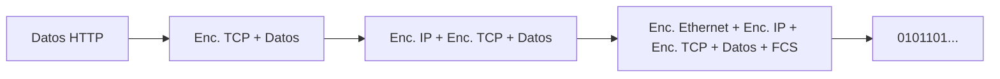

# Encapsulamiento y PDUs

Parte de: [[19-Redes/01 Fundamentos/_Índice Fundamentos|Fundamentos]]

> [!info] Cómo avanzar
> `progreso`: **pendiente** → **viendo** (estudiando) → **visto** (contestaste la autoevaluación sin abrir las respuestas) → **dominado** (hiciste el laboratorio o lo aplicaste de verdad).

## Contenido

### Qué es
El **encapsulamiento** es el proceso por el que cada capa toma los datos de la capa superior y les agrega su propia información de control (encabezado y, a veces, tráiler) antes de pasarlos hacia abajo. El resultado de cada capa tiene un nombre: la **PDU** (Protocol Data Unit). El proceso inverso en el receptor se llama **desencapsulamiento**. Entenderlo es la llave para leer capturas, saber qué ve cada equipo y diagnosticar por capas.

### Cómo funciona
| Capa | PDU | Qué se agrega |
|---|---|---|
| Aplicación (5-7) | Datos | Mensaje del protocolo (HTTP, DNS…) |
| Transporte (4) | Segmento (TCP) / datagrama (UDP) | Puertos, secuencia, ACK, checksum |
| Red (3) | Paquete | IP origen y destino, TTL, protocolo |
| Enlace (2) | Trama | MAC destino y origen, tipo, y al final el **FCS** |
| Física (1) | Bits | Señales en el medio |

La capa 2 es la única que agrega un **tráiler**: el FCS (Frame Check Sequence), un CRC de 4 bytes calculado sobre toda la trama. El receptor recalcula el CRC; si no coincide, descarta la trama porque se dañó en el camino.



Cada dispositivo intermedio desencapsula **solo hasta la capa que necesita**:
- Un **hub** no lee nada: repite bits.
- Un **switch** lee el encabezado Ethernet (MAC destino) para decidir el puerto y verifica el FCS; no necesita mirar IP.
- Un **router** quita la trama, lee el encabezado IP, decide la ruta y **encapsula en una trama nueva** para el siguiente salto.
- El **host destino** sube hasta la aplicación.

### Ejemplo
Con [[Cisco Packet Tracer]] en modo simulación puedes ver esto. Arma PC0 — Switch — Router — Servidor, filtra solo ICMP y haz `ping` del PC al servidor. Al hacer clic en el sobre de la PDU en el switch, la pestaña "OSI Model" muestra que trabajó en capa 2; en el router verás capas 1 a 3 y que la trama de salida tiene MAC origen y destino diferentes a la de entrada. El [[Lab 1 - Encapsulamiento, hub y switch en modo simulación]] te guía paso a paso.

Tamaños típicos de una petición HTTPS pequeña:

```text
Ethernet: 14 bytes de encabezado + 4 de FCS
IPv4:     20 bytes (sin opciones)
TCP:      20 bytes (más opciones, típicamente 32 con timestamps)
Datos:    lo que quepa hasta el MTU de 1500 bytes del paquete IP
```

Por eso el MSS típico de TCP en Ethernet es 1460 bytes: 1500 menos 20 de IP menos 20 de TCP.

### Cuándo usarlo y cuándo no
Piensa en encapsulamiento al leer capturas, al calcular MTU y fragmentación (por ejemplo, en túneles VPN que agregan encabezados y reducen el espacio útil), al explicar por qué un switch "no ve" IP o por qué NAT tiene que recalcular checksums. No necesitas memorizar cada campo de cada encabezado, pero sí qué capa agrega qué información.

### Errores comunes
- **Pensar que el router conserva la trama original**: la reemplaza en cada salto.
- **Llamar "paquete" a todo**: en el examen la PDU correcta importa (segmento, paquete, trama, bits).
- **Olvidar el overhead de túneles**: GRE o IPsec agregan encabezados; si el MTU no se ajusta, aparecen fallas raras con paquetes grandes.
- **Creer que el tráiler existe en todas las capas**: solo la capa 2 agrega tráiler.

### Para profundizar
- [RFC 1122: capas de comunicación de hosts de internet](https://www.rfc-editor.org/rfc/rfc1122)
- [RFC 894: transmisión de IP sobre Ethernet](https://www.rfc-editor.org/rfc/rfc894)
- [Guía de usuario de Wireshark](https://www.wireshark.org/docs/wsug_html_chunked/)

## Autoevaluación

Contesta primero en voz alta o en papel; luego despliega la respuesta.

> [!question]- ¿Qué es el encapsulamiento?
> Cada capa agrega su encabezado (y a veces un tráiler) a los datos de la capa superior antes de pasarlos hacia abajo. Al recibir se hace el proceso inverso: **desencapsulamiento**.

> [!question]- Nombra la PDU de cada capa.
> Aplicación: **datos** · Transporte: **segmento** (TCP) o datagrama (UDP) · Red: **paquete** · Enlace: **trama** · Física: **bits**.

> [!question]- ¿Qué capa agrega un tráiler y para qué?
> La capa de **enlace de datos**: el **FCS** (CRC) al final de la trama, que sirve para detectar errores de transmisión.

> [!question]- Un switch recibe una trama. ¿Hasta qué encabezado necesita leer para reenviarla?
> Solo el encabezado de **capa 2** (MAC destino). No necesita abrir el paquete IP.

## Práctica

- [[Lab 1 - Encapsulamiento, hub y switch en modo simulación]]
- [[Lab 2 - Wireshark capturando ARP, ICMP y DNS]]

