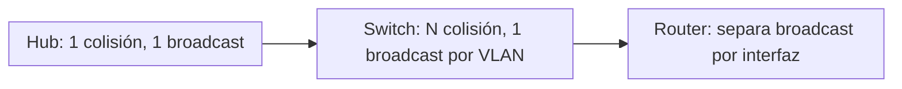

# Hub vs switch vs router

Parte de: [[19-Redes/01 Fundamentos/_Índice Fundamentos|Fundamentos]]

> [!info] Cómo avanzar
> `progreso`: **pendiente** → **viendo** (estudiando) → **visto** (contestaste la autoevaluación sin abrir las respuestas) → **dominado** (hiciste el laboratorio o lo aplicaste de verdad).

## Contenido

### Qué es
Esta nota compara los tres dispositivos clásicos de interconexión para que tengas clara la diferencia esencial: **un hub repite, un switch conmuta por MAC y un router enruta por IP**. Cada uno trabaja en una capa distinta del [[Modelo OSI]] y por eso tiene efectos distintos sobre las colisiones, los broadcasts y la seguridad. Los detalles individuales están en [[Hub]], [[Switch]] y [[Router]].

### Cómo funciona
| Característica | Hub | Switch (capa 2) | Router |
|---|---|---|---|
| Capa OSI | 1 | 2 | 3 |
| Decide con | Nada | MAC destino | IP destino |
| Tabla | Ninguna | Tabla MAC (CAM) | Tabla de rutas |
| Unicast | A todos los puertos | Solo al puerto del destino (o inunda si es desconocido) | Al siguiente salto según la ruta |
| Broadcast | A todos | A todos los puertos de la VLAN | **No lo reenvía** |
| Dominios de colisión | 1 para todo el hub | 1 por puerto | 1 por interfaz |
| Dominios de broadcast | 1 | 1 por VLAN | 1 por interfaz |
| Dúplex | Half | Full | Full |
| Une redes IP distintas | No | No | Sí |

Una forma de recordarlo: cada dispositivo "rompe" algo. El switch rompe dominios de **colisión**; el router rompe dominios de **broadcast**. El hub no rompe nada.

### Ejemplo
Dos departamentos: Desarrollo en `192.168.10.0/24` y Finanzas en `192.168.20.0/24`, conectados al mismo switch de capa 2 y sin VLAN. ¿Se comunican?

- Están en el mismo dominio de broadcast, así que los ARP de unos llegan a los otros.
- Pero una PC de Desarrollo que quiere hablar con `192.168.20.15` ve que no está en su subred y manda el paquete a su gateway. Si no hay router (o el gateway no existe), la comunicación falla.
- **Conclusión**: un switch capa 2 no basta. Necesitas un router (o switch capa 3) con una interfaz o subinterfaz en cada red, y lo correcto es además separar los departamentos en VLAN (ver [[Routing entre VLANs (router on a stick y switch capa 3)]]).

Cálculo rápido de dominios: un router con dos interfaces; en una, un switch con 4 PCs; en la otra, un hub con 3 PCs.
- Colisión: el switch aporta 5 (4 PCs y el enlace al router) y el hub aporta 1 (todo el hub, incluido el puerto del router) → **6**.
- Broadcast: uno por interfaz del router → **2**.
Más ejemplos en [[Dominios de colisión y de broadcast]].

### Cuándo usarlo y cuándo no
- **Hub**: no lo uses; solo en simulación.
- **Switch**: para conectar equipos de la misma red o VLAN.
- **Router**: para unir redes distintas, salir a internet, aplicar NAT o VPN.
- **Switch capa 3**: cuando necesitas enrutar entre muchas VLAN dentro del edificio con alto rendimiento.

### Errores comunes
- **Decir que el switch separa broadcasts**: solo con VLAN distintas.
- **Contar mal los dominios de colisión en un hub**: es uno solo, sin importar cuántos puertos tenga.
- **Olvidar el enlace entre switch y router** al contar dominios de colisión: también cuenta.
- **Creer que el router reenvía broadcasts** de una LAN a otra: no lo hace por defecto.

### Para profundizar
- [IEEE 802.1 Working Group](https://www.ieee802.org/1/)
- [RFC 1812: requisitos para routers IPv4](https://www.rfc-editor.org/rfc/rfc1812)
- [Cisco Packet Tracer en Networking Academy](https://www.netacad.com/cisco-packet-tracer)

## Autoevaluación

Contesta primero en voz alta o en papel; luego despliega la respuesta.

> [!question]- Resume cómo reenvía cada uno.
> **Hub**: a todos los puertos (bits). **Switch**: al puerto de la MAC destino (tramas). **Router**: a la interfaz de la mejor ruta para la IP destino (paquetes).

> [!question]- ¿Cuántos dominios de colisión y de broadcast crea cada uno?
> Hub: 1 colisión y 1 broadcast. Switch: 1 colisión **por puerto** y 1 broadcast (por VLAN). Router: 1 colisión y 1 broadcast **por interfaz**.

> [!question]- Tienes dos departamentos con subredes distintas que deben comunicarse. ¿Basta un switch capa 2?
> No: hace falta un router o un switch capa 3 para enrutar entre las subredes.

## Práctica

- [[Lab 1 - Encapsulamiento, hub y switch en modo simulación]]

