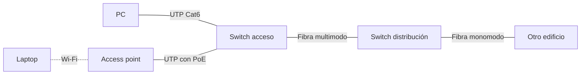

# Medios físicos (cobre, fibra e inalámbrico)

Parte de: [[19-Redes/01 Fundamentos/_Índice Fundamentos|Fundamentos]]

> [!info] Cómo avanzar
> `progreso`: **pendiente** → **viendo** (estudiando) → **visto** (contestaste la autoevaluación sin abrir las respuestas) → **dominado** (hiciste el laboratorio o lo aplicaste de verdad).

## Contenido

### Qué es
Los **medios físicos** son el canal por el que viajan los bits: el material o el espacio que lleva la señal entre dos dispositivos. Se agrupan en tres familias: **cobre**, que transporta impulsos eléctricos; **fibra óptica**, que transporta pulsos de luz; e **inalámbrico**, que usa ondas de radio. Elegir bien el medio define la velocidad, la distancia, la inmunidad al ruido y el costo de una red. Los detalles están en [[Cable de cobre (UTP y STP)]], [[Fibra óptica (monomodo y multimodo)]] y [[Medios inalámbricos]].

### Cómo funciona
| Medio | Señal | Distancia típica | Ventajas | Limitaciones |
|---|---|---|---|---|
| Cobre UTP/STP | Eléctrica | Hasta 100 m por enlace Ethernet | Barato, fácil de instalar, lleva PoE | Sensible a interferencia, distancia corta |
| Fibra multimodo | Luz (LED o VCSEL) | Cientos de metros | Alta velocidad, inmune a EMI | Más cara, conectores delicados |
| Fibra monomodo | Luz (láser) | Kilómetros a decenas de km | Máxima distancia y ancho de banda | Transceptores más caros |
| Inalámbrico | Radio | Decenas de metros (Wi-Fi) | Movilidad, sin cables | Medio compartido, interferencia, seguridad |

Las tres comparten responsabilidades de la [[Capa 1 - Física]]: codificar bits, sincronizar y entregar la señal. Cambian los conectores (RJ45, LC, SC) y los estándares (802.3 para Ethernet en cobre y fibra; 802.11 para Wi-Fi).



### Ejemplo
Un campus pequeño con dos edificios separados 400 m:
- **Escritorios**: UTP Cat 6 desde la roseta al switch de piso (menos de 100 m). Con PoE alimentas teléfonos IP y APs.
- **Entre pisos**: fibra multimodo OM4 entre el cuarto de cada piso y el principal, a 10 Gbps.
- **Entre edificios**: fibra monomodo; además de la distancia, la fibra no conduce electricidad y evita problemas por diferencias de tierra o descargas eléctricas entre edificios.
- **Salas de juntas y movilidad**: Wi-Fi 6 o 6E con APs en el techo.

En casa la lógica es igual: tu PC de edición con la GTX 1660 Ti por cable para subir videos de la Sony a6700 sin cortes, y el iPhone y la laptop por Wi-Fi.

### Cuándo usarlo y cuándo no
- **Cobre**: conexiones de usuario y equipos dentro de 100 m, cuando necesitas PoE.
- **Fibra**: backbone, distancias mayores a 100 m, enlaces entre edificios, ambientes con mucho ruido eléctrico (naves industriales) o cuando necesitas 25 Gbps o más.
- **Inalámbrico**: movilidad, lugares donde cablear es caro o imposible, invitados, IoT. No lo uses como único enlace para servidores o equipos que requieren latencia estable.

### Errores comunes
- **Pasar de 100 m en cobre**: aparecen errores o el enlace baja de velocidad.
- **Mezclar transceptores monomodo y multimodo** en el mismo enlace: no hay luz útil en el otro extremo.
- **Tratar Wi-Fi como si fuera cable**: es half dúplex, compartido y su rendimiento real es mucho menor al nominal.
- **Tender UTP junto a cables de energía o motores** sin separación: interferencia y CRC.

### Para profundizar
- [IEEE 802.3 Ethernet Working Group](https://www.ieee802.org/3/)
- [IEEE 802.11 Working Group](https://www.ieee802.org/11/)

## Subtemas

- [[Cable de cobre (UTP y STP)]]
- [[Fibra óptica (monomodo y multimodo)]]
- [[Medios inalámbricos]]

## Autoevaluación

Contesta primero en voz alta o en papel; luego despliega la respuesta.

> [!question]- ¿Qué tres familias de medios se usan en redes?
> **Cobre** (señales eléctricas), **fibra óptica** (pulsos de luz) e **inalámbrico** (ondas de radio).

> [!question]- ¿Cuándo elegirías fibra en vez de cobre?
> Para distancias mayores a 100 m, enlaces entre edificios, ambientes con mucha interferencia electromagnética o cuando necesitas mucho ancho de banda en el backbone.

> [!question]- ¿Qué limitación tiene el medio inalámbrico frente al cableado?
> Es compartido (half-duplex en la práctica), sufre interferencia y atenuación por paredes, y su seguridad depende del cifrado porque cualquiera en el área recibe la señal.

## Progreso de los subtemas

```base
filters:
  and:
    - file.inFolder("19-Redes/01 Fundamentos/Medios físicos (cobre, fibra e inalámbrico)")
    - file.name != "Medios físicos (cobre, fibra e inalámbrico)"
views:
  - type: table
    name: Progreso
    order:
      - file.name
      - progreso
      - nivel
```
