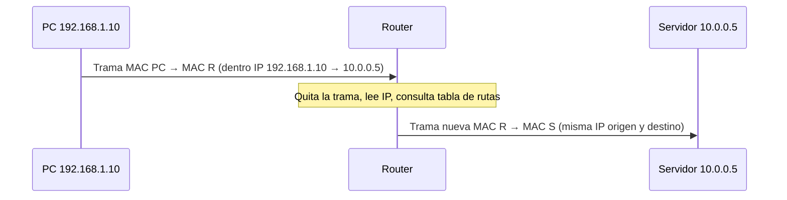

# Capa 2 - Enlace de datos

Parte de: [[Modelo OSI]]

> [!info] Cómo avanzar
> `progreso`: **pendiente** → **viendo** (estudiando) → **visto** (contestaste la autoevaluación sin abrir las respuestas) → **dominado** (hiciste el laboratorio o lo aplicaste de verdad).

## Contenido

### Qué es
La capa de enlace de datos se encarga de mover **tramas** entre dos dispositivos conectados al mismo medio o al mismo segmento local. Define el direccionamiento físico ([[Direcciones MAC]]), el formato de la trama, cómo se accede al medio compartido y cómo se detectan errores. Es la capa de Ethernet, Wi-Fi (802.11), PPP y de los switches.

### Cómo funciona
En las normas IEEE 802 la capa 2 se divide en dos subcapas:
- **LLC (Logical Link Control, 802.2)**: la parte de arriba; identifica qué protocolo de capa 3 viaja dentro (en Ethernet II esto lo hace el campo EtherType) y se comunica con el software de red.
- **MAC (Media Access Control)**: la parte de abajo; agrega las direcciones MAC origen y destino, arma la trama, controla el acceso al medio (CSMA/CD en Ethernet half dúplex, CSMA/CA en Wi-Fi) y calcula el **FCS** para detectar errores.

El alcance de una trama es **local**: solo vive dentro de un segmento. Cuando un router reenvía un paquete a otra red, **descarta la trama recibida y construye una nueva** con su propia MAC como origen y la MAC del siguiente salto como destino. La IP origen y destino se conservan (salvo NAT), pero las MAC cambian en cada salto.



Un switch trabaja aquí: aprende qué MAC está en qué puerto y reenvía las tramas solo por donde corresponde (ver [[Cómo aprende un switch (tabla MAC)]]). Las VLAN y el trunking 802.1Q también son funciones de capa 2, igual que STP, que evita bucles entre switches.

### Ejemplo
Desde tu PC con Windows haces `ping 192.168.1.1` y luego `arp -a`. Verás la MAC del gateway asociada a su IP: tu equipo usó [[ARP]] para averiguar a qué MAC mandar la trama. En el switch puedes confirmar dónde aprendió esa MAC:

```text
SW1# show mac address-table address 0011.2233.4455
          Mac Address Table
Vlan    Mac Address       Type        Ports
----    -----------       --------    -----
  10    0011.2233.4455    DYNAMIC     Gi0/1
```

En [[Wireshark (captura y análisis de tráfico)]], en el panel de detalle, la línea "Ethernet II" muestra exactamente estos campos: Destination, Source y Type (0x0800 para IPv4).

### Cuándo usarlo y cuándo no
Piensa en capa 2 cuando el enlace físico está bien pero los equipos de la **misma red** no se ven: VLAN equivocada en el puerto, trunk que no permite la VLAN, puerto bloqueado por STP, port security que apagó el puerto o un switch que no aprende MAC. Si los equipos de la misma subred sí se comunican pero no llegan a otra red, el problema probablemente es de capa 3 (gateway, rutas). Comandos clave: `show mac address-table`, `show vlan brief`, `show interfaces trunk`, `show spanning-tree`.

### Errores comunes
- **Creer que la MAC destino es la del servidor remoto**: si el destino está en otra red, la MAC destino es la del gateway. La IP sí es la del servidor.
- **Olvidar que el router reescribe la trama**: por eso un switch nunca ve la MAC del equipo remoto.
- **Pensar que un switch aísla broadcasts**: no; todos los puertos de una misma VLAN comparten dominio de broadcast. Solo una VLAN distinta o un router lo separa.
- **Ignorar el FCS**: si una trama llega dañada, el switch o la NIC la descartan en silencio; el síntoma se ve como pérdida de paquetes, no como error visible.

### Para profundizar
- [IEEE 802.1 Working Group (puentes, VLAN)](https://www.ieee802.org/1/)
- [IEEE 802.3 Ethernet Working Group](https://www.ieee802.org/3/)
- [RFC 826: protocolo ARP](https://www.rfc-editor.org/rfc/rfc826)

## Autoevaluación

Contesta primero en voz alta o en papel; luego despliega la respuesta.

> [!question]- ¿Qué hace la capa de enlace de datos?
> Entrega tramas entre equipos del **mismo segmento**: arma la trama con direcciones MAC, controla el acceso al medio y detecta errores con el FCS.

> [!question]- ¿Cuáles son las dos subcapas de la capa 2 en IEEE 802?
> **LLC** (control de enlace lógico, se comunica con capa 3) y **MAC** (control de acceso al medio y direccionamiento físico).

> [!question]- ¿Qué pasa con la trama cuando un router reenvía un paquete a otra red?
> El router quita la trama de entrada y arma una **nueva** con MAC origen = su interfaz de salida y MAC destino = siguiente salto. Las IP origen y destino no cambian (salvo NAT).

