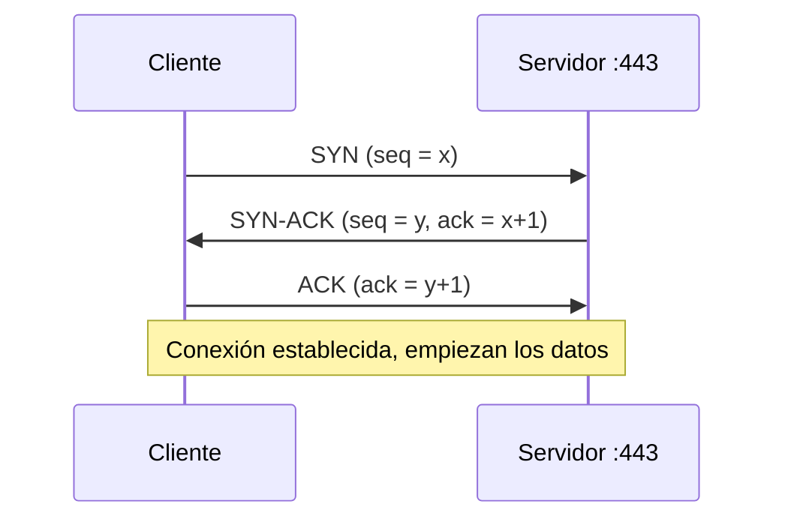

# Capa 4 - Transporte

Parte de: [[Modelo OSI]]

> [!info] Cómo avanzar
> `progreso`: **pendiente** → **viendo** (estudiando) → **visto** (contestaste la autoevaluación sin abrir las respuestas) → **dominado** (hiciste el laboratorio o lo aplicaste de verdad).

## Contenido

### Qué es
La capa de transporte lleva los datos de **una aplicación a otra** entre dos hosts. Mientras la capa 3 entrega paquetes a un equipo, la capa 4 decide a qué proceso le tocan gracias a los **números de puerto**, y opcionalmente garantiza que todo llegue completo y en orden. Sus dos protocolos principales son **TCP** (confiable, orientado a conexión) y **UDP** (sin conexión, ligero). Su PDU se llama **segmento** en TCP y **datagrama** en UDP.

### Cómo funciona
**Puertos**: un número de 16 bits identifica el servicio. Los puertos bien conocidos van de 0 a 1023 (HTTP 80, HTTPS 443, SSH 22, DNS 53), los registrados de 1024 a 49151 (SQL Server 1433, por ejemplo) y los dinámicos o efímeros de 49152 a 65535, que el cliente usa como origen. La combinación IP origen, puerto origen, IP destino, puerto destino y protocolo identifica una conversación única; por eso puedes tener veinte pestañas abiertas al mismo servidor.

**TCP** establece una conexión con el **saludo de tres vías**:



Luego numera cada byte (número de secuencia), el receptor confirma lo recibido (ACK), lo que no se confirma se retransmite, la **ventana** controla cuántos datos se envían sin esperar confirmación (control de flujo) y el emisor reduce su ritmo si detecta pérdida (control de congestión). La conexión se cierra con FIN/ACK o se corta con RST.

**UDP** solo agrega puertos, longitud y checksum: no hay saludo, ni confirmaciones, ni retransmisiones. Es más rápido y con menos encabezado (8 bytes contra al menos 20 de TCP).

### Ejemplo
En una llamada de VoIP o una videollamada, un paquete de audio que llega tarde ya no sirve: retransmitirlo empeoraría la experiencia, porque bloquearía los siguientes. Por eso RTP corre sobre UDP y la aplicación tolera pequeñas pérdidas. En cambio, cuando Itzamna.Clio pide datos a la API de Itzamna.Dionisio, necesitas cada byte del JSON: HTTP/1.1 y HTTP/2 usan TCP. DNS usa UDP 53 para consultas normales (rápidas y pequeñas) y TCP 53 para respuestas grandes o transferencias de zona.

Para ver las conexiones TCP de tu equipo:

```bash
# Windows (PowerShell): conexiones TCP establecidas con su proceso
Get-NetTCPConnection -State Established | Select-Object LocalPort, RemoteAddress, RemotePort, OwningProcess
# Linux
ss -tn state established
```

En [[Wireshark (captura y análisis de tráfico)]] el filtro `tcp.flags.syn == 1` muestra los saludos y `udp.port == 53` las consultas DNS.

### Cuándo usarlo y cuándo no
Elige TCP cuando la integridad y el orden importan (web, APIs, bases de datos, SSH, correo). Elige UDP cuando la latencia importa más que la confiabilidad o cuando la aplicación maneja sus propias reglas (voz, video en vivo, juegos, DNS, DHCP, SNMP, syslog, TFTP). QUIC, que usa HTTP/3, corre sobre UDP y reimplementa confiabilidad y cifrado en espacio de usuario.

### Errores comunes
- **Abrir un puerto en el firewall con el protocolo equivocado**: abrir TCP 53 y olvidar UDP 53 rompe DNS.
- **Pensar que UDP "pierde datos siempre"**: en una LAN sana casi no hay pérdida; simplemente no hay garantía.
- **Confundir el puerto origen con el destino**: el cliente usa un puerto efímero aleatorio como origen; el servidor escucha en el puerto conocido.
- **Olvidar que una ACL extendida filtra por puerto destino**: para el tráfico de regreso, el puerto conocido está en el origen.

### Para profundizar
- [RFC 9293: Transmission Control Protocol (TCP)](https://www.rfc-editor.org/rfc/rfc9293)
- [RFC 768: User Datagram Protocol (UDP)](https://www.rfc-editor.org/rfc/rfc768)
- [IANA: registro de números de puerto](https://www.iana.org/assignments/service-names-port-numbers/service-names-port-numbers.xhtml)

## Autoevaluación

Contesta primero en voz alta o en papel; luego despliega la respuesta.

> [!question]- ¿Qué diferencia hay entre TCP y UDP?
> **TCP**: orientado a conexión (handshake de 3 vías), confiable, ordena y retransmite, control de flujo. **UDP**: sin conexión, sin garantías, menos sobrecarga; ideal para voz, video en vivo, DNS.

> [!question]- ¿Para qué sirven los números de puerto?
> Identifican la aplicación dentro del equipo. Ejemplos: HTTP 80, HTTPS 443, SSH 22, DNS 53. La combinación IP + protocolo + puerto forma un *socket*.

> [!question]- Describe el handshake de TCP.
> Cliente envía **SYN** → servidor responde **SYN-ACK** → cliente responde **ACK**. Ahí empieza el envío de datos.

> [!question]- ¿Por qué una llamada de VoIP usa UDP y no TCP?
> Un paquete de voz que llega tarde ya no sirve; retransmitirlo (TCP) solo agrega retardo. Es mejor perder un poco de audio que tener latencia.

