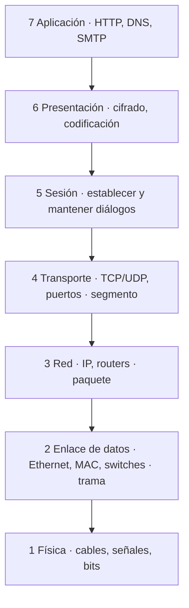

# Modelo OSI

Parte de: [[19-Redes/01 Fundamentos/_Índice Fundamentos|Fundamentos]]

> [!info] Cómo avanzar
> `progreso`: **pendiente** → **viendo** (estudiando) → **visto** (contestaste la autoevaluación sin abrir las respuestas) → **dominado** (hiciste el laboratorio o lo aplicaste de verdad).

## Contenido

### Qué es
El modelo OSI (Open Systems Interconnection) es un modelo de referencia de la ISO que divide la comunicación entre dos equipos en **siete capas**, cada una con una responsabilidad concreta y una interfaz con la capa de arriba y la de abajo. No es un protocolo ni un producto: es un mapa mental. En la práctica, internet funciona con la pila TCP/IP, pero OSI sigue siendo el idioma común para **explicar, diseñar y diagnosticar** redes. Cuando un ingeniero dice "es un problema de capa 2" todos entienden que hablamos de tramas, MAC y switches, no de IP ni de la aplicación.

### Cómo funciona
Cada capa le ofrece un servicio a la de arriba y usa el servicio de la de abajo. Al enviar, los datos bajan de la capa 7 a la 1 y cada capa agrega su propio encabezado (eso es el [[Encapsulamiento y PDUs]]). Al recibir, el proceso se invierte: cada capa lee y retira su encabezado y entrega el resto hacia arriba. Una capa solo "conversa" con su capa par en el otro extremo.



De abajo hacia arriba las capas son: [[Capa 1 - Física]], [[Capa 2 - Enlace de datos]], [[Capa 3 - Red]], [[Capa 4 - Transporte]], [[Capa 5 - Sesión]], [[Capa 6 - Presentación]] y [[Capa 7 - Aplicación]]. Una regla mnemotécnica en español: "**F**ui **E**l **R**ey **T**omando **S**idra **P**or **A**mor" (Física, Enlace, Red, Transporte, Sesión, Presentación, Aplicación).

Los equipos se ubican por la capa más alta que necesitan leer para hacer su trabajo: un hub repite bits (capa 1), un switch decide con la MAC destino (capa 2), un router decide con la IP destino (capa 3) y un firewall moderno puede inspeccionar hasta la capa 7. Las capas 5 y 6 casi no tienen protocolos propios en TCP/IP; sus funciones viven dentro de la aplicación o de bibliotecas como TLS.

### Ejemplo
Abres en tu navegador la API de Itzamna.Dionisio en `https://dionisio.local/api/clientes`:
- **7**: el navegador arma una petición HTTP `GET`.
- **6**: TLS cifra esa petición (por eso HTTPS no es "solo capa 7": el cifrado es una función de presentación y la negociación de la sesión TLS toca la 5).
- **5**: TLS mantiene la sesión; si la conexión se reanuda, reutiliza parámetros.
- **4**: TCP agrega puertos (origen efímero, destino 443) y números de secuencia.
- **3**: IP agrega IP origen y destino.
- **2**: Ethernet agrega MAC origen y la MAC del gateway (o del servidor si está en la misma red).
- **1**: la tarjeta convierte todo a señales eléctricas o de radio.

En [[Cisco Packet Tracer]], el modo simulación te muestra exactamente esta tabla por capas al hacer clic en cada PDU.

### Cuándo usarlo y cuándo no
Úsalo para **diagnosticar** (ir de la capa 1 hacia arriba, ver [[Troubleshooting de redes (metodología por capas)]]), para ubicar dispositivos y protocolos y para comunicarte con otros equipos. No lo uses como descripción literal de cómo está programada una pila real: TCP/IP agrupa capas y muchos protocolos caen "entre" capas (ARP vive entre la 2 y la 3; TLS entre la 4 y la 7). Para el examen CCNA debes dominar ambos modelos y saber mapear uno con el otro (ver [[Modelo TCP-IP]]).

### Errores comunes
- **Memorizar sin entender**: saber el orden de las capas no sirve si no puedes decir qué encabezado lee un switch o un router. Practica con capturas reales en [[Wireshark (captura y análisis de tráfico)]].
- **Ubicar HTTPS solo en capa 7**: HTTP es capa 7, pero el cifrado de TLS corresponde a funciones de capa 6 y el manejo de la sesión a la 5.
- **Confundir el nombre de la PDU**: segmento (4), paquete (3), trama (2), bits (1). Mezclarlos genera confusión al leer documentación.
- **Pensar que un switch nunca toca la capa 3**: los switches capa 3 enrutan; el modelo describe funciones, no cajas.

### Para profundizar
- [ISO/IEC 7498-1 (modelo de referencia OSI)](https://www.iso.org/standard/20269.html)
- [RFC 1122: requisitos de hosts en internet (capas TCP/IP)](https://www.rfc-editor.org/rfc/rfc1122)
- [Cisco Packet Tracer en Networking Academy](https://www.netacad.com/cisco-packet-tracer)

## Subtemas

- [[Capa 1 - Física]]
- [[Capa 2 - Enlace de datos]]
- [[Capa 3 - Red]]
- [[Capa 4 - Transporte]]
- [[Capa 5 - Sesión]]
- [[Capa 6 - Presentación]]
- [[Capa 7 - Aplicación]]

## Autoevaluación

Contesta primero en voz alta o en papel; luego despliega la respuesta.

> [!question]- ¿Para qué sirve el modelo OSI si en la práctica se usa TCP/IP?
> Es un modelo de referencia: da un vocabulario común ("es un problema de capa 2") y ayuda a diagnosticar por capas y a entender qué hace cada protocolo o equipo.

> [!question]- Nombra las 7 capas de abajo hacia arriba.
> 1 Física · 2 Enlace de datos · 3 Red · 4 Transporte · 5 Sesión · 6 Presentación · 7 Aplicación. (Regla: "**F**ue **E**l **R**ey **T**omás **S**u **P**ropio **A**migo").

> [!question]- ¿En qué capa trabajan normalmente un switch y un router?
> Switch: **capa 2** (reenvía por MAC). Router: **capa 3** (reenvía por IP). Un switch capa 3 hace ambas cosas.

> [!question]- Error común: ubicar HTTPS solo en capa 7. ¿Qué matiz falta?
> HTTP es capa 7, pero el cifrado TLS se asocia a capa 6 (presentación) en OSI; en TCP/IP todo eso queda en la capa de aplicación. Lo importante es saber que OSI no encaja exacto con los protocolos reales.

## Práctica

- [[Lab 1 - Encapsulamiento, hub y switch en modo simulación]]

## Progreso de los subtemas

```base
filters:
  and:
    - file.inFolder("19-Redes/01 Fundamentos/Modelo OSI")
    - file.name != "Modelo OSI"
views:
  - type: table
    name: Progreso
    order:
      - file.name
      - progreso
      - nivel
```
