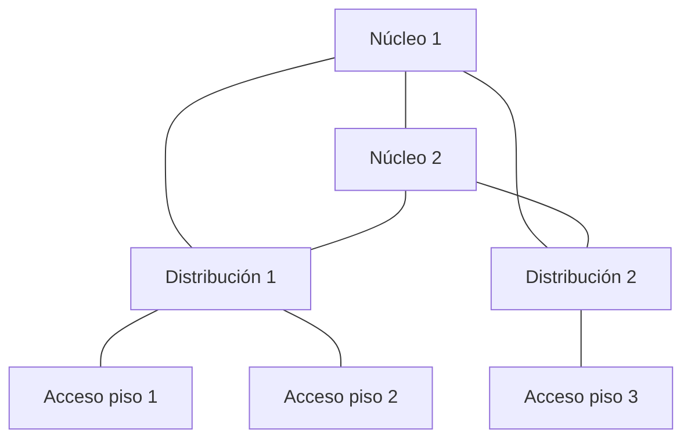

# Topologías de red

Parte de: [[19-Redes/01 Fundamentos/_Índice Fundamentos|Fundamentos]]

> [!info] Cómo avanzar
> `progreso`: **pendiente** → **viendo** (estudiando) → **visto** (contestaste la autoevaluación sin abrir las respuestas) → **dominado** (hiciste el laboratorio o lo aplicaste de verdad).

## Contenido

### Qué es
La **topología** describe cómo están dispuestos y conectados los elementos de una red. Hay dos vistas: la **topología física** (por dónde van realmente los cables y dónde están los equipos) y la **topología lógica** (cómo fluyen los datos entre ellos). Pueden ser diferentes: un hub conectado en estrella física se comporta como un bus lógico, porque todos comparten el mismo medio.

### Cómo funciona
Topologías clásicas:

| Topología | Cómo es | Ventaja | Desventaja |
|---|---|---|---|
| **Bus** | Un cable común al que se conectan todos | Barata | Un corte tumba todo; colisiones |
| **Anillo** | Cada nodo conectado a dos vecinos | Acceso ordenado | Un fallo puede romper el anillo (si no es doble) |
| **Estrella** | Todos a un punto central (switch) | Fácil de administrar; un cable dañado solo afecta a un equipo | El centro es punto único de falla |
| **Estrella extendida / jerárquica** | Estrellas conectadas entre sí | Escala bien | Requiere diseño |
| **Malla completa** | Todos con todos | Máxima redundancia | Muchos enlaces y costo |
| **Malla parcial** | Algunos nodos con varios enlaces | Equilibrio costo/redundancia | Diseño más complejo |
| **Punto a punto** | Dos nodos | Simple | Solo dos extremos |

Para una **malla completa** con n nodos el número de enlaces es n(n − 1)/2. Con 4 sitios son 6 enlaces; con 8 sitios, 28; con 10 sitios, 45. Crece rápido, por eso se reserva para pocos nodos críticos.

En LAN Ethernet la topología dominante es la **estrella extendida**: cada PC va a un switch de acceso, y los switches de acceso suben a switches de distribución o núcleo. Cisco describe el diseño de campus en tres niveles (acceso, distribución y núcleo) o en dos niveles con **núcleo colapsado** para sitios medianos. En centros de datos se usa **spine-leaf**: cada switch leaf se conecta a todos los spine, así cualquier servidor está a dos saltos de cualquier otro.

### Ejemplo
Una empresa con oficina central en CDMX y tres sucursales:
- **LAN de cada sitio**: estrella extendida; un switch por piso conectado a un par de switches de distribución con enlaces redundantes (STP o EtherChannel evitan bucles).
- **WAN**: hub-and-spoke (estrella) donde cada sucursal tiene un túnel a la central. Si las sucursales hablan mucho entre sí, una **malla parcial** con SD-WAN agrega túneles directos entre ellas.
- Malla completa entre los 4 sitios: 4 × 3 / 2 = 6 túneles; aceptable. Con 40 sucursales serían 780: impráctico, por eso se usa malla parcial dinámica.

En [[Cisco Packet Tracer]] dibuja las dos variantes y cuenta enlaces: es la mejor forma de sentir el costo.

### Cuándo usarlo y cuándo no
- **Estrella/estrella extendida**: casi siempre en LAN.
- **Malla completa**: pocos nodos críticos (núcleo, centros de datos, enlaces entre routers de borde).
- **Hub-and-spoke**: WAN con tráfico mayoritariamente hacia la central.
- **Bus y anillo**: hoy casi solo en redes industriales o anillos de fibra de proveedores (con anillo doble para redundancia).

### Errores comunes
- **Confundir física con lógica**: un hub en estrella sigue siendo un dominio de colisión compartido (bus lógico).
- **Agregar enlaces redundantes sin STP**: crea bucles de capa 2 y tormentas de broadcast.
- **Dejar un único switch central sin respaldo**: la estrella hereda su punto único de falla.
- **Calcular mal la malla**: es n(n − 1)/2, no n².

### Para profundizar
- [Cisco: Campus LAN and Wireless LAN Design Guide](https://www.cisco.com/c/en/us/td/docs/solutions/CVD/Campus/cisco-campus-lan-wlan-design-guide.html)
- [Cisco Packet Tracer en Networking Academy](https://www.netacad.com/cisco-packet-tracer)

## Autoevaluación

Contesta primero en voz alta o en papel; luego despliega la respuesta.

> [!question]- ¿Qué diferencia hay entre topología física y lógica?
> La **física** es cómo están conectados los cables y equipos; la **lógica** es cómo viajan los datos. Ejemplo: un hub se ve como estrella física pero se comporta como bus lógico.

> [!question]- ¿Cuál es la topología más usada en LAN Ethernet hoy y por qué?
> **Estrella** (o estrella extendida): cada equipo va a un switch. Si falla un cable solo cae ese equipo, y es fácil de crecer y diagnosticar. Su punto débil es el equipo central.

> [!question]- ¿Cuándo conviene una malla completa?
> Cuando la disponibilidad es crítica (núcleo de un ISP, enlaces entre centros de datos): hay caminos redundantes. Su costo crece rápido: con n nodos necesitas n(n−1)/2 enlaces.

> [!question]- Si tienes 6 sitios y quieres malla completa, ¿cuántos enlaces necesitas?
> 6 × 5 / 2 = **15 enlaces**.

