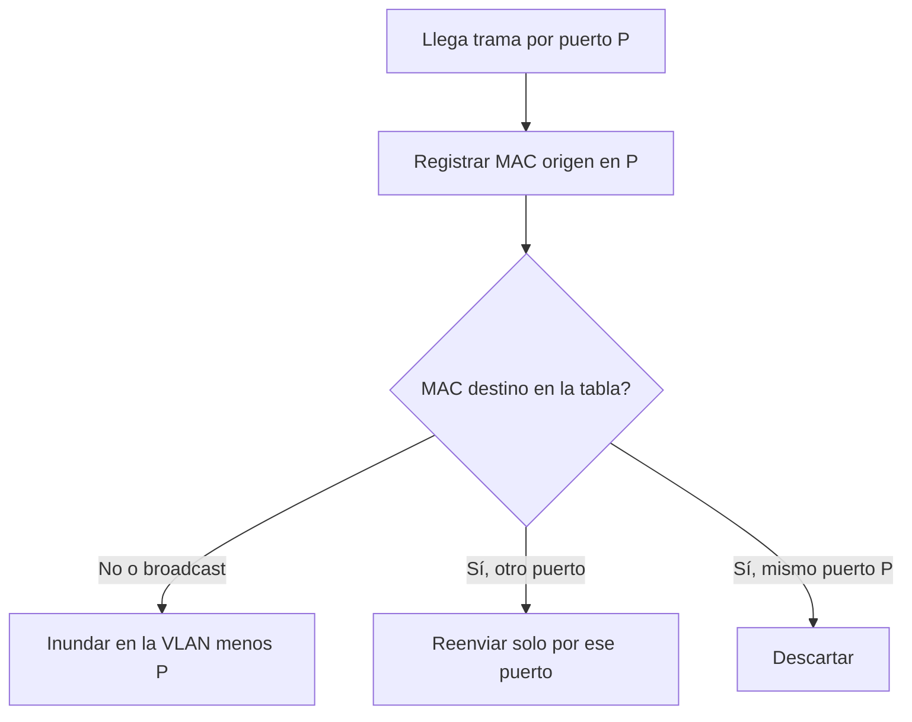

# Cómo aprende un switch (tabla MAC)

Parte de: [[19-Redes/02 Switching/_Índice Switching|Switching]]

> [!info] Cómo avanzar
> `progreso`: **pendiente** → **viendo** (estudiando) → **visto** (contestaste la autoevaluación sin abrir las respuestas) → **dominado** (hiciste el laboratorio o lo aplicaste de verdad).

## Contenido

### Qué es
Un switch no viene sabiendo dónde está cada equipo: lo **aprende observando el tráfico**. Guarda lo aprendido en la **tabla de direcciones MAC** (en Cisco también llamada tabla CAM, por la memoria de contenido direccionable donde se almacena). Cada entrada asocia una MAC, una VLAN y un puerto. Con esa tabla el switch decide si reenvía una trama por un solo puerto, si la inunda o si la descarta.

### Cómo funciona
Para cada trama entrante el switch aplica dos pasos, siempre en este orden:

1. **Aprender con la MAC origen**. Anota "MAC X está en el puerto P, VLAN V". Si ya existía en otro puerto, la mueve al nuevo (el equipo cambió de lugar). Si ya existía en el mismo puerto, reinicia su temporizador.
2. **Reenviar con la MAC destino**:
   - **Conocida** en otro puerto → la envía solo por ese puerto (*forward*).
   - **Conocida** en el mismo puerto de entrada → la descarta (*filter*).
   - **Desconocida** (unicast desconocido), **broadcast** o multicast sin control → la **inunda** por todos los puertos de la misma VLAN excepto el de entrada (*flood*).



**Envejecimiento**: las entradas **dinámicas** se borran si la MAC no envía tráfico durante el *aging time*, que en Cisco es de **300 segundos** por defecto. Así la tabla no se llena de equipos que ya no existen. También hay entradas **estáticas** (configuradas a mano) y **sticky** (aprendidas por port security y guardables en la configuración).

### Ejemplo
Switch recién encendido, tabla vacía. PC-1 (Fa0/1) hace ping a PC-3 (Fa0/3); ambos en VLAN 1.

1. PC-1 no conoce la MAC de PC-3 y envía un **ARP request** en broadcast. El switch aprende `MAC PC-1 → Fa0/1` y, como el destino es broadcast, inunda por Fa0/2, Fa0/3 y demás.
2. PC-3 responde con un **ARP reply** unicast a PC-1. El switch aprende `MAC PC-3 → Fa0/3` y, como ya conoce a PC-1, lo envía solo por Fa0/1.
3. Los ICMP siguientes van directo entre Fa0/1 y Fa0/3; PC-2 ya no ve nada.

Si después desconectas PC-1 y lo conectas en Fa0/7, en cuanto envíe una trama el switch actualiza la entrada a Fa0/7.

Comandos útiles:

```text
SW1# show mac address-table
SW1# show mac address-table dynamic vlan 1
SW1# show mac address-table count
SW1# show mac address-table aging-time
SW1# clear mac address-table dynamic
SW1(config)# mac address-table aging-time 600
SW1(config)# mac address-table static 0050.7966.6800 vlan 1 interface fa0/10
```

En un enlace hacia otro switch (uplink o trunk) verás **muchas MAC en el mismo puerto**: todas las que están detrás del otro switch. Es normal.

### Cuándo usarlo y cuándo no
Consulta la tabla MAC para **localizar físicamente** un equipo (sigue la MAC de switch en switch hasta el puerto de acceso), detectar bucles (una MAC que "salta" entre puertos), confirmar que un equipo está en la VLAN correcta y verificar port security. Las entradas estáticas se usan poco: impiden movilidad y se olvidan; prefiere port security con sticky si necesitas fijar equipos.

### Errores comunes
- **Pensar que el switch aprende con la MAC destino**: aprende con la de origen.
- **Esperar que un equipo silencioso aparezca en la tabla**: si no transmite, no se aprende; un ping desde él lo soluciona.
- **Confundir inundación con broadcast**: la inundación de un unicast desconocido no cambia la MAC destino.
- **Ignorar "MAC flapping"** en los logs: indica un bucle o una mala configuración de EtherChannel.

### Para profundizar
- [IEEE 802.1Q (puentes y VLAN), IEEE 802.1 Working Group](https://www.ieee802.org/1/)
- [Cisco Catalyst 2960: guías de configuración](https://www.cisco.com/c/en/us/support/switches/catalyst-2960-series-switches/products-installation-and-configuration-guides-list.html)

## Ejercicios

Resuélvelos en papel o en la herramienta; la solución está plegada.

> [!question]- La tabla de SW1 está vacía. PC-A (Fa0/1) hace ping a PC-B (Fa0/2) en la misma red. Describe qué aprende el switch con la primera trama (ARP request).
> Aprende **MAC de PC-A → Fa0/1**. Como es broadcast, la inunda por todos los puertos de la VLAN menos Fa0/1.

> [!question]- Continúa: PC-B responde el ARP (unicast a PC-A). ¿Qué pasa?
> Aprende **MAC de PC-B → Fa0/2** y, como ya conoce a PC-A, envía la respuesta **solo** por Fa0/1.

> [!question]- Mueves PC-A al puerto Fa0/5 y envía una trama. ¿Qué hace el switch?
> Actualiza la entrada: MAC de PC-A → **Fa0/5** (la MAC origen ahora llega por otro puerto).

## Autoevaluación

Contesta primero en voz alta o en papel; luego despliega la respuesta.

> [!question]- ¿Qué guarda la tabla MAC (CAM) de un switch?
> Pares **MAC → puerto** (y VLAN). Los aprende leyendo la **MAC origen** de cada trama que entra.

> [!question]- ¿Qué hace el switch con una trama de MAC destino desconocida?
> La **inunda** por todos los puertos de esa VLAN excepto por el que entró (*unknown unicast flooding*).

> [!question]- ¿Cuánto dura una entrada dinámica y cómo la ves en IOS?
> Por defecto **300 segundos** sin tráfico. Se ve con `show mac address-table` (o `show mac address-table dynamic`).

## Práctica

- [[Lab 1 - VLANs, trunk y router on a stick en Packet Tracer]]

