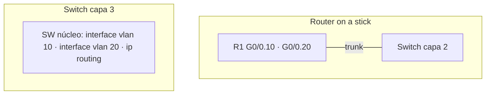

# Routing entre VLANs (router on a stick y switch capa 3)

Parte de: [[19-Redes/02 Switching/_Índice Switching|Switching]]

> [!info] Cómo avanzar
> `progreso`: **pendiente** → **viendo** (estudiando) → **visto** (contestaste la autoevaluación sin abrir las respuestas) → **dominado** (hiciste el laboratorio o lo aplicaste de verdad).

## Contenido

### Qué es
Las VLAN separan dominios de broadcast: dos equipos en VLAN distintas **no pueden comunicarse en capa 2**. Si queremos que se hablen (por ejemplo, que las PCs de Desarrollo usen la impresora de la VLAN de Servicios o lleguen a la API en la VLAN de Servidores), hace falta un dispositivo de **capa 3** que enrute entre ellas: eso es el **routing entre VLANs**. Cada VLAN es una subred y su gateway vive en ese equipo de capa 3.

### Cómo funciona
Hay tres formas de hacerlo:

| Método | Cómo es | Ventajas | Desventajas |
|---|---|---|---|
| **Router con una interfaz física por VLAN** (legado) | Cada VLAN llega al router por un cable distinto | Simple de entender | No escala: una interfaz y un puerto de switch por VLAN |
| **Router on a stick** | Un solo enlace trunk al router con **subinterfaces** 802.1Q | Barato, un solo cable | Todo el tráfico entre VLAN comparte ese enlace; el router puede ser cuello de botella |
| **Switch capa 3 con SVI** | Interfaces virtuales de VLAN en el propio switch con `ip routing` | Enrutamiento por hardware a velocidad de línea, escalable | Requiere un switch capa 3 (más caro) |

Detalles en [[Router on a stick]] y [[Switch capa 3 (SVI)]].



Flujo en cualquiera de los métodos: la PC de la VLAN 10 ve que el destino está en otra subred, manda la trama a su gateway (la IP del router o de la SVI en la VLAN 10), el equipo de capa 3 enruta el paquete y lo entrega en la VLAN 20 con una trama nueva.

### Ejemplo
Itzamna tiene tres VLAN: 10 Desarrollo (`192.168.10.0/24`), 20 Servidores (`192.168.20.0/24`) y 30 Invitados (`192.168.30.0/24`).
- **Sucursal chica** con un router ISR y un 2960: router on a stick. Un trunk de G0/0 al switch con subinterfaces `.10`, `.20` y `.30`.
- **Oficina central** con un switch capa 3: SVI `interface vlan 10/20/30`, `ip routing`, y un enlace enrutado al router de internet.
- En ambos casos, una ACL impide que Invitados llegue a Servidores.

Verificación desde una PC de la VLAN 10:

```text
C:\> ipconfig          # gateway 192.168.10.1
C:\> ping 192.168.10.1 # el gateway responde: la parte de capa 2 está bien
C:\> tracert 192.168.20.15
  1  192.168.10.1
  2  192.168.20.15     # pasó por el equipo de capa 3
```

Practica ambos modelos en el [[Lab 1 - VLANs, trunk y router on a stick en Packet Tracer]].

### Cuándo usarlo y cuándo no
- **Router on a stick**: pocas VLAN, poco tráfico entre ellas, presupuesto limitado o laboratorios.
- **Switch capa 3**: oficina mediana o grande, mucho tráfico este-oeste (entre VLAN), necesidad de alta disponibilidad (con HSRP entre dos switches núcleo).
- **Interfaz física por VLAN**: prácticamente nunca hoy.
Si además necesitas inspección de seguridad entre zonas, el routing entre ciertas VLAN puede pasar por un firewall.

### Errores comunes
- **PCs sin gateway o con gateway de otra VLAN**.
- **Trunk que no permite la VLAN** hacia el router.
- **Olvidar `ip routing`** en el switch capa 3: las SVI tienen IP pero no enrutan.
- **No filtrar entre VLAN**: enrutar todo con todo anula parte del beneficio de segmentar.

### Para profundizar
- [IEEE 802.1 Working Group (802.1Q)](https://www.ieee802.org/1/)
- [Cisco Packet Tracer en Networking Academy](https://www.netacad.com/cisco-packet-tracer)

## Subtemas

- [[Router on a stick]]
- [[Switch capa 3 (SVI)]]

## Autoevaluación

Contesta primero en voz alta o en papel; luego despliega la respuesta.

> [!question]- ¿Por qué se necesita routing entre VLANs?
> Cada VLAN es una subred distinta; para que se comuniquen hace falta un equipo de capa 3.

> [!question]- ¿Cuáles son las tres formas de hacerlo?
> 1) **Router con una interfaz física por VLAN** (antiguo, no escala). 2) **Router on a stick**: un enlace troncal y subinterfaces. 3) **Switch capa 3** con SVIs.

> [!question]- ¿Cuándo elegirías switch capa 3 sobre router on a stick?
> Cuando hay muchas VLANs o mucho tráfico entre ellas: el switch capa 3 enruta por hardware y no depende de un solo enlace troncal hacia el router.

## Práctica

- [[Lab 1 - VLANs, trunk y router on a stick en Packet Tracer]]

## Progreso de los subtemas

```base
filters:
  and:
    - file.inFolder("19-Redes/02 Switching/Routing entre VLANs (router on a stick y switch capa 3)")
    - file.name != "Routing entre VLANs (router on a stick y switch capa 3)"
views:
  - type: table
    name: Progreso
    order:
      - file.name
      - progreso
      - nivel
```
