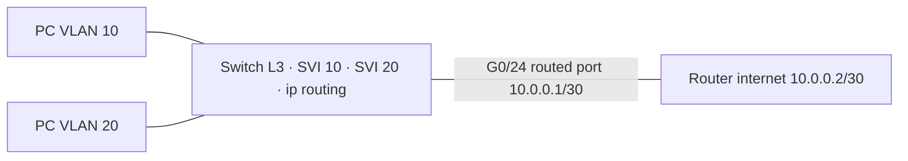

# Switch capa 3 (SVI)

Parte de: [[Routing entre VLANs (router on a stick y switch capa 3)]]

> [!info] Cómo avanzar
> `progreso`: **pendiente** → **viendo** (estudiando) → **visto** (contestaste la autoevaluación sin abrir las respuestas) → **dominado** (hiciste el laboratorio o lo aplicaste de verdad).

## Contenido

### Qué es
Un **switch capa 3** (multilayer switch) combina switching de capa 2 con **enrutamiento de capa 3 por hardware**. Para enrutar entre VLAN usa **SVI** (Switched Virtual Interface): interfaces lógicas `interface vlan N`, una por VLAN, cada una con la IP que hace de gateway para esa VLAN. También puede convertir un puerto físico en **puerto enrutado** (routed port), que se comporta como la interfaz de un router.

### Cómo funciona
1. Se crean las VLAN y se asignan los puertos de acceso como en cualquier switch.
2. Se crea una **SVI** por VLAN con su IP y `no shutdown`.
3. Se activa el enrutamiento IPv4 con **`ip routing`** (en muchos modelos viene apagado). Sin este comando, las SVI tienen IP pero el switch no enruta entre ellas. Para IPv6, `ipv6 unicast-routing`.
4. El tráfico entre VLAN se enruta dentro del switch, a velocidad de línea, sin salir por ningún cable.
5. Para salir hacia el router de internet o hacia otro switch de capa 3 se usa un **puerto enrutado** (`no switchport` + IP) o una SVI de tránsito. El puerto enrutado no pertenece a ninguna VLAN, no corre STP y no aprende MAC como un puerto de acceso.

**Estado de una SVI**: está `up/up` solo si la VLAN existe en la base de datos, la SVI no está apagada y hay **al menos un puerto activo** en esa VLAN en estado forwarding de STP (un puerto de acceso conectado o un trunk que la permita). Si una SVI aparece `down/down`, revisa esas tres cosas.



### Ejemplo
Switch núcleo con VLAN 10 y 20 y salida a un router por un puerto enrutado:

```text
CORE(config)# ip routing
CORE(config)# vlan 10
CORE(config-vlan)# vlan 20
CORE(config-vlan)# exit
CORE(config)# interface vlan 10
CORE(config-if)# ip address 192.168.10.1 255.255.255.0
CORE(config-if)# no shutdown
CORE(config-if)# interface vlan 20
CORE(config-if)# ip address 192.168.20.1 255.255.255.0
CORE(config-if)# no shutdown
CORE(config-if)# interface g1/0/24
CORE(config-if)# no switchport
CORE(config-if)# ip address 10.0.0.1 255.255.255.252
CORE(config-if)# no shutdown
CORE(config-if)# exit
CORE(config)# ip route 0.0.0.0 0.0.0.0 10.0.0.2
CORE(config)# end
CORE# show ip interface brief | include Vlan|Gi1/0/24
CORE# show ip route
```

En la tabla de rutas verás las dos redes de las SVI y la `/30` del puerto enrutado como conectadas, y la ruta por defecto como `S*`. El router de internet necesita rutas de regreso hacia `192.168.10.0/24` y `192.168.20.0/24` vía `10.0.0.1` (o un protocolo dinámico como OSPF).

En [[Cisco Packet Tracer]] usa un 3560-24PS o 3650 para practicar; el 2960 no enruta entre VLAN.

### Cuándo usarlo y cuándo no
Úsalo en la capa de distribución o núcleo de cualquier red con varias VLAN y tráfico entre ellas. Agrega HSRP o VRRP entre dos switches núcleo para que el gateway sea redundante (ver [[Redundancia de gateway (HSRP y VRRP)]]). Si solo tienes una sucursal con dos VLAN y poco tráfico, un [[Router on a stick]] puede bastar.

### Errores comunes
- **Olvidar `ip routing`**: cada VLAN alcanza su gateway, pero no hay comunicación entre VLAN.
- **SVI sin puertos activos en la VLAN**: queda `down/down`.
- **Configurar `ip default-gateway`** en un switch que enruta: se ignora; usa `ip route 0.0.0.0 0.0.0.0`.
- **Olvidar las rutas de regreso** en el router de borde hacia las subredes de las SVI.

### Para profundizar
- [Cisco Catalyst 3650: guías de configuración](https://www.cisco.com/c/en/us/support/switches/catalyst-3650-series-switches/products-installation-and-configuration-guides-list.html)
- [Cisco Packet Tracer en Networking Academy](https://www.netacad.com/cisco-packet-tracer)

## Autoevaluación

Contesta primero en voz alta o en papel; luego despliega la respuesta.

> [!question]- ¿Qué es una SVI?
> Una interfaz virtual de VLAN (`interface vlan 10`) con IP. En un switch capa 3 funciona como puerta de enlace de esa VLAN.

> [!question]- ¿Qué comando activa el enrutamiento en un switch capa 3?
> `ip routing` (en modo de configuración global). Sin él, las SVIs no enrutan entre sí.

> [!question]- ¿Qué es un puerto enrutado (routed port)?
> Un puerto físico del switch capa 3 configurado con `no switchport` para que actúe como interfaz de router, con IP propia (típico hacia el router de borde).

> [!question]- Una SVI aparece `down/down`. ¿Causas probables?
> La VLAN no existe, no hay ningún puerto activo en esa VLAN (ni trunk que la lleve) o la SVI tiene `shutdown`.

