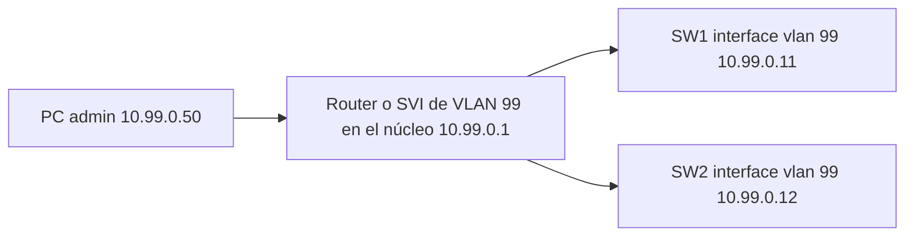

# VLAN de administración

Parte de: [[VLANs]]

> [!info] Cómo avanzar
> `progreso`: **pendiente** → **viendo** (estudiando) → **visto** (contestaste la autoevaluación sin abrir las respuestas) → **dominado** (hiciste el laboratorio o lo aplicaste de verdad).

## Contenido

### Qué es
La **VLAN de administración** (management VLAN) es la VLAN que se usa para **acceder y gestionar** los equipos de red: SSH, SNMP, syslog, NTP, TFTP para respaldos. Un switch de capa 2 no tiene IP en sus puertos; para administrarlo en remoto se le asigna una IP en una **interfaz virtual de VLAN (SVI)**. Separar la gestión en su propia VLAN, distinta de la VLAN 1 y de las de usuarios, es una buena práctica de seguridad.

### Cómo funciona
1. Se crea una VLAN dedicada, por ejemplo la **99**.
2. Se crea la interfaz `interface vlan 99` y se le asigna una IP de la subred de gestión.
3. Se activa con `no shutdown`. La SVI solo estará `up/up` si la VLAN existe y hay al menos un puerto activo en esa VLAN (de acceso o un trunk que la permita).
4. Como el switch de capa 2 no enruta, necesita una **puerta de enlace** para responder a equipos de otras redes: `ip default-gateway`.
5. Se restringe quién puede entrar: SSH en las líneas VTY y una ACL que solo permita la subred de los administradores (ver [[SSH y acceso seguro a dispositivos]]).



### Ejemplo
Gestión de SW-PISO2 en la VLAN 99 con la red `10.99.0.0/24`:

```text
SW-PISO2(config)# vlan 99
SW-PISO2(config-vlan)# name GESTION
SW-PISO2(config-vlan)# exit
SW-PISO2(config)# interface vlan 99
SW-PISO2(config-if)# ip address 10.99.0.12 255.255.255.0
SW-PISO2(config-if)# no shutdown
SW-PISO2(config-if)# exit
SW-PISO2(config)# ip default-gateway 10.99.0.1
SW-PISO2(config)# interface vlan 1
SW-PISO2(config-if)# shutdown
SW-PISO2(config-if)# end
SW-PISO2# show ip interface brief | include Vlan
Vlan1      unassigned   YES unset  administratively down down
Vlan99     10.99.0.12   YES manual up                    up
```

Asegúrate de que la VLAN 99 esté permitida en el trunk hacia el núcleo (`show interfaces trunk`) y de que el router o switch capa 3 tenga una interfaz o SVI en `10.99.0.1`.

Si el switch tiene IP, responde ping desde su propia subred, pero **no** desde otra red, casi siempre falta `ip default-gateway`, o el gateway no tiene ruta de regreso, o la VLAN no está permitida en el trunk. Prueba primero desde un equipo en la VLAN 99 para aislar el problema.

Nota: `ip default-gateway` solo aplica cuando el equipo **no** enruta. En un switch capa 3 con `ip routing` activo se usa una ruta por defecto (`ip route 0.0.0.0 0.0.0.0 ...`).

### Cuándo usarlo y cuándo no
Siempre en redes con más de un switch administrable. En redes grandes se va más lejos con **gestión fuera de banda** (OOB): una red física separada o puertos de gestión dedicados, para poder entrar aunque la red de datos esté caída. En un laboratorio de Packet Tracer con un solo switch puedes usar la VLAN 1, pero acostúmbrate a la práctica correcta.

### Errores comunes
- **Olvidar `ip default-gateway`**: el switch solo es alcanzable desde su subred.
- **SVI `down/down`**: la VLAN no existe o no tiene puertos activos.
- **Usar la VLAN 1 para gestión**: es la VLAN por defecto de todos los puertos y la más expuesta.
- **Dejar Telnet habilitado**: credenciales en texto claro.

### Para profundizar
- [Cisco Catalyst 2960: guías de configuración](https://www.cisco.com/c/en/us/support/switches/catalyst-2960-series-switches/products-installation-and-configuration-guides-list.html)
- [Cisco Guide to Harden Cisco IOS Devices](https://www.cisco.com/c/en/us/support/docs/ip/access-lists/13608-21.html)

## Autoevaluación

Contesta primero en voz alta o en papel; luego despliega la respuesta.

> [!question]- ¿Qué es la VLAN de administración?
> La VLAN donde está la IP de gestión del switch (una SVI), usada para SSH, SNMP, syslog, etc.

> [!question]- ¿Qué comandos dan IP de gestión a un switch en la VLAN 99?
> ```
> interface vlan 99
>  ip address 192.168.99.11 255.255.255.0
>  no shutdown
> ip default-gateway 192.168.99.1
> ```

> [!question]- Error común: el switch tiene IP pero no responde desde otra red. ¿Qué falta?
> `ip default-gateway` (en un switch capa 2), o que la VLAN 99 exista, tenga un puerto activo o viaje por el trunk.

## Práctica

- [[Lab 1 - VLANs, trunk y router on a stick en Packet Tracer]]

