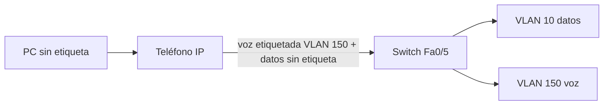

# VLAN de voz

Parte de: [[VLANs]]

> [!info] Cómo avanzar
> `progreso`: **pendiente** → **viendo** (estudiando) → **visto** (contestaste la autoevaluación sin abrir las respuestas) → **dominado** (hiciste el laboratorio o lo aplicaste de verdad).

## Contenido

### Qué es
La **VLAN de voz** es una VLAN dedicada al tráfico de **telefonía IP**. Permite que un teléfono IP y una PC compartan el mismo cable y el mismo puerto del switch (la PC se conecta al puerto de PC del teléfono), pero que cada uno quede en su propia VLAN: los datos en la VLAN de usuarios y la voz en la VLAN de voz. Así la voz recibe prioridad (QoS) y queda separada del resto.

### Cómo funciona
1. El puerto del switch se configura como **access** en la VLAN de datos y además con una **VLAN de voz**.
2. El switch le anuncia al teléfono cuál es la VLAN de voz mediante **CDP** (en teléfonos Cisco) o **LLDP-MED** (estándar, para otros fabricantes).
3. El teléfono **etiqueta** sus tramas con 802.1Q en la VLAN de voz y les pone prioridad de capa 2 (CoS 5). La PC, conectada detrás del teléfono, envía tramas **sin etiqueta**, que el switch coloca en la VLAN de datos.
4. El switch puede confiar en las marcas de QoS del teléfono (`mls qos trust` o `trust device cisco-phone` en modelos que lo soportan) y priorizar la voz en sus colas. En capa 3 la voz se marca normalmente como **DSCP EF (46)** (ver [[QoS (calidad de servicio)]]).

Aunque internamente el puerto maneja tramas etiquetadas para la voz, para IOS sigue siendo un puerto de **acceso**, no un trunk completo. Muchos teléfonos se alimentan por **PoE**.



### Ejemplo
Puerto Fa0/5 con PC en VLAN 20 (Soporte) y teléfono en VLAN 120:

```text
SW1(config)# vlan 20
SW1(config-vlan)# name SOPORTE
SW1(config-vlan)# vlan 120
SW1(config-vlan)# name VOZ
SW1(config-vlan)# exit
SW1(config)# interface fa0/5
SW1(config-if)# switchport mode access
SW1(config-if)# switchport access vlan 20
SW1(config-if)# switchport voice vlan 120
SW1(config-if)# mls qos trust cos
SW1(config-if)# spanning-tree portfast
SW1(config-if)# end
SW1# show interfaces fa0/5 switchport
...
Access Mode VLAN: 20 (SOPORTE)
Voice VLAN: 120 (VOZ)
```

En el DHCP conviene un pool distinto para cada VLAN; para teléfonos Cisco suele agregarse la opción 150 con la IP del servidor de llamadas (TFTP). En [[Cisco Packet Tracer]] puedes simular esto con un IP Phone 7960, un switch 2960 y un router con Call Manager Express.

### Cuándo usarlo y cuándo no
Úsala siempre que haya telefonía IP en la red cableada: mejora calidad (prioridad), seguridad (el tráfico de voz no se mezcla con el de las PCs) y administración (subred separada para teléfonos). Si la empresa usa solo softphones como Teams en las laptops, la voz viaja en la VLAN de datos y la QoS se maneja de otra forma (por aplicación o puerto).

### Errores comunes
- **Configurar el puerto como trunk** para el teléfono: funciona, pero expone más VLAN de las necesarias; usa `switchport voice vlan`.
- **Olvidar CDP o LLDP-MED**: el teléfono no sabe en qué VLAN etiquetar y cae en la VLAN de datos.
- **No dar DHCP en la VLAN de voz**: el teléfono no obtiene IP.
- **No confiar en las marcas QoS** del teléfono: la voz compite con las descargas de la PC.

### Para profundizar
- [Cisco Catalyst 2960: guías de configuración (Voice VLAN)](https://www.cisco.com/c/en/us/support/switches/catalyst-2960-series-switches/products-installation-and-configuration-guides-list.html)
- [RFC 3246: Expedited Forwarding (DSCP EF)](https://www.rfc-editor.org/rfc/rfc3246)

## Autoevaluación

Contesta primero en voz alta o en papel; luego despliega la respuesta.

> [!question]- ¿Para qué sirve la VLAN de voz?
> Separa el tráfico de teléfonos IP del de datos para aplicarle prioridad (QoS) y seguridad, aunque teléfono y PC compartan el mismo puerto.

> [!question]- ¿Cómo se configura un puerto con PC en VLAN 10 y teléfono en VLAN 150?
> ```
> interface fa0/5
>  switchport mode access
>  switchport access vlan 10
>  switchport voice vlan 150
>  mls qos trust cos
> ```
> (`mls qos trust cos` depende del modelo; en Packet Tracer basta con `switchport voice vlan`).

