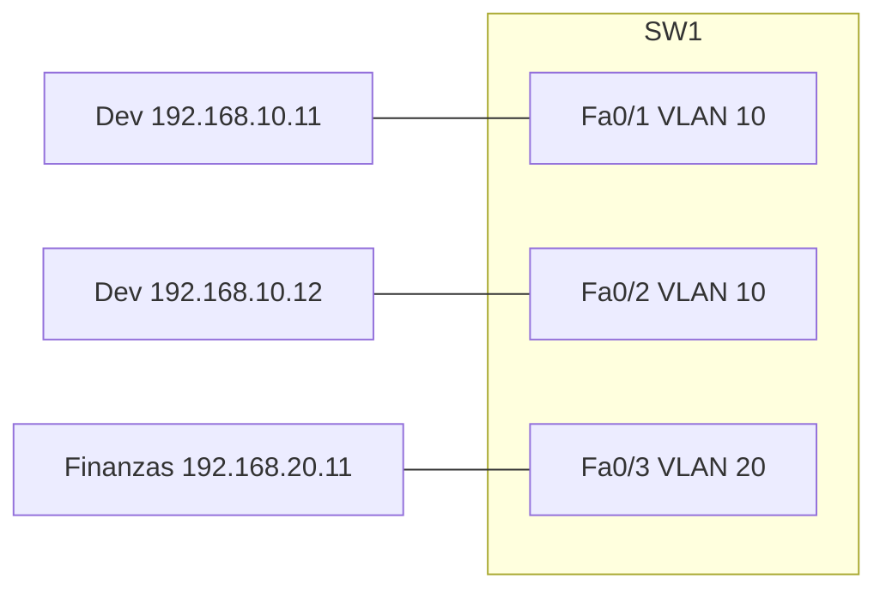

# VLANs

Parte de: [[19-Redes/02 Switching/_Índice Switching|Switching]]

> [!info] Cómo avanzar
> `progreso`: **pendiente** → **viendo** (estudiando) → **visto** (contestaste la autoevaluación sin abrir las respuestas) → **dominado** (hiciste el laboratorio o lo aplicaste de verdad).

## Contenido

### Qué es
Una **VLAN** (Virtual LAN) es una división lógica de un switch (o de varios) en **dominios de broadcast independientes**. Los puertos en VLAN distintas se comportan como si estuvieran en switches separados: no se ven en capa 2 aunque compartan el mismo equipo físico. Cada VLAN se corresponde normalmente con una subred IP. Esta nota da el panorama; los tipos especiales están en [[VLAN nativa]], [[VLAN de administración]] y [[VLAN de voz]].

### Cómo funciona
- Cada VLAN tiene un **ID** de 12 bits: de 1 a 4094 son utilizables. El rango **normal** es 1 a 1005 (1002 a 1005 están reservadas para tecnologías antiguas) y el **extendido** de 1006 a 4094.
- La **VLAN 1** es la predeterminada: todos los puertos empiezan ahí y no se puede borrar.
- Un **puerto de acceso** pertenece a una sola VLAN y conecta un equipo final.
- Un **puerto troncal** transporta varias VLAN entre switches o hacia un router, etiquetando las tramas con **802.1Q** (ver [[Trunking 802.1Q]]).
- Para comunicar VLAN distintas se necesita **routing entre VLANs** (ver [[Routing entre VLANs (router on a stick y switch capa 3)]]).

Beneficios:
- **Seguridad**: Finanzas no ve el tráfico de capa 2 de Invitados; los controles se aplican al enrutar entre VLAN.
- **Rendimiento**: dominios de broadcast más pequeños.
- **Flexibilidad**: agrupas por función, no por ubicación física; un desarrollador en el piso 3 puede estar en la misma VLAN que su equipo del piso 1.
- **Administración**: cambiar a alguien de departamento es cambiar la VLAN del puerto, no recablear.



### Ejemplo
Crear VLAN, nombrarlas y asignar puertos en un Cisco 2960:

```text
SW1(config)# vlan 10
SW1(config-vlan)# name DESARROLLO
SW1(config-vlan)# vlan 20
SW1(config-vlan)# name FINANZAS
SW1(config-vlan)# exit
SW1(config)# interface range fa0/1 - 12
SW1(config-if-range)# switchport mode access
SW1(config-if-range)# switchport access vlan 10
SW1(config-if-range)# interface range fa0/13 - 20
SW1(config-if-range)# switchport mode access
SW1(config-if-range)# switchport access vlan 20
SW1(config-if-range)# end
SW1# show vlan brief
```

Ahora, si por error pones a dos PCs con IP de la misma subred pero en VLAN distintas, **no se harán ping**: el ARP de una nunca llega a la otra porque son dominios de broadcast separados. La IP "dice" que están juntas, pero la capa 2 dice que no. Siempre alinea VLAN y subred.

Si asignas un puerto a una VLAN que no existe, Cisco la crea automáticamente en muchos modelos, pero conviene crearla y nombrarla explícitamente. La base de datos de VLAN se guarda en `flash:vlan.dat`, no en la running-config.

Practica en el [[Lab 1 - VLANs, trunk y router on a stick en Packet Tracer]].

### Cuándo usarlo y cuándo no
Usa VLAN en cualquier red con más de un tipo de usuario o dispositivo: usuarios, servidores, voz, invitados, IoT, gestión. No crees una VLAN por persona ni cientos sin necesidad: cada una agrega administración y reglas de routing. Las VLAN no son un control de seguridad completo por sí solas; combínalas con ACL o firewall entre ellas.

### Errores comunes
- **IP y VLAN desalineadas**: misma subred en VLAN distintas o distintas subredes en la misma VLAN.
- **Dejar todo en VLAN 1**, incluida la gestión.
- **Olvidar permitir la VLAN en los trunks**: la VLAN existe en ambos switches, pero no cruza.
- **Borrar `vlan.dat` sin querer** al limpiar el switch: perderás las VLAN.

### Para profundizar
- [IEEE 802.1 Working Group (802.1Q)](https://www.ieee802.org/1/)
- [Cisco Catalyst 2960: guías de configuración](https://www.cisco.com/c/en/us/support/switches/catalyst-2960-series-switches/products-installation-and-configuration-guides-list.html)

## Subtemas

- [[VLAN nativa]]
- [[VLAN de administración]]
- [[VLAN de voz]]

## Autoevaluación

Contesta primero en voz alta o en papel; luego despliega la respuesta.

> [!question]- ¿Qué es una VLAN?
> Una división lógica de un switch en varios dominios de broadcast. Equipos en VLANs distintas no se ven en capa 2 aunque estén en el mismo switch.

> [!question]- ¿Qué beneficios dan las VLANs?
> Seguridad (separan departamentos), menos broadcast, organización por función y no por ubicación física, y facilidad para mover usuarios.

> [!question]- ¿Qué comandos crean la VLAN 10 y asignan Fa0/1 a ella?
> ```
> vlan 10
>  name VENTAS
> interface fa0/1
>  switchport mode access
>  switchport access vlan 10
> ```

> [!question]- Dos PCs en VLAN 10 y VLAN 20 con IPs de la misma subred no se hacen ping. ¿Por qué?
> Porque están en dominios de broadcast distintos: el ARP de una nunca llega a la otra. Cada VLAN debe tener su subred y un router para comunicarse.

## Práctica

- [[Lab 1 - VLANs, trunk y router on a stick en Packet Tracer]]

## Progreso de los subtemas

```base
filters:
  and:
    - file.inFolder("19-Redes/02 Switching/VLANs")
    - file.name != "VLANs"
views:
  - type: table
    name: Progreso
    order:
      - file.name
      - progreso
      - nivel
```
