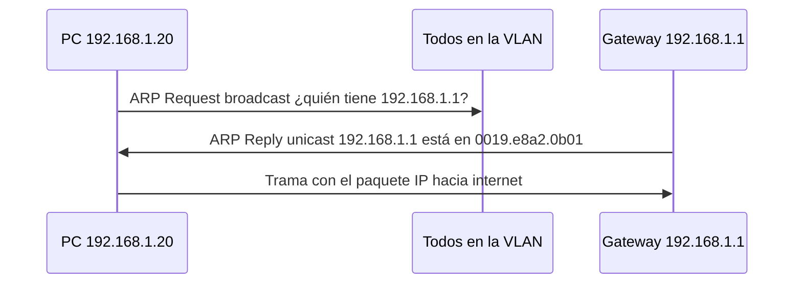

# ARP

Parte de: [[_Índice Direccionamiento IP]]

> [!info] Cómo avanzar
> `progreso`: **pendiente** → **viendo** (estudiando) → **visto** (contestaste la autoevaluación sin abrir las respuestas) → **dominado** (hiciste el laboratorio o lo aplicaste de verdad).

## Contenido

### Qué es
**ARP** (Address Resolution Protocol) traduce una **dirección IPv4 conocida** en la **dirección MAC** correspondiente dentro de la misma red local. Es necesario porque, para enviar un paquete IP por Ethernet, el equipo debe poner una MAC destino en la trama, y lo único que sabe del destino es su IP. Trabaja entre la capa 2 y la capa 3, usa tramas Ethernet con EtherType `0x0806` y no cruza routers.

### Cómo funciona
1. El equipo quiere enviar un paquete a una IP. Con su máscara decide si el destino está **en su red** o no.
   - Si está en su red, necesita la MAC **del destino**.
   - Si está en otra red, necesita la MAC **de su gateway** (la IP del destino no cambia; solo la trama va al router).
2. Busca en su **caché ARP**. Si la entrada existe, la usa.
3. Si no, envía un **ARP Request** en **broadcast** (MAC destino `FF:FF:FF:FF:FF:FF`): "¿Quién tiene 192.168.1.1? Responde a 192.168.1.20".
4. Solo el dueño de esa IP responde con un **ARP Reply** en **unicast** directo al solicitante, con su MAC.
5. Ambos guardan la pareja IP–MAC en la caché por un tiempo (en Windows son segundos a minutos; en Cisco IOS, **4 horas** por defecto).



Variantes: **ARP gratuito** (un equipo anuncia su propia IP–MAC, por ejemplo al levantar una interfaz o en HSRP al cambiar de router activo) y **proxy ARP** (un router responde por equipos de otra red; está activo por defecto en interfaces Cisco, aunque en diseños modernos se deshabilita).

**En IPv6 no hay ARP**: lo reemplaza **NDP** (Neighbor Discovery Protocol), con mensajes ICMPv6 Neighbor Solicitation y Neighbor Advertisement enviados a la dirección multicast de nodo solicitado (ver [[IPv6 multicast]]).

**Seguridad**: ARP no tiene autenticación; cualquiera puede responder. En el **ARP spoofing** (o envenenamiento ARP) un atacante envía respuestas falsas diciendo "la IP del gateway está en mi MAC" y se coloca en medio de las comunicaciones (MITM). Se mitiga con **Dynamic ARP Inspection** junto con DHCP snooping en los switches (ver [[DHCP snooping y Dynamic ARP Inspection]]), con entradas estáticas en equipos críticos y con cifrado de extremo a extremo (TLS), que hace inútil la información interceptada.

### Ejemplo
En tu PC:

```text
C:\> arp -a
Interfaz: 192.168.1.20 --- 0x7
  Dirección de Internet    Dirección física      Tipo
  192.168.1.1              00-19-e8-a2-0b-01     dinámico
  192.168.1.255            ff-ff-ff-ff-ff-ff     estático
C:\> arp -d *              # borra la caché (requiere administrador)
```

En un router Cisco:

```text
R1# show ip arp
Protocol  Address        Age (min)  Hardware Addr   Type   Interface
Internet  192.168.1.1        -      0019.e8a2.0b01  ARPA   GigabitEthernet0/0
Internet  192.168.1.20      12      3c52.8212.3456  ARPA   GigabitEthernet0/0
R1# clear arp-cache
```

En [[Wireshark (captura y análisis de tráfico)]] usa el filtro `arp` y haz `ping` a un equipo que no esté en la caché: verás el Request y el Reply.

### Cuándo usarlo y cuándo no
ARP funciona solo; tú lo consultas para diagnosticar. Si un `ping` a un equipo de la misma red falla, revisa si hay entrada ARP: si no la hay, el problema es de capa 1 o 2 (cable, VLAN, firewall del host que no responde ARP es raro, pero un equipo apagado sí). Si hay una entrada con una MAC inesperada para el gateway, sospecha de spoofing o de un conflicto de IP.

### Errores comunes
- **Buscar la MAC del servidor remoto**: solo se resuelve la del gateway.
- **Pensar que la respuesta ARP es broadcast**: es unicast.
- **Ignorar conflictos de IP**: dos equipos con la misma IP hacen que la MAC en la caché cambie y la conexión sea intermitente.
- **Olvidar que ARP no existe en IPv6**.

### Para profundizar
- [RFC 826: An Ethernet Address Resolution Protocol](https://www.rfc-editor.org/rfc/rfc826)
- [RFC 4861: Neighbor Discovery para IPv6](https://www.rfc-editor.org/rfc/rfc4861)

## Autoevaluación

Contesta primero en voz alta o en papel; luego despliega la respuesta.

> [!question]- ¿Qué resuelve ARP?
> La dirección **MAC** que corresponde a una IPv4 dentro de la misma red local.

> [!question]- ¿La petición ARP es unicast o broadcast? ¿Y la respuesta?
> La petición va por **broadcast** (`FF:FF:FF:FF:FF:FF`); la respuesta es **unicast**.

> [!question]- Si el destino está en otra red, ¿de quién busca la MAC el equipo?
> De su **puerta de enlace** (default gateway): el router es quien reenvía el paquete.

> [!question]- ¿Qué reemplaza a ARP en IPv6?
> **NDP** (Neighbor Discovery): mensajes Neighbor Solicitation / Advertisement por multicast.

> [!question]- ¿Qué ataque abusa de ARP y cómo se mitiga?
> **ARP spoofing**: alguien responde con su MAC para interceptar tráfico. Se mitiga con Dynamic ARP Inspection ([[DHCP snooping y Dynamic ARP Inspection]]).

## Práctica

- [[Lab 1 - Subredes IPv4 en Packet Tracer]]

