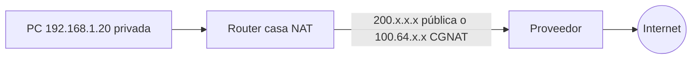

# Direcciones públicas y privadas

Parte de: [[_Índice Direccionamiento IP]]

> [!info] Cómo avanzar
> `progreso`: **pendiente** → **viendo** (estudiando) → **visto** (contestaste la autoevaluación sin abrir las respuestas) → **dominado** (hiciste el laboratorio o lo aplicaste de verdad).

## Contenido

### Qué es
Las direcciones IPv4 se dividen, según su alcance, en **públicas** (únicas en todo internet y enrutables globalmente) y **privadas** (reutilizables dentro de cualquier organización y no enrutables en internet). Además hay bloques de **uso especial**: loopback, link-local (APIPA), CGNAT, documentación y multicast. Esta nota da el panorama y la relación entre los subtemas: [[IP pública]], [[IP privada (RFC 1918)]], [[Loopback y APIPA]] y [[Dirección de red y de broadcast]].

### Cómo funciona
El espacio IPv4 tiene unos 4,300 millones de direcciones, insuficientes para todos los dispositivos del mundo. La solución de los años 90 fue reservar rangos privados (RFC 1918) que cualquiera puede usar en su LAN y traducirlos a una dirección pública al salir a internet con **NAT/PAT** (ver [[NAT y PAT]]). Así, miles de redes caseras usan `192.168.1.0/24` al mismo tiempo sin conflicto, porque esas direcciones nunca aparecen en internet.

| Tipo | Rango | Para qué |
|---|---|---|
| Privadas | 10.0.0.0/8, 172.16.0.0/12, 192.168.0.0/16 | LAN de empresas y hogares |
| CGNAT (espacio compartido) | 100.64.0.0/10 | NAT del proveedor hacia sus clientes |
| Loopback | 127.0.0.0/8 | El propio equipo |
| Link-local (APIPA) | 169.254.0.0/16 | Autoasignada cuando no hay DHCP |
| Documentación | 192.0.2.0/24, 198.51.100.0/24, 203.0.113.0/24 | Ejemplos en libros y manuales |
| Multicast | 224.0.0.0/4 | Grupos |
| Públicas | El resto asignable | Servicios visibles en internet |

Dentro de cada subred, además, la primera dirección es la de red y la última la de broadcast; no se asignan a equipos.



### Ejemplo
Tu PC de casa tiene `192.168.1.20`. Cuando consultas la API de Itzamna.Dionisio publicada en Azure, el router de casa traduce tu IP a la pública que te asignó el proveedor. Para saber cuál es:

```powershell
# IP privada local
ipconfig | findstr IPv4
# IP pública vista desde internet (servicio externo)
(Invoke-WebRequest -UseBasicParsing https://api.ipify.org).Content
```

Si la IP que muestra la interfaz WAN de tu módem está en `100.64.0.0/10`, tu proveedor usa CGNAT: hay una segunda capa de NAT y no podrás abrir puertos entrantes desde internet hacia tu casa.

Con Python puedes clasificar direcciones rápidamente:

```python
import ipaddress
for a in ["10.1.2.3", "172.32.0.1", "100.70.1.1", "169.254.10.5", "8.8.8.8"]:
    ip = ipaddress.ip_address(a)
    print(a, "privada" if ip.is_private else "pública/otra", ip.is_link_local)
```

### Cuándo usarlo y cuándo no
Usa direcciones privadas para todo lo interno: VLAN, servidores, VNets de Azure (que exigen rangos privados o propios). Usa públicas solo en las interfaces o servicios que deben ser alcanzables desde internet (balanceadores, VPN, servidores web en la DMZ), normalmente asignadas por tu proveedor o la nube. Planea los rangos privados para que no se traslapen con los de socios, VPN o la nube; un traslape impide enrutar entre ambas redes.

### Errores comunes
- **Creer que una IP privada viaja por internet**: los routers de internet descartan esos destinos y el tráfico depende de NAT.
- **Pensar que privada significa segura**: NAT oculta, pero no sustituye a un firewall.
- **Elegir 192.168.0.0/24 o 192.168.1.0/24 para la empresa**: chocan con la red casera de quienes se conectan por VPN.
- **Confundir CGNAT con privado RFC 1918**: es otro rango y otra finalidad.

### Para profundizar
- [RFC 1918: direcciones para redes privadas](https://www.rfc-editor.org/rfc/rfc1918)
- [RFC 6598: espacio compartido 100.64.0.0/10](https://www.rfc-editor.org/rfc/rfc6598)
- [IANA: registro de direcciones IPv4 de propósito especial](https://www.iana.org/assignments/iana-ipv4-special-registry/iana-ipv4-special-registry.xhtml)

## Subtemas

- [[IP pública]]
- [[IP privada (RFC 1918)]]
- [[Loopback y APIPA]]
- [[Dirección de red y de broadcast]]

## Autoevaluación

Contesta primero en voz alta o en papel; luego despliega la respuesta.

> [!question]- ¿Por qué existen las direcciones privadas?
> Porque IPv4 se agotó: las privadas se reutilizan dentro de cada red y salen a internet traducidas por **NAT** ([[NAT y PAT]]).

> [!question]- ¿Una IP privada puede viajar por internet?
> No: los proveedores no enrutan esos rangos.

## Práctica

- [[Lab 1 - Subredes IPv4 en Packet Tracer]]

## Progreso de los subtemas

```base
filters:
  and:
    - file.inFolder("19-Redes/03 Direccionamiento IP/Direcciones públicas y privadas")
    - file.name != "Direcciones públicas y privadas"
views:
  - type: table
    name: Progreso
    order:
      - file.name
      - progreso
      - nivel
```
