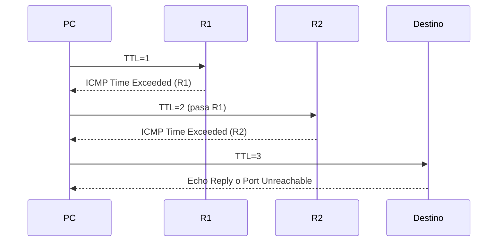

# ICMP, ping y traceroute

Parte de: [[_Índice Direccionamiento IP]]

> [!info] Cómo avanzar
> `progreso`: **pendiente** → **viendo** (estudiando) → **visto** (contestaste la autoevaluación sin abrir las respuestas) → **dominado** (hiciste el laboratorio o lo aplicaste de verdad).

## Contenido

### Qué es
**ICMP** (Internet Control Message Protocol) es el protocolo de **mensajes de control y error** de IP. No transporta datos de aplicaciones: informa que un destino no es alcanzable, que se acabó el TTL, que hay una ruta mejor, o responde a pruebas de eco. Sobre ICMP se construyen las dos herramientas de diagnóstico más usadas: **ping** (¿llego al destino?) y **traceroute** (¿por dónde paso?). En IPv6 existe **ICMPv6**, que además incluye Neighbor Discovery.

### Cómo funciona
Mensajes ICMP clave (tipo):
- **8 Echo Request** y **0 Echo Reply**: los usa ping.
- **3 Destination Unreachable**: con códigos como red inalcanzable, host inalcanzable, puerto inalcanzable o "fragmentación necesaria" (vital para descubrir el MTU del camino).
- **11 Time Exceeded**: el TTL llegó a 0 en un router.
- **5 Redirect**: el router avisa de un gateway mejor en la misma red.

**ping**: envía Echo Requests y mide el tiempo hasta cada Echo Reply (RTT). Indica pérdida y latencia. En Cisco IOS los símbolos son `!` (respuesta), `.` (tiempo agotado), `U` (destino inalcanzable) y otros. El primer ping en Cisco a menudo pierde el primer paquete (`.!!!!`) mientras se resuelve ARP.

**traceroute**: envía paquetes con **TTL creciente** (1, 2, 3…). El primer router decrementa el TTL a 0 y responde con *Time Exceeded*, revelando su IP; el segundo hace lo mismo con TTL 2, y así sucesivamente hasta llegar al destino.
- **`tracert` de Windows** usa **ICMP Echo Request** con TTL creciente.
- **`traceroute` de Linux/macOS** usa por defecto **UDP** a puertos altos (desde 33434); el destino responde con *Port Unreachable* y así se sabe que llegó. Con `-I` usa ICMP y con `-T` TCP.
- **`traceroute` de Cisco IOS** también usa UDP.
Esta diferencia importa porque un firewall puede permitir uno y bloquear otro.



### Ejemplo
Diagnóstico desde la PC hacia la API de Itzamna.Dionisio:

```text
C:\> ping -n 4 10.50.1.10
Tiempo de espera agotado para esta solicitud. (x4)
C:\> tracert -d 10.50.1.10
  1   1 ms  192.168.10.1
  2   3 ms  10.0.0.2
  3   *     *     *    Tiempo de espera agotado
```

El paquete llega a `10.0.0.2` y se pierde después: revisa la ruta de ese router hacia `10.50.0.0/16` o una ACL. Desde el router Cisco puedes usar ping y traceroute extendidos con origen específico:

```text
R1# ping 10.50.1.10 source g0/0 repeat 20
R1# traceroute 10.50.1.10 source loopback0
```

**Un servidor que no responde ping pero su web sí carga**: es muy común. El firewall del servidor o de la red bloquea ICMP Echo (Windows Server lo bloquea por defecto en muchos perfiles; Azure y otros servicios también pueden filtrarlo), mientras permite TCP 443. Por eso, para probar un servicio, usa una prueba al puerto:

```powershell
Test-NetConnection 10.50.1.10 -Port 443
```

### Cuándo usarlo y cuándo no
Ping es la primera prueba de conectividad de capa 3; traceroute localiza en qué salto se corta o dónde aparece la latencia. No concluyas que algo está caído solo porque no responde ping. Y no bloquees todo ICMP en tus firewalls: romperías el descubrimiento de MTU (tipo 3 código 4) y, en IPv6, el funcionamiento básico de la red.

### Errores comunes
- **Concluir "caído" por falta de ping**.
- **Leer los asteriscos de traceroute como pérdida real**: muchos routers limitan o no envían ICMP; si los saltos siguientes responden, no hay problema.
- **Olvidar el ping con origen** en routers: sin `source`, el router usa la IP de la interfaz de salida y la ruta de regreso puede ser distinta.
- **Bloquear ICMPv6 por completo**: rompe NDP y SLAAC.

### Para profundizar
- [RFC 792: ICMP](https://www.rfc-editor.org/rfc/rfc792)
- [RFC 4443: ICMPv6](https://www.rfc-editor.org/rfc/rfc4443)
- [RFC 4890: recomendaciones para filtrar ICMPv6 en firewalls](https://www.rfc-editor.org/rfc/rfc4890)

## Autoevaluación

Contesta primero en voz alta o en papel; luego despliega la respuesta.

> [!question]- ¿Qué mensajes ICMP usa ping?
> Echo Request (tipo 8) y Echo Reply (tipo 0).

> [!question]- ¿Cómo funciona traceroute?
> Envía paquetes con TTL 1, 2, 3… Cada router que baja el TTL a 0 descarta el paquete y responde **ICMP Time Exceeded** (tipo 11), y así se descubre cada salto.

> [!question]- ¿Qué diferencia hay entre `tracert` de Windows y `traceroute` de Linux?
> `tracert` usa ICMP Echo; `traceroute` en Linux usa UDP por omisión.

> [!question]- Un servidor no responde ping pero su página web carga. ¿Por qué?
> Un firewall bloquea ICMP. Que ping falle **no** prueba que el equipo esté caído.

## Práctica

- [[Lab 1 - Subredes IPv4 en Packet Tracer]]

