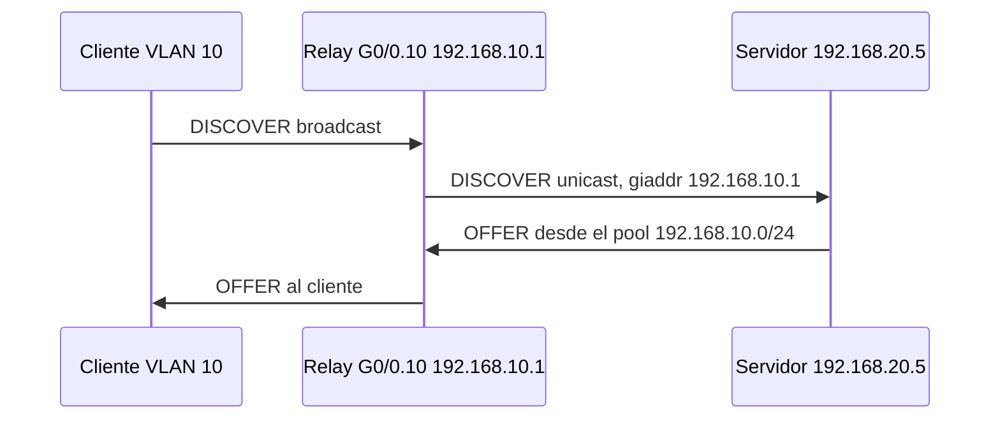

# DHCP relay

Parte de: [[DHCP]]

> [!info] Cómo avanzar
> `progreso`: **pendiente** → **viendo** (estudiando) → **visto** (contestaste la autoevaluación sin abrir las respuestas) → **dominado** (hiciste el laboratorio o lo aplicaste de verdad).

## Contenido

### Qué es
Un **DHCP relay** (agente de retransmisión) es un router o switch capa 3 que **reenvía las peticiones DHCP de los clientes de una subred hacia un servidor DHCP que está en otra subred**. Hace falta porque el Discover y el Request iniciales son broadcasts y los routers no reenvían broadcasts. Gracias al relay, una empresa puede tener un servidor DHCP central para todas sus VLAN y sucursales.

### Cómo funciona
1. El cliente envía un DHCPDISCOVER en broadcast en su VLAN.
2. El router (o la SVI del switch capa 3) que es el **gateway de esa VLAN** recibe el broadcast en la interfaz configurada con `ip helper-address`.
3. El relay convierte el mensaje en **unicast** hacia la IP del servidor y llena el campo **giaddr** (gateway IP address) con la IP de la interfaz por donde llegó la petición.
4. El servidor lee `giaddr` y elige el **pool cuya red contiene esa dirección**. Así sabe de qué subred es el cliente, aunque el paquete le llegue desde lejos.
5. El servidor responde al relay, y este entrega el Offer y el Ack al cliente en su VLAN.

Opcionalmente, el relay agrega la **opción 82** con información del puerto o circuito del cliente, que el servidor puede usar para políticas.



En Cisco IOS, `ip helper-address` **no solo reenvía DHCP**: por defecto también reenvía otros broadcasts UDP como TFTP (69), DNS (53), servicio de tiempo (37), NetBIOS (137 y 138), TACACS (49) y BOOTP (67 y 68). Si no los quieres, desactívalos con `no ip forward-protocol udp <puerto>`.

### Ejemplo
Servidor Windows DHCP en la VLAN 20 (`192.168.20.5`) con ámbitos para las VLAN 10 y 30. El router on a stick tiene las subinterfaces:

```text
R1(config)# interface g0/0.10
R1(config-subif)# ip address 192.168.10.1 255.255.255.0
R1(config-subif)# ip helper-address 192.168.20.5
R1(config-subif)# interface g0/0.30
R1(config-subif)# ip address 192.168.30.1 255.255.255.0
R1(config-subif)# ip helper-address 192.168.20.5
R1(config-subif)# end
R1# show ip interface g0/0.10 | include Helper
  Helper address is 192.168.20.5
```

El comando va en la interfaz **que recibe a los clientes**, no en la que da al servidor. En el servidor, cada ámbito debe tener como red la de cada VLAN y como gateway `192.168.10.1` o `192.168.30.1` respectivamente. En un switch capa 3 el comando va en la SVI: `interface vlan 10`, `ip helper-address 192.168.20.5`.

Si tienes dos servidores DHCP por redundancia, agrega dos líneas `ip helper-address`.

Verificación: en el cliente `ipconfig /all` muestra el servidor DHCP `192.168.20.5`; en el servidor, la concesión aparece en el ámbito de la VLAN 10.

### Cuándo usarlo y cuándo no
Úsalo siempre que el servidor DHCP no esté en la misma VLAN que los clientes, que es lo normal en empresas con servidor central. Si cada sucursal tiene su propio router como servidor DHCP local, no necesitas relay (aunque perderías la gestión centralizada). En IPv6, el equivalente es `ipv6 dhcp relay destination <dirección>`.

### Errores comunes
- **Configurar el helper en la interfaz equivocada** (la del lado del servidor).
- **No tener ámbito en el servidor para la red de `giaddr`**: el servidor ignora la petición.
- **Ruta de regreso faltante** desde el servidor a la subred del relay.
- **DHCP snooping** en el switch de acceso que descarta respuestas o inserta la opción 82 de forma que el servidor rechaza.

### Para profundizar
- [RFC 1542: aclaraciones y extensiones de BOOTP (agentes relay)](https://www.rfc-editor.org/rfc/rfc1542)
- [RFC 3046: opción 82 Relay Agent Information](https://www.rfc-editor.org/rfc/rfc3046)
- [RFC 2131: DHCP](https://www.rfc-editor.org/rfc/rfc2131)

## Autoevaluación

Contesta primero en voz alta o en papel; luego despliega la respuesta.

> [!question]- ¿Para qué sirve un DHCP relay?
> Los Discover son broadcast y el router no los reenvía. El relay convierte esos broadcasts en unicast hacia un servidor DHCP de otra red.

> [!question]- ¿Qué comando configura el relay en IOS y dónde va?
> `ip helper-address <IP del servidor>` en la interfaz del router que da a los **clientes** (la puerta de enlace de su VLAN).

> [!question]- ¿Cómo sabe el servidor de qué pool asignar?
> El relay pone su IP de la interfaz de los clientes en el campo **giaddr**; el servidor elige el pool que contiene esa red.

## Práctica

- [[Lab 1 - DHCP y NAT-PAT en Packet Tracer]]

