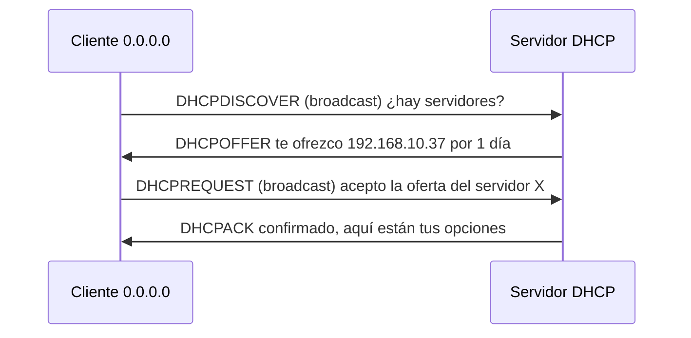

# Proceso DORA de DHCP

Parte de: [[DHCP]]

> [!info] Cómo avanzar
> `progreso`: **pendiente** → **viendo** (estudiando) → **visto** (contestaste la autoevaluación sin abrir las respuestas) → **dominado** (hiciste el laboratorio o lo aplicaste de verdad).

## Contenido

### Qué es
**DORA** es el acrónimo de los cuatro mensajes con los que un cliente obtiene su configuración por DHCP: **D**iscover, **O**ffer, **R**equest y **A**cknowledgment. Entender el intercambio, quién lo envía, si es broadcast o unicast, y qué pasa al renovar es fundamental para diagnosticar fallas de DHCP y para leer capturas.

### Cómo funciona


1. **Discover**: el cliente, sin IP, envía un broadcast desde `0.0.0.0:68` a `255.255.255.255:67` buscando servidores. Incluye su MAC y, a veces, la IP que tuvo antes.
2. **Offer**: cada servidor que lo recibe ofrece una dirección con su máscara, gateway, DNS y tiempo de lease. Puede ir en unicast o en broadcast según el flag que puso el cliente.
3. **Request**: el cliente elige una oferta (normalmente la primera) y envía un Request **en broadcast**, aunque ya conoce al servidor. ¿Por qué? Porque así **todos los servidores** que hicieron ofertas se enteran de cuál se aceptó; los demás retiran su oferta y liberan la dirección. Además, el cliente todavía no tiene una IP confirmada.
4. **Ack**: el servidor elegido confirma. El cliente puede hacer una comprobación ARP para verificar que nadie más use la dirección y, si la encuentra ocupada, la rechaza con un **DHCPDECLINE**. Si el servidor no puede cumplir, responde **DHCPNAK**.

**Renovación del lease**:
- Al **50%** del lease (T1), el cliente intenta **renovar** con un Request **unicast** directo al servidor que se la dio. Si recibe Ack, el contador se reinicia y conserva su IP.
- Si no hay respuesta, al **87.5%** (T2) intenta **rebind** con un Request en **broadcast** a cualquier servidor.
- Si el lease expira sin respuesta, el cliente pierde la dirección y empieza de nuevo con un Discover.
- Al apagarse correctamente o con `ipconfig /release`, envía **DHCPRELEASE** para devolverla.

Hay además un **DHCPINFORM**, que usa un equipo con IP estática para pedir solo opciones.

### Ejemplo
Captura en [[Wireshark (captura y análisis de tráfico)]] con el filtro `dhcp` (en versiones antiguas `bootp`) mientras haces en Windows:

```text
C:\> ipconfig /release
C:\> ipconfig /renew
```

Verás: Release, luego Discover, Offer, Request y ACK. Expande "Dynamic Host Configuration Protocol" y revisa la opción 53 (tipo de mensaje), la 50 (IP solicitada), la 51 (tiempo de lease), la 3 (router), la 6 (DNS) y la 54 (identificador del servidor). Con lease de 8 horas, verás la renovación unicast a las 4 horas.

En un router Cisco que actúa como servidor:

```text
R1# debug ip dhcp server events
R1# show ip dhcp binding
IP address       Client-ID/Hardware address  Lease expiration       Type
192.168.10.37    0100.1a2b.3c4d.5e           Nov 11 2026 09:14 AM   Automatic
R1# undebug all
```

En [[Cisco Packet Tracer]], en modo simulación con el filtro DHCP, haz clic en "DHCP" en la configuración IP de la PC y observa los cuatro sobres.

### Cuándo usarlo y cuándo no
DORA ocurre solo; lo que importa es reconocer en qué paso falla:
- No sale el Discover: problema del cliente o de capa 1/2.
- Hay Discover pero no Offer: servidor caído, sin relay, pool agotado o DHCP snooping bloqueando.
- Hay Offer pero no Ack: conflicto, NAK por red equivocada o problemas con la opción 82.

### Errores comunes
- **Creer que el Request es unicast**: en la obtención inicial es broadcast.
- **Pensar que el lease se renueva al expirar**: se intenta a la mitad.
- **Olvidar que el Offer puede ser broadcast**: depende del flag del cliente.
- **Ignorar los DHCPDECLINE en los logs**: indican direcciones ocupadas por equipos con IP estática dentro del pool.

### Para profundizar
- [RFC 2131: Dynamic Host Configuration Protocol](https://www.rfc-editor.org/rfc/rfc2131)
- [RFC 2132: opciones de DHCP](https://www.rfc-editor.org/rfc/rfc2132)

## Autoevaluación

Contesta primero en voz alta o en papel; luego despliega la respuesta.

> [!question]- ¿Qué significa DORA?
> **Discover** (cliente busca servidores, broadcast) → **Offer** (servidor ofrece IP) → **Request** (cliente pide la oferta elegida, broadcast) → **Acknowledge** (servidor confirma).

> [!question]- ¿Por qué el Request se manda en broadcast si el cliente ya conoce al servidor?
> Para avisar a **todos** los servidores qué oferta aceptó; los demás liberan la IP que habían ofrecido.

> [!question]- ¿Qué pasa al llegar a la mitad del lease?
> El cliente intenta renovar con un Request unicast al servidor (T1 = 50 %). Si no responde, a T2 (87.5 %) lo intenta con cualquier servidor.

## Práctica

- [[Lab 1 - DHCP y NAT-PAT en Packet Tracer]]

