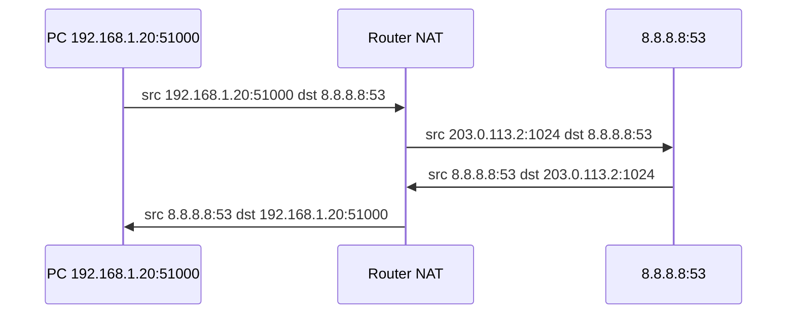

# NAT y PAT

Parte de: [[19-Redes/04 Servicios de red/_Índice Servicios de red|Servicios de red]]

> [!info] Cómo avanzar
> `progreso`: **pendiente** → **viendo** (estudiando) → **visto** (contestaste la autoevaluación sin abrir las respuestas) → **dominado** (hiciste el laboratorio o lo aplicaste de verdad).

## Contenido

### Qué es
**NAT** (Network Address Translation) es la función de un router o firewall que **cambia las direcciones IP** (y, en PAT, también los puertos) de los paquetes cuando cruzan de una red a otra. Su uso principal es permitir que equipos con IP privada (RFC 1918) salgan a internet usando una o pocas IP públicas, y publicar servidores internos. Hay tres variantes: [[NAT estático]], [[NAT dinámico]] y [[PAT (sobrecarga de NAT)]].

### Cómo funciona
**Terminología de Cisco** (aparece en el examen y en `show ip nat translations`):

| Término | Qué es | Ejemplo |
|---|---|---|
| **Inside local** | La IP real del equipo interno | 192.168.1.20 |
| **Inside global** | Cómo se ve ese equipo desde afuera (después de traducir) | 203.0.113.2 |
| **Outside local** | Cómo ve el equipo interno al host externo | 8.8.8.8 (normalmente igual que el global) |
| **Outside global** | La IP real del host externo | 8.8.8.8 |

"Inside/outside" indica de qué lado está el equipo; "local/global" indica desde dónde se mira la dirección.

**Flujo**:
1. La PC `192.168.1.20` envía un paquete a `8.8.8.8`.
2. El router recibe por una interfaz **inside**, consulta la regla NAT, cambia el origen a `203.0.113.2` (con un puerto distinto si es PAT) y guarda la traducción en su tabla.
3. Sale por la interfaz **outside**.
4. La respuesta llega a `203.0.113.2`; el router busca la traducción, regresa el destino a `192.168.1.20` y entrega.



| Tipo | Mapeo | Uso |
|---|---|---|
| Estático | 1 privada ↔ 1 pública, fijo | Publicar un servidor |
| Dinámico | Privadas → pool de públicas, 1 a 1 temporal | Pocos usuarios con pool de públicas |
| PAT (sobrecarga) | Muchas privadas → 1 pública con distintos puertos | Salida a internet de una LAN (lo más común) |

### Ejemplo
Marcar interfaces y verificar en un router Cisco:

```text
R1(config)# interface g0/0
R1(config-if)# ip nat inside
R1(config-if)# interface g0/1
R1(config-if)# ip nat outside
R1(config-if)# exit
R1(config)# access-list 1 permit 192.168.1.0 0.0.0.255
R1(config)# ip nat inside source list 1 interface g0/1 overload
R1(config)# end
R1# show ip nat translations
Pro  Inside global      Inside local        Outside local    Outside global
udp  203.0.113.2:1024   192.168.1.20:51000  8.8.8.8:53       8.8.8.8:53
tcp  203.0.113.2:1025   192.168.1.21:50122  20.42.65.92:443  20.42.65.92:443
R1# show ip nat statistics
R1# clear ip nat translation *
R1# debug ip nat
```

`show ip nat statistics` muestra qué interfaces son inside/outside, cuántas traducciones hay, y "hits" y "misses": si los hits no suben al generar tráfico, la regla no está aplicando.

Practica en el [[Lab 1 - DHCP y NAT-PAT en Packet Tracer]].

### Cuándo usarlo y cuándo no
NAT es casi obligatorio en IPv4 para salir a internet desde redes privadas. También se usa para resolver traslapes entre redes al conectar dos empresas. En IPv6 la idea es **no** usar NAT: cada equipo tiene dirección global y la seguridad la da el firewall. Recuerda que NAT rompe el modelo de extremo a extremo: complica VoIP, VPN IPsec (necesita NAT-T, UDP 4500) y protocolos que llevan IPs dentro de los datos (FTP activo).

### Errores comunes
- **Olvidar `ip nat inside` u `outside`** en alguna interfaz.
- **ACL que no coincide con la red interna**: nada se traduce.
- **Confundir inside global con outside global**.
- **Pensar que NAT es un firewall**: oculta, pero no inspecciona; usa un firewall de verdad.

### Para profundizar
- [RFC 3022: NAT tradicional (NAPT)](https://www.rfc-editor.org/rfc/rfc3022)
- [RFC 2663: terminología de NAT](https://www.rfc-editor.org/rfc/rfc2663)
- [Cisco: NAT Order of Operation y configuración (IP Addressing: NAT Configuration Guide)](https://www.cisco.com/c/en/us/support/docs/ip/network-address-translation-nat/26704-nat-faq-00.html)

## Subtemas

- [[NAT estático]]
- [[NAT dinámico]]
- [[PAT (sobrecarga de NAT)]]

## Autoevaluación

Contesta primero en voz alta o en papel; luego despliega la respuesta.

> [!question]- ¿Para qué sirve NAT?
> Traduce direcciones privadas (RFC 1918) a públicas para salir a Internet, ahorrando direcciones IPv4 públicas.

> [!question]- Define inside local, inside global, outside global.
> **Inside local**: IP privada del host interno. **Inside global**: IP pública con la que se ve hacia afuera. **Outside global**: IP real del destino externo. (Outside local: cómo ve el interno al externo, casi siempre igual al global).

> [!question]- ¿Qué comandos marcan las interfaces?
> `ip nat inside` en la interfaz hacia la LAN y `ip nat outside` en la interfaz hacia Internet.

> [!question]- ¿Cómo verificas NAT?
> `show ip nat translations` y `show ip nat statistics`; para limpiar, `clear ip nat translation *`.

## Práctica

- [[Lab 1 - DHCP y NAT-PAT en Packet Tracer]]

## Progreso de los subtemas

```base
filters:
  and:
    - file.inFolder("19-Redes/04 Servicios de red/NAT y PAT")
    - file.name != "NAT y PAT"
views:
  - type: table
    name: Progreso
    order:
      - file.name
      - progreso
      - nivel
```
