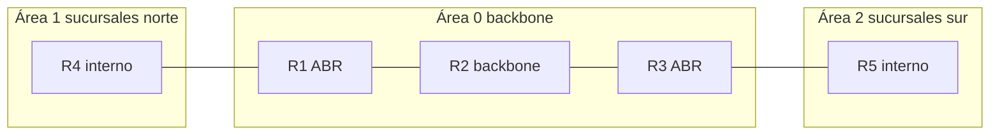

# OSPF multiárea

Parte de: [[OSPF]]

> [!info] Cómo avanzar
> `progreso`: **pendiente** → **viendo** (estudiando) → **visto** (contestaste la autoevaluación sin abrir las respuestas) → **dominado** (hiciste el laboratorio o lo aplicaste de verdad).

## Contenido

### Qué es
**OSPF multiárea** divide el dominio OSPF en varias **áreas** conectadas a un área central, el **área 0** o backbone. Cada área tiene su propia base de datos de estado de enlace; entre áreas solo viajan resúmenes. Así, un cambio en un área no obliga a recalcular SPF en toda la red, las bases de datos son más pequeñas y se pueden resumir rutas. Para el CCNA basta entender el concepto; la configuración detallada es de niveles posteriores.

### Cómo funciona
**Por qué dividir**: en una red grande con una sola área, cada router guarda el mapa completo y cada cambio (un enlace que oscila en una sucursal) dispara SPF en todos. Con áreas:
- **LSDB más pequeñas** por área: menos memoria.
- **SPF localizado**: un cambio interno solo hace recalcular a los routers de esa área.
- **Sumarización** en los bordes de área: menos rutas en las tablas.
- **Aislamiento de fallas** e inestabilidad.

**Tipos de router**:
- **Interno**: todas sus interfaces en la misma área.
- **Backbone**: al menos una interfaz en el área 0.
- **ABR** (Area Border Router): interfaces en el área 0 y en al menos otra área. Mantiene una LSDB por área y genera resúmenes entre ellas.
- **ASBR** (Autonomous System Boundary Router): inyecta rutas externas a OSPF (redistribución desde estáticas, BGP u otro protocolo).

**Regla de diseño**: **todas las áreas deben conectarse al área 0**. El tráfico entre dos áreas no backbone pasa por el backbone. (Existen *virtual links* para casos excepcionales, pero se consideran un parche.)

**Tipos de LSA** básicos:

| Tipo | Nombre | Quién lo genera | Alcance |
|---|---|---|---|
| 1 | Router LSA | Cada router | Su área; describe sus enlaces |
| 2 | Network LSA | El DR de una red multiacceso | Su área; lista los routers de ese segmento |
| 3 | Summary LSA | El ABR | Anuncia redes de un área en otra |
| 4 | ASBR Summary | El ABR | Indica cómo llegar a un ASBR |
| 5 | External LSA | El ASBR | Todo el dominio (rutas externas) |

En la tabla de rutas, las rutas **intra-área** aparecen como `O`, las **inter-área** (de LSA tipo 3) como `O IA` y las externas como `O E2` u `O E1`.

Existen áreas especiales (stub, totally stubby, NSSA) que filtran LSA externas o de resumen para simplificar aún más las sucursales.



### Ejemplo
R1 como ABR entre el área 0 (núcleo) y el área 1 (sucursal Monterrey):

```text
R1(config)# router ospf 1
R1(config-router)# router-id 1.1.1.1
R1(config-router)# network 10.0.0.0 0.0.0.255 area 0
R1(config-router)# network 10.1.0.0 0.0.255.255 area 1
R1(config-router)# area 1 range 10.1.0.0 255.255.0.0
R1(config-router)# end
R1# show ip ospf
R1# show ip ospf border-routers
R1# show ip ospf database summary
```

`area 1 range` resume todas las subredes del área 1 en un solo anuncio `10.1.0.0/16` hacia el área 0. En R2 (backbone) verás `O IA 10.1.0.0/16`.

### Cuándo usarlo y cuándo no
Considera multiárea cuando la red tiene muchos routers (como regla práctica, decenas o más), muchas sucursales o enlaces inestables que no quieres que afecten a todo el dominio, y cuando el direccionamiento permite sumarizar por área. Si tu red cabe cómodamente en un área, no compliques el diseño: área única es más fácil de operar.

### Errores comunes
- **Área no conectada al área 0**: sus rutas no llegan al resto.
- **Mismatch de área en un enlace**: los vecinos no se forman.
- **Direccionamiento que no permite resumir** (subredes de un área repartidas en otras).
- **Confundir ABR con ASBR**.

### Para profundizar
- [RFC 2328: OSPF versión 2](https://www.rfc-editor.org/rfc/rfc2328)
- [Cisco: OSPF Design Guide](https://www.cisco.com/c/en/us/support/docs/ip/open-shortest-path-first-ospf/7039-1.html)

## Autoevaluación

Contesta primero en voz alta o en papel; luego despliega la respuesta.

> [!question]- ¿Por qué dividir OSPF en varias áreas?
> Reduce el tamaño de la base de datos y el cálculo SPF; los cambios de un área no obligan a recalcular a las demás, y permite resumir rutas.

> [!question]- ¿Qué es un ABR y qué regla cumplen las áreas?
> Un **ABR** conecta un área con el área **0 (backbone)**. Toda área debe tocar el área 0.

> [!question]- ¿Qué LSAs tipo 1, 2 y 3 existen?
> **Tipo 1** (router, dentro del área) · **Tipo 2** (network, lo genera el DR) · **Tipo 3** (summary, el ABR anuncia redes de un área a otra). Las rutas entre áreas aparecen como `O IA`.

