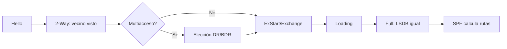

# OSPF

Parte de: [[19-Redes/05 Routing/_Índice Routing|Routing]]

> [!info] Cómo avanzar
> `progreso`: **pendiente** → **viendo** (estudiando) → **visto** (contestaste la autoevaluación sin abrir las respuestas) → **dominado** (hiciste el laboratorio o lo aplicaste de verdad).

## Contenido

### Qué es
**OSPF** (Open Shortest Path First) es un protocolo de enrutamiento interior (IGP) de **estado de enlace** y estándar abierto. Cada router construye el mapa de su área, calcula los caminos más cortos con el algoritmo SPF (Dijkstra) usando el **costo** como métrica y converge rápido ante fallas. **OSPFv2** es para IPv4 y **OSPFv3** para IPv6. Es el IGP más usado en empresas y el que más pesa en el CCNA. Esta nota da el panorama; la configuración está en [[OSPF de área única]] y el diseño jerárquico en [[OSPF multiárea]].

### Cómo funciona
**Vecindad**: los routers envían **hellos** (por defecto cada 10 s en Ethernet, con *dead interval* de 40 s) a la dirección multicast `224.0.0.5`. Para hacerse vecinos deben coincidir:
- **Área** (el mismo ID de área en ese enlace).
- **Subred y máscara** de la interfaz.
- **Temporizadores hello y dead**.
- **Autenticación** (tipo y clave), si la hay.
- **Tipo de área** (flags de stub).
- **MTU** de la interfaz (si no coincide, se quedan atascados en ExStart/Exchange).
- Y deben tener **router ID distintos**.

**Router ID** (32 bits, con formato de IPv4), en este orden:
1. El configurado con `router-id`.
2. Si no hay, la **IP más alta de una interfaz loopback** activa.
3. Si no hay loopback, la **IP más alta de una interfaz física activa**.
Se elige al iniciar el proceso; para cambiarlo luego hay que reiniciarlo (`clear ip ospf process`).

**Estados de vecino**: Down → Init → **2-Way** → ExStart → Exchange → Loading → **Full**. En Full ya sincronizaron sus bases de datos (LSDB).

**DR y BDR**: en redes multiacceso como Ethernet, si todos los routers formaran adyacencia completa con todos, habría n(n−1)/2 adyacencias y las LSA se repetirían muchísimo. Por eso se elige un **router designado (DR)** y un **respaldo (BDR)**: todos forman adyacencia Full solo con DR y BDR, y entre los demás (**DROTHER**) se quedan en 2-Way. El DR recibe actualizaciones en `224.0.0.6` y las reparte. Elección: mayor **prioridad de interfaz** (por defecto 1; 0 significa nunca ser DR), y si empatan, mayor router ID. **No es preemptiva**: si llega un router con prioridad mayor, no desplaza al DR actual hasta que este falle o se reinicie el proceso. En enlaces punto a punto no hay elección.



### Ejemplo
Router ID estable con loopback y verificación:

```text
R1(config)# interface loopback0
R1(config-if)# ip address 1.1.1.1 255.255.255.255
R1(config-if)# exit
R1(config)# router ospf 10
R1(config-router)# router-id 1.1.1.1
R1(config-router)# network 10.0.12.0 0.0.0.3 area 0
R1(config-router)# end
R1# show ip ospf neighbor
Neighbor ID   Pri  State          Dead Time  Address      Interface
2.2.2.2         1  FULL/DR        00:00:35   10.0.12.2    GigabitEthernet0/1
R1# show ip ospf interface g0/1
R1# show ip protocols
```

El número de proceso (`10`) es local y **no** necesita coincidir entre routers (a diferencia del número de sistema autónomo de EIGRP).

### Cuándo usarlo y cuándo no
Úsalo como IGP por defecto en redes con varios routers, sucursales o equipos de varios fabricantes. Para redes muy pequeñas con una sola salida, las estáticas bastan. Para intercambio con proveedores o en internet, BGP. En la nube, Azure se integra con BGP, no con OSPF.

### Errores comunes
- **Timers, área o máscara distintos**: no hay vecindad.
- **Router ID duplicado**: vecindades inestables y errores en los logs.
- **Esperar que un router nuevo con mayor prioridad se vuelva DR** al instante.
- **MTU distinta**: vecinos atorados en ExStart.

### Para profundizar
- [RFC 2328: OSPF versión 2](https://www.rfc-editor.org/rfc/rfc2328)
- [RFC 5340: OSPF para IPv6 (OSPFv3)](https://www.rfc-editor.org/rfc/rfc5340)
- [Cisco: OSPF Design Guide](https://www.cisco.com/c/en/us/support/docs/ip/open-shortest-path-first-ospf/7039-1.html)

## Subtemas

- [[OSPF de área única]]
- [[OSPF multiárea]]

## Autoevaluación

Contesta primero en voz alta o en papel; luego despliega la respuesta.

> [!question]- ¿Qué es OSPF?
> Un protocolo de enrutamiento de estado de enlace, estándar abierto, que usa costo como métrica y Dijkstra (SPF) para calcular rutas. AD 110.

> [!question]- ¿Qué debe coincidir para que dos routers sean vecinos OSPF?
> Área, subred y máscara, temporizadores hello/dead, autenticación, tipo de área (stub) y MTU (si no, se quedan en ExStart/Exchange). El router ID debe ser único.

> [!question]- ¿Cómo se elige el router ID?
> 1) `router-id` manual. 2) La IP más alta de una loopback. 3) La IP más alta de una interfaz activa.

> [!question]- ¿Para qué existen DR y BDR?
> En redes multiacceso (Ethernet) reducen adyacencias: todos forman adyacencia completa solo con DR y BDR. Gana la prioridad más alta (predeterminada 1) y luego el router ID más alto; prioridad 0 nunca es DR.

## Práctica

- [[Lab 1 - Rutas estáticas y OSPF de área única en Packet Tracer]]

## Progreso de los subtemas

```base
filters:
  and:
    - file.inFolder("19-Redes/05 Routing/OSPF")
    - file.name != "OSPF"
views:
  - type: table
    name: Progreso
    order:
      - file.name
      - progreso
      - nivel
```
