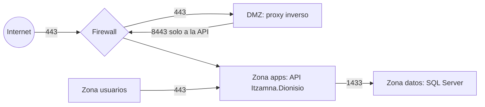

# Segmentación y DMZ

Parte de: [[19-Redes/07 Seguridad de redes/_Índice Seguridad de redes|Seguridad de redes]]

> [!info] Cómo avanzar
> `progreso`: **pendiente** → **viendo** (estudiando) → **visto** (contestaste la autoevaluación sin abrir las respuestas) → **dominado** (hiciste el laboratorio o lo aplicaste de verdad).

## Contenido

### Qué es
La **segmentación de red** consiste en dividir la red en **zonas** separadas (por VLAN, subredes, VRF o redes virtuales en la nube) y **controlar el tráfico entre ellas** con ACL o firewalls. Así, un equipo comprometido en una zona no tiene acceso libre al resto. La **DMZ** (zona desmilitarizada) es una zona intermedia entre internet y la red interna donde se colocan los servicios que deben ser accesibles desde afuera.

### Cómo funciona
**Segmentación**:
1. Agrupa los equipos por **función y nivel de confianza**: usuarios, servidores de aplicaciones, bases de datos, gestión de red, voz, invitados, IoT, laboratorios.
2. Da a cada grupo su VLAN y subred.
3. Define una **matriz de flujos**: qué zona puede hablar con cuál, en qué puertos y en qué sentido.
4. Implementa esa matriz en el punto de enrutamiento entre zonas: firewall, ACL en el switch capa 3, o NSG en la nube.
5. Registra y revisa.

Beneficios: **contiene** incidentes (el ransomware de una laptop no llega directo al SQL Server), reduce el **ruido** de broadcast, facilita el **cumplimiento** (aislar datos de tarjetas o datos personales) y hace más claro el diagnóstico. La **microsegmentación** lleva la idea al nivel de cada carga de trabajo (reglas por servidor o por contenedor) y es parte de [[Zero Trust en redes]].

**DMZ**:
- Es una zona aislada con sus propias reglas, típicamente en una interfaz separada del firewall (diseño de tres patas) o entre dos firewalls (externo e interno).
- Contiene lo que internet debe ver: proxy inverso o balanceador, servidores web públicos, relay de correo, servidores VPN.
- **Internet → DMZ**: solo los puertos publicados (por ejemplo, TCP 443 al proxy).
- **DMZ → LAN interna**: solo lo estrictamente necesario, del servidor concreto al puerto concreto (por ejemplo, del proxy a la API en TCP 8443). Nunca acceso amplio.
- **LAN → DMZ**: administración desde la VLAN de gestión (SSH, RDP desde un bastión) y lo que los usuarios necesiten.
- **DMZ → internet**: limitado (actualizaciones, DNS); un servidor web no necesita navegar libremente.
- La regla de oro: si un servidor de la DMZ es comprometido, el atacante **no debe** poder moverse a la LAN.



### Ejemplo
Matriz de flujos para la empresa:

| Origen | Destino | Servicio | Acción |
|---|---|---|---|
| Internet | DMZ proxy 192.168.50.10 | TCP 443 | Permitir |
| DMZ proxy | Apps 192.168.20.15 | TCP 8443 | Permitir |
| Apps | Datos 192.168.30.5 | TCP 1433 | Permitir |
| Usuarios 192.168.10.0/24 | Apps | TCP 443 | Permitir |
| Usuarios | Datos | Cualquiera | Denegar |
| Gestión 10.99.0.0/24 | Todo | SSH, RDP, SNMP | Permitir |
| Invitados | Interno | Cualquiera | Denegar |
| Cualquiera | Cualquiera | Cualquiera | Denegar y registrar |

En Azure, lo mismo se logra con subnets por capa, NSG en cada subnet, Azure Firewall o Application Gateway con WAF como "DMZ" y Private Endpoints para la base de datos (ver [[Redes en la nube (VNet, subnets, NSG y peering)]]).

En un switch capa 3, una ACL extendida en la SVI de usuarios bloquea el acceso directo a la zona de datos:

```text
CORE(config)# ip access-list extended USUARIOS-IN
CORE(config-ext-nacl)# deny ip 192.168.10.0 0.0.0.255 192.168.30.0 0.0.0.255 log
CORE(config-ext-nacl)# permit ip any any
CORE(config)# interface vlan 10
CORE(config-if)# ip access-group USUARIOS-IN in
```

### Cuándo usarlo y cuándo no
Segmenta siempre, incluso en una oficina pequeña: al menos usuarios, servidores, gestión e invitados. Usa una DMZ siempre que publiques algo a internet desde tus propias instalaciones. En la nube, prefiere servicios administrados (App Service, Front Door) con acceso privado a los datos.

### Errores comunes
- **DMZ con acceso amplio a la LAN**: anula su propósito.
- **Segmentar sin filtrar** entre segmentos.
- **Servidor publicado con NAT directo en la LAN** en vez de en la DMZ.
- **No documentar** la matriz: nadie sabe por qué existe cada regla.

### Para profundizar
- [NIST SP 800-41 Rev. 1: guía de firewalls (arquitecturas y DMZ)](https://csrc.nist.gov/pubs/sp/800/41/r1/final)
- [Microsoft Learn: red perimetral (DMZ) en Azure](https://learn.microsoft.com/azure/architecture/reference-architectures/dmz/secure-vnet-dmz)

## Autoevaluación

Contesta primero en voz alta o en papel; luego despliega la respuesta.

> [!question]- ¿Qué es la segmentación de red?
> Dividir la red en zonas (VLANs, subredes, zonas de firewall) con reglas de tráfico entre ellas para limitar el movimiento lateral de un atacante.

> [!question]- ¿Qué es una DMZ?
> Una zona intermedia entre Internet y la red interna donde se ponen los servidores públicos (web, correo). Desde Internet se llega a la DMZ, pero la DMZ no puede iniciar conexiones libremente hacia la LAN.

> [!question]- ¿Qué tráfico permitirías típicamente?
> Internet → DMZ: solo los puertos publicados (443). LAN → DMZ: administración y servicios necesarios. DMZ → LAN: lo mínimo (p. ej. a una base de datos específica en su puerto).

## Práctica

- [[Lab 1 - ACLs estándar y extendidas en Packet Tracer]]

